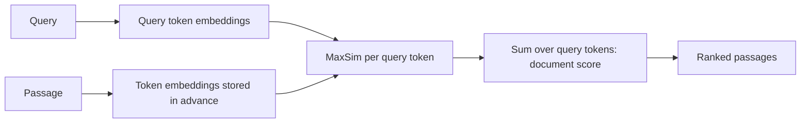

---
related:
- engineering/vector-databases
- engineering/rag
tags:
- engineering
- retrieval
- dense retrieval
- late interaction
aliases:
- ColBERT
- Late interaction
---

# ColBERT: Late Interaction

ColBERT is a retrieval model that keeps one embedding per token of a passage, rather than one vector for the whole passage. It scores a document by matching each query token to its best passage token and summing the matches. Khattab and Zaharia (2020) introduced it as a way to keep much of the detail that a single vector loses.

## Overview

A single-vector dual encoder compresses a passage into one point, and some detail is lost. ColBERT avoids this by delaying the interaction between query and passage until scoring. The passage tokens are encoded and stored in advance, and the query is compared with them at search time. The cost is storage, because a passage needs many vectors instead of one.

## Key concepts

- **Late interaction**: query and document are encoded separately, and their fine-grained comparison happens at scoring time.
- **MaxSim**: for each query token, the maximum similarity over all passage tokens, summed over the query tokens.
- **Token embeddings**: each token has its own vector, so the index is larger than a single-vector index by roughly the length of the passage.
- **Compression**: practical systems compress token vectors to reduce storage, at some cost in accuracy.

## How it works

## Key ideas

- **Problem:** a single vector per passage can lose fine details, so a passage that matches a question in a specific phrase may be ranked below a less relevant one.
- **Core idea:** keep token-level embeddings for passages and compare them with token-level embeddings of the query at search time, so the match can use the best-aligned token for each query term.
- **Equation or algorithm:** the score is the sum over query tokens $q_i$ of the maximum similarity to any passage token $p_j$, written $S(q, p) = \sum_i \max_j E_q(q_i)^\top E_p(p_j)$.
- **Results:** the abstract reports effectiveness competitive with existing BERT-based models, while executing about two orders of magnitude faster and requiring about four orders of magnitude fewer FLOPs per query.
- **Limitations:** the index is larger than for single-vector retrieval, and the search engine must support multi-vector scoring.

## Trade-offs

- **Storage against accuracy**: token vectors cost more storage and memory than one vector per passage, and compression is needed for large collections.
- **Search engineering**: multi-vector scoring needs specialised search code; standard single-vector ANN indexes do not provide it directly.
- **Comparison with dense passage retrieval**: a single vector is simpler to index and faster to search, while late interaction keeps more detail.

## Open questions

- Does the accuracy gain over single-vector models persist for embeddings from newer encoders at the same storage budget?
- How much token-level compression can be applied before the advantage disappears?

## References

- Khattab, O. & Zaharia, M. (2020). *ColBERT: Efficient and Effective Passage Search via Contextualized Late Interaction over BERT*. arXiv:2004.12832. https://arxiv.org/abs/2004.12832 — Introduces late interaction with token-level embeddings and MaxSim scoring.
- Karpukhin, V. et al. (2020). *Dense Passage Retrieval for Open-Domain Question Answering*. arXiv:2004.04906. https://arxiv.org/abs/2004.04906 — Presents the single-vector dual encoder that late interaction is compared against.
- Thakur, N. et al. (2021). *BEIR: A Heterogenous Benchmark for Zero-shot Evaluation of Information Retrieval Models*. NeurIPS 2021 Datasets and Benchmarks. https://arxiv.org/abs/2104.08663 — Evaluates retrievers across 18 datasets, including late-interaction models, for zero-shot generalisation.
- Lewis, P. et al. (2020). *Retrieval-Augmented Generation for Knowledge-Intensive NLP Tasks*. arXiv:2005.11401. https://arxiv.org/abs/2005.11401 — Shows a retriever used inside a generation system, the setting where retrieval quality matters.
- Johnson, J., Douze, M. & Jégou, H. (2017). *Billion-scale similarity search with GPUs*. arXiv:1702.08734. https://arxiv.org/abs/1702.08734 — Describes the vector search engineering that multi-vector methods must work alongside at scale.
