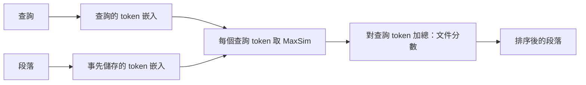

---
related:
- engineering/vector-databases
- engineering/rag
tags:
- engineering
- retrieval
- dense retrieval
- late interaction
aliases:
- ColBERT
- 晚期互動
---

# ColBERT：晚期互動

ColBERT 是一種檢索模型，它為段落中的每個 token 保留一個嵌入，而不是為整個段落保留一個向量。它的評分方式是：把查詢的每個 token 與段落中最相符的 token 配對，再把這些配對分數加總。Khattab 與 Zaharia（2020）提出它，作為保留單一向量會遺失之細節的方法。

## 概述

單向量的雙編碼器會把段落壓縮成一個點，因此會遺失部分細節。ColBERT 的做法是延後查詢與段落之間的互動，直到評分時才進行。段落的 token 事先編碼並儲存，查詢時再與它們比對。代價是儲存空間，因為每個段落需要許多向量，而不是一個。

## 關鍵概念

- **晚期互動**：查詢與文件分別編碼，細粒度的比對發生在評分時。
- **MaxSim**：對查詢的每個 token，取它與所有段落 token 之間的最大相似度，再對查詢的所有 token 加總。
- **token 嵌入**：每個 token 都有自己的向量，因此索引大小約為單向量索引的段落長度倍。
- **壓縮**：實際系統會壓縮 token 向量以節省儲存空間，但會犧牲一些準確度。

## 運作方式

## 關鍵想法

- **問題**：每個段落只有一個向量時，可能遺失細節，因此以某個特定片語回答問題的段落，可能排在相關性較低的段落之後。
- **核心想法**：為段落保留 token 層級的嵌入，搜尋時與查詢的 token 層級嵌入比對，使每個查詢詞都能用最對齊的 token 來匹配。
- **方程式或演算法**：分數是對每個查詢 token $q_i$，取它與任一段落 token $p_j$ 的最大相似度，再加總，寫成 $S(q, p) = \sum_i \max_j E_q(q_i)^\top E_p(p_j)$。
- **結果**：摘要指出，其效果與現有以 BERT 為基礎的模型相當，同時執行速度快約兩個數量級，每次查詢所需的 FLOPs 少約四個數量級。
- **限制**：索引比單向量檢索大，搜尋引擎也必須支援多向量評分。

## 取捨

- **儲存與準確度**：token 向量比每個段落一個向量需要更多儲存與記憶體，大型資料集需要壓縮。
- **搜尋工程**：多向量評分需要專門的搜尋程式碼；一般的單向量近似最近鄰索引無法直接提供。
- **相對密集段落檢索**：單一向量較容易建索引、搜尋較快；晚期互動則保留更多細節。

## 開放問題

- 在相同的儲存預算下，對於較新編碼器產生的嵌入，相對單向量模型的準確度優勢是否仍然存在？
- token 層級的壓縮可以做到多少，優勢才會消失？

## 參考文獻

- Khattab, O. & Zaharia, M. (2020). *ColBERT: Efficient and Effective Passage Search via Contextualized Late Interaction over BERT*. arXiv:2004.12832. https://arxiv.org/abs/2004.12832 — 以 token 層級嵌入與 MaxSim 評分提出晚期互動。
- Karpukhin, V. et al. (2020). *Dense Passage Retrieval for Open-Domain Question Answering*. arXiv:2004.04906. https://arxiv.org/abs/2004.04906 — 提出單向量的雙編碼器，晚期互動即與之比較。
- Thakur, N. et al. (2021). *BEIR: A Heterogenous Benchmark for Zero-shot Evaluation of Information Retrieval Models*. NeurIPS 2021 Datasets and Benchmarks. https://arxiv.org/abs/2104.08663 — 在 18 個資料集上評估檢索器，包括晚期互動模型的零樣本泛化能力。
- Lewis, P. et al. (2020). *Retrieval-Augmented Generation for Knowledge-Intensive NLP Tasks*. arXiv:2005.11401. https://arxiv.org/abs/2005.11401 — 展示在生成系統中使用檢索器的情境，檢索品質在這裡很重要。
- Johnson, J., Douze, M. & Jégou, H. (2017). *Billion-scale similarity search with GPUs*. arXiv:1702.08734. https://arxiv.org/abs/1702.08734 — 說明多向量方法在大規模時必須與之共存的向量搜尋工程。
