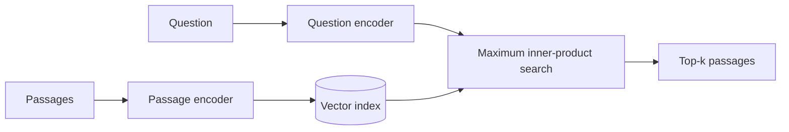

---
related:
- engineering/vector-databases
- engineering/rag
- engineering/training
tags:
- engineering
- retrieval
- dense retrieval
aliases:
- DPR
- Dense passage retrieval
---

# Dense Passage Retrieval

Dense passage retrieval (DPR) trains two encoders, one for questions and one for passages, so that relevant pairs have high dot-product similarity. Karpukhin et al. (2020) introduced it for open-domain question answering. Its passage vectors are what a vector database stores and searches in a [retrieval-augmented generation](../rag/index.md) system.

## Overview

Keyword retrieval such as BM25 scores documents by word overlap, so it misses passages that answer a question in different words. A dual encoder maps questions and passages into one vector space. Passages are encoded once, offline, and questions are encoded at query time, so a standard approximate nearest-neighbour index can serve the search.

## Key concepts

- **Dual encoder**: two separate networks, one for queries and one for passages, whose outputs are compared with a dot product.
- **In-batch negatives**: within a training batch, the positive passages of other questions serve as negatives, which gives many negatives at no extra encoding cost.
- **Hard negatives**: passages that look relevant but are not, which make training harder and more informative.
- **Index compatibility**: because the score is a dot product, the passage vectors can be stored in an ANN index such as HNSW or IVF-PQ.

## How it works

## Key ideas

- **Problem:** sparse keyword retrieval such as BM25 misses paraphrases and relevant passages with different wording.
- **Core idea:** train two BERT encoders, one for questions and one for passages, so that a question and its relevant passage have high dot-product similarity. Training uses in-batch negatives, which reuses other questions' positives as cheap negatives.
- **Equation or algorithm:** relevance is the dot product $\mathrm{sim}(q, p) = E_Q(q)^\top E_P(p)$, trained with a softmax loss over one positive and several negatives per question.
- **Results:** the paper reports higher top-k retrieval accuracy than BM25 on several open-domain question-answering datasets.
- **Limitations:** training needs labelled question-passage pairs, and dual encoders compress each passage into one vector, which can lose detail that late-interaction models keep.

## Trade-offs

- **Against BM25**: dense retrieval handles paraphrase well but can miss exact identifiers, such as product codes, that keyword search finds. Hybrid retrieval is often used.
- **Against late interaction**: one vector per passage is cheap to store and search, but ColBERT-style models keep token-level detail at higher storage cost.
- **Domain shift**: a retriever trained on one kind of question may underperform on another, as the BEIR benchmark shows.

## Open questions

- How much labelled data is needed to adapt a dual encoder to a new domain without large retraining?
- Which mix of dense and keyword retrieval is most robust across domains?

## References

- Karpukhin, V. et al. (2020). *Dense Passage Retrieval for Open-Domain Question Answering*. arXiv:2004.04906. https://arxiv.org/abs/2004.04906 — Shows that trained dual encoders can outperform BM25 for passage retrieval.
- Lewis, P. et al. (2020). *Retrieval-Augmented Generation for Knowledge-Intensive NLP Tasks*. arXiv:2005.11401. https://arxiv.org/abs/2005.11401 — Uses a dense retriever inside a generation model, which is the setting where DPR is most often applied.
- Khattab, O. & Zaharia, M. (2020). *ColBERT: Efficient and Effective Passage Search via Contextualized Late Interaction over BERT*. arXiv:2004.12832. https://arxiv.org/abs/2004.12832 — Keeps token-level embeddings and scores documents by late interaction, as an alternative to one vector per passage.
- Thakur, N. et al. (2021). *BEIR: A Heterogenous Benchmark for Zero-shot Evaluation of Information Retrieval Models*. NeurIPS 2021 Datasets and Benchmarks. https://arxiv.org/abs/2104.08663 — Shows that many dense retrievers underperform BM25 on out-of-domain tasks, across 18 datasets.
- Johnson, J., Douze, M. & Jégou, H. (2017). *Billion-scale similarity search with GPUs*. arXiv:1702.08734. https://arxiv.org/abs/1702.08734 — Describes the ANN search that serves dense passage vectors at scale.
