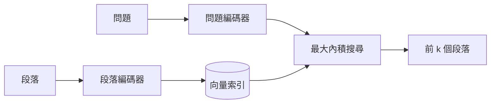

---
related:
- engineering/vector-databases
- engineering/rag
- engineering/training
tags:
- engineering
- retrieval
- dense retrieval
aliases:
- DPR
- 密集段落檢索
---

# 密集段落檢索

密集段落檢索（DPR）訓練兩個編碼器，一個處理問題，一個處理段落，使相關的配對具有很高的內積相似度。Karpukhin 等人（2020）為開放領域問答提出了這個方法。它產生的段落向量，正是向量資料庫在[檢索增強生成](../rag/index.zh-TW.md)系統中所儲存與搜尋的內容。

## 概述

BM25 等關鍵字檢索依照詞彙重疊為文件評分，因此會漏掉以不同說法回答問題的段落。雙編碼器把問題與段落映射到同一個向量空間。段落在離線時只需編碼一次，問題則在查詢時編碼，因此一般的近似最近鄰索引就能支援搜尋。

## 關鍵概念

- **雙編碼器**：兩個分開的網路，一個處理查詢、一個處理段落，兩者的輸出以內積比較。
- **批次內負樣本**：在同一個訓練批次中，其他問題的正樣本段落被當作負樣本，因此不需額外編碼就能有許多負樣本。
- **困難負樣本**：看起來相關但其實不相關的段落，它們讓訓練更困難，也更有資訊量。
- **索引相容性**：由於分數是內積，段落向量可以存進 HNSW 或 IVF-PQ 等近似最近鄰索引。

## 運作方式

## 關鍵想法

- **問題**：BM25 等稀疏關鍵字檢索會漏掉改寫過的說法，以及用詞不同的相關段落。
- **核心想法**：訓練兩個 BERT 編碼器，一個處理問題，一個處理段落，使問題與其相關段落的內積相似度很高。訓練使用批次內負樣本，把同一批次中其他問題的正樣本當作便宜的負樣本。
- **方程式或演算法**：相關性為內積 $\mathrm{sim}(q, p) = E_Q(q)^\top E_P(p)$，以每個問題一個正樣本與數個負樣本的 softmax 損失訓練。
- **結果**：論文指出，在多個開放領域問答資料集上，其前 k 筆檢索準確度高於 BM25。
- **限制**：訓練需要有標註的問題與段落配對；雙編碼器會把每個段落壓縮成一個向量，可能失去晚期互動模型保留的細節。

## 取捨

- **相對 BM25**：密集檢索能處理改寫的說法，但可能漏掉關鍵字搜尋能找到的精確識別碼，例如商品編號。因此常採用混合檢索。
- **相對晚期互動**：每個段落一個向量，儲存與搜尋的成本較低；ColBERT 式模型則以較高的儲存成本保留 token 層級的細節。
- **領域轉移**：在某一類問題上訓練的檢索器，換到另一類問題可能表現較差，BEIR 基準對此有所展示。

## 開放問題

- 要讓雙編碼器適應新領域，需要多少標註資料，又能否避免大規模重新訓練？
- 密集檢索與關鍵字檢索的哪種組合，在各領域中最穩健？

## 參考文獻

- Karpukhin, V. et al. (2020). *Dense Passage Retrieval for Open-Domain Question Answering*. arXiv:2004.04906. https://arxiv.org/abs/2004.04906 — 顯示訓練過的雙編碼器在段落檢索上可以勝過 BM25。
- Lewis, P. et al. (2020). *Retrieval-Augmented Generation for Knowledge-Intensive NLP Tasks*. arXiv:2005.11401. https://arxiv.org/abs/2005.11401 — 在生成模型中使用密集檢索器，是 DPR 最常被應用的情境。
- Khattab, O. & Zaharia, M. (2020). *ColBERT: Efficient and Effective Passage Search via Contextualized Late Interaction over BERT*. arXiv:2004.12832. https://arxiv.org/abs/2004.12832 — 保留 token 層級的嵌入並以晚期互動為文件評分，是每個段落一個向量的替代方案。
- Thakur, N. et al. (2021). *BEIR: A Heterogenous Benchmark for Zero-shot Evaluation of Information Retrieval Models*. NeurIPS 2021 Datasets and Benchmarks. https://arxiv.org/abs/2104.08663 — 在 18 個資料集上顯示，許多密集檢索器在跨領域任務上表現不及 BM25。
- Johnson, J., Douze, M. & Jégou, H. (2017). *Billion-scale similarity search with GPUs*. arXiv:1702.08734. https://arxiv.org/abs/1702.08734 — 說明大規模服務密集段落向量的近似最近鄰搜尋。
