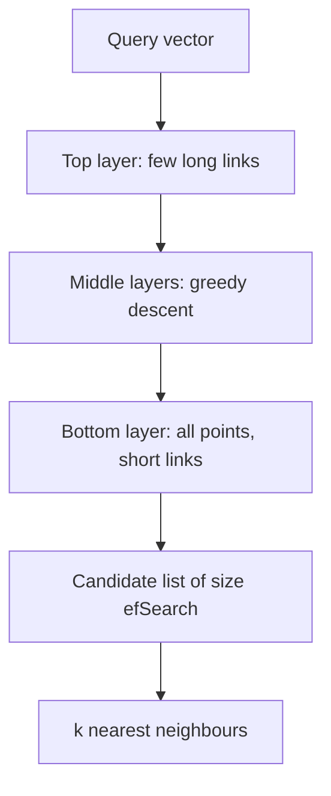

---
related:
- engineering/vector-databases
- engineering/rag
tags:
- engineering
- retrieval
- vector search
aliases:
- HNSW
- Hierarchical navigable small world
---

# HNSW: Hierarchical Navigable Small-World Graphs

HNSW is a graph-based index for approximate nearest-neighbour search. It is one of the most widely used indexes in vector databases, because it gives a good recall and speed trade-off without needing the data to be clustered in advance. Malkov and Yashunin (2016) introduced it.

## Overview

A query needs the stored vectors closest to it. A graph index links each vector to some of its neighbours, so a search can walk from a point to nearby points rather than scanning everything. HNSW adds layers to this idea. The top layers are sparse and make long jumps, and the bottom layer is dense and refines the answer. The search descends through the layers the way a skip list finds a key.

## Key concepts

- **Proximity graph**: vectors are nodes, and edges connect nodes that are close in the embedding space.
- **Layers**: a random level is drawn for each inserted point. Higher levels hold fewer points, so they give coarse routes across the collection.
- **Greedy search**: at each layer the search moves to the neighbour nearest the query until no neighbour is closer.
- **Recall and efSearch**: the search keeps a candidate list whose size controls how many true neighbours are found. A larger list gives higher recall at a higher cost.

## How it works

## Key ideas

- **Problem:** tree-based and hash-based indexes lose accuracy or speed in high dimensions, and exact search is too slow for large collections.
- **Core idea:** build a multilayer proximity graph. Upper layers hold a sparse sample of points with long-range links, and the bottom layer holds all points with short-range links. A query starts at the top layer and descends, greedily moving to the closest neighbour at each step.
- **Equation or algorithm:** each insertion draws a layer from an exponentially decaying distribution, then connects the new point to up to $M$ neighbours chosen by a heuristic that favours diverse neighbours. Search keeps a candidate list of size $\mathrm{efSearch}$.
- **Results:** the paper reports higher recall-speed trade-offs than earlier graph and tree methods on several benchmark datasets, with search cost growing slowly with collection size.
- **Limitations:** the graph lives in memory and is costly to update when deleting points. Memory use grows with $M$, so large indexes need quantisation or disk-based variants.

## Trade-offs

- **Memory**: the graph stores links for every vector, so memory is higher than for compressed indexes such as IVF-PQ or ScaNN.
- **Updates**: insertion is supported well, but deletion is harder and often handled by marking points rather than removing them.
- **Filters**: restrictive metadata filters can leave the graph with few reachable matches, so filtered search needs care.

## Open questions

- How should a graph index be updated when a large share of the points are deleted or re-embedded?
- How much of the memory cost can be removed by combining the graph with quantisation without losing recall?

## References

- Malkov, Y. A. & Yashunin, D. A. (2016). *Efficient and Robust Approximate Nearest Neighbor Search Using Hierarchical Navigable Small World Graphs*. arXiv:1603.09320. https://arxiv.org/abs/1603.09320 — Introduces the layered graph index that underlies HNSW.
- Johnson, J., Douze, M. & Jégou, H. (2017). *Billion-scale similarity search with GPUs*. arXiv:1702.08734. https://arxiv.org/abs/1702.08734 — Describes the FAISS library, which implements HNSW alongside other index types.
- Aumüller, M., Bernhardsson, E. & Faithfull, A. (2018). *ANN-Benchmarks: A Benchmarking Tool for Approximate Nearest Neighbor Algorithms*. arXiv:1807.05614. https://arxiv.org/abs/1807.05614 — Provides a common benchmark for comparing recall and speed of ANN indexes, including graph-based ones.
- Guo, R. et al. (2019). *Accelerating Large-Scale Inference with Anisotropic Vector Quantization*. arXiv:1908.10396. https://arxiv.org/abs/1908.10396 — Describes a quantisation method that is an alternative to graph indexes at large scale.
- Thakur, N. et al. (2021). *BEIR: A Heterogenous Benchmark for Zero-shot Evaluation of Information Retrieval Models*. NeurIPS 2021 Datasets and Benchmarks. https://arxiv.org/abs/2104.08663 — Evaluates retrievers across 18 datasets, which is the setting where index quality matters.
