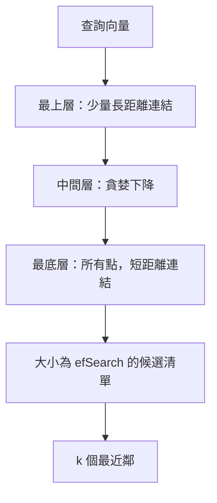

---
related:
- engineering/vector-databases
- engineering/rag
tags:
- engineering
- retrieval
- vector search
aliases:
- HNSW
- 階層式可導航小世界圖
---

# HNSW：階層式可導航小世界圖

HNSW 是一種以圖結構為基礎的近似最近鄰索引。它是向量資料庫中使用最廣的索引之一，因為不需要事先把資料分群，就能在召回率與速度之間取得良好的平衡。Malkov 與 Yashunin（2016）提出了這個方法。

## 概述

查詢需要找出與它最接近的已儲存向量。圖索引會把每個向量連到它的一些鄰居，因此搜尋可以從一個點走到附近的點，而不必掃描所有資料。HNSW 在這個想法上加入了層級。最上層稀疏、會做長距離的跳躍，最底層稠密、負責精修結果。搜尋會逐層向下，就像跳躍表（skip list）尋找鍵值的方式。

## 關鍵概念

- **鄰近圖**：向量是節點，嵌入空間中彼此接近的節點之間以邊相連。
- **層級**：每個插入的點都會隨機抽出一個層級。層級越高，點越少，因此提供了整個資料集的粗略路徑。
- **貪婪搜尋**：在每一層，搜尋會移向最接近查詢的鄰居，直到沒有更近的鄰居為止。
- **召回率與 efSearch**：搜尋維護一個候選清單，其大小決定能找到多少真正的鄰居。清單越大，召回率越高，但成本也越高。

## 運作方式

## 關鍵想法

- **問題**：樹狀與雜湊式索引在高維度下會失去準確度或速度，而對大型資料集做精確搜尋又太慢。
- **核心想法**：建立多層的鄰近圖。上層保存稀疏抽樣的點，並有長距離連結；最底層保存所有點與短距離連結。查詢從最上層出發，每一步貪婪地移到最近的鄰居，逐層下降。
- **方程式或演算法**：每次插入會從指數遞減的分布抽出層級，然後把新點連到至多 $M$ 個鄰居，鄰居由偏好多樣性的啟發式方法挑選。搜尋時維護一個大小為 $\mathrm{efSearch}$ 的候選清單。
- **結果**：論文指出，在多個基準資料集上，它的召回率與速度取捨優於早期的圖與樹狀方法，且搜尋成本隨資料量增加而緩慢成長。
- **限制**：圖結構保存在記憶體中，刪除點時更新成本高。記憶體用量隨 $M$ 增加，因此大型索引需要量化或磁碟式變體。

## 取捨

- **記憶體**：圖為每個向量保存連結，因此記憶體用量高於 IVF-PQ 或 ScaNN 等壓縮式索引。
- **更新**：插入支援得很好，但刪除較困難，通常以標記取代實際移除。
- **過濾**：嚴格的中繼資料過濾可能使圖中可到達的符合項目很少，因此過濾搜尋需要小心處理。

## 開放問題

- 當大量點被刪除或重新嵌入時，圖索引應如何更新？
- 圖結構與量化結合後，能在不損失召回率的前提下減少多少記憶體成本？

## 參考文獻

- Malkov, Y. A. & Yashunin, D. A. (2016). *Efficient and Robust Approximate Nearest Neighbor Search Using Hierarchical Navigable Small World Graphs*. arXiv:1603.09320. https://arxiv.org/abs/1603.09320 — 提出 HNSW 所依據的分層圖索引。
- Johnson, J., Douze, M. & Jégou, H. (2017). *Billion-scale similarity search with GPUs*. arXiv:1702.08734. https://arxiv.org/abs/1702.08734 — 說明 FAISS 函式庫，其中也實作了 HNSW 與其他索引類型。
- Aumüller, M., Bernhardsson, E. & Faithfull, A. (2018). *ANN-Benchmarks: A Benchmarking Tool for Approximate Nearest Neighbor Algorithms*. arXiv:1807.05614. https://arxiv.org/abs/1807.05614 — 提供比較 ANN 索引召回率與速度的共同基準，包括圖式索引。
- Guo, R. et al. (2019). *Accelerating Large-Scale Inference with Anisotropic Vector Quantization*. arXiv:1908.10396. https://arxiv.org/abs/1908.10396 — 說明一種量化方法，是大規模情境下圖索引的替代方案。
- Thakur, N. et al. (2021). *BEIR: A Heterogenous Benchmark for Zero-shot Evaluation of Information Retrieval Models*. NeurIPS 2021 Datasets and Benchmarks. https://arxiv.org/abs/2104.08663 — 在 18 個資料集上評估檢索器，是索引品質重要的應用情境。
