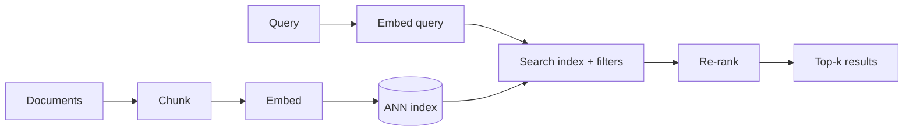

---
tags:
- engineering
- retrieval
aliases:
- 向量資料庫
- 語意搜尋
---

# Vector Databases and Semantic Search

A vector database stores embeddings, which are fixed-length numeric vectors produced by a neural encoder, and finds the stored vectors nearest to a query. It is the retrieval layer behind semantic search and most [retrieval-augmented generation](../rag/index.md) systems: meaning is compared as geometric distance, so a query can match a passage that shares no keywords with it.

## Overview

Keyword search matches words; semantic search matches meaning by embedding both queries and documents into the same space. The hard part is scale. Comparing a query with every stored vector is exact but costs time proportional to the collection size. Vector databases therefore trade a small amount of accuracy for large gains in speed and memory, using *approximate nearest neighbour* (ANN) search.

## Key concepts

- **Embedding**: a vector, often 384 to 4096 dimensions, whose geometry reflects similarity. Its quality depends on the encoder and the task. The representation theory is covered in [Theory](../../theory/index.md); a dedicated embeddings page is still open.
- **Similarity metric**: cosine similarity, dot product or Euclidean distance. Normalised vectors make cosine and dot product equivalent.
- **Exact vs. approximate search**: exact search scans every vector. ANN indexes return most of the true nearest neighbours while examining a small fraction of the data.
- **Recall**: the fraction of true nearest neighbours that the approximate index returns. It is the main quality measure for an index.
- **Filtering**: restricting results by metadata such as date, source or user permission. Filters interact badly with some indexes, because a graph or cluster may contain few matching items.
- **Hybrid search**: combining dense vector scores with keyword scores such as BM25, which often beats either alone.

## How it works

A typical pipeline has an offline and an online half:

Documents are chunked and embedded once, then stored in an index. At query time the query is embedded and the index returns candidates, which a re-ranker, often a cross-encoder, reorders. Re-ranking is slower per item but more accurate, so it runs only on the candidates.

## Key methods

Each method has its own page. This section compares them and points to the detail.

| Method | Family | Strength | Main cost | Page |
|---|---|---|---|---|
| HNSW | Proximity graph index | High recall at low latency | Memory use and costly deletions | [HNSW](hnsw.md) |
| IVF-PQ in FAISS | Inverted file with product quantisation | Billion-scale search in limited memory | Quantisation error limits recall | [IVF-PQ in FAISS](ivf-pq-faiss.md) |
| ScaNN | Anisotropic quantisation | Better recall per byte for inner-product ranking | Benefit depends on inner-product ranking | [ScaNN](scann.md) |
| Dense passage retrieval | Trained dual encoder | Learns semantic matching from labelled pairs | Needs labelled data; one vector per passage | [Dense passage retrieval](dense-passage-retrieval.md) |
| ColBERT | Late interaction over token vectors | Keeps fine-grained matching detail | Much larger index and multi-vector search | [ColBERT](colbert.md) |

The first three are index and compression methods that answer how to find nearest vectors quickly. The last two are encoder designs that decide what the vectors mean: one vector per passage, or one per token. A typical system combines a trained encoder with an ANN index, and the choice between graph and quantised indexes depends on memory, update rate and recall targets.

## Connections

- Vector search is the retrieval step of [Retrieval-Augmented Generation](../rag/index.md); chunking and re-ranking decisions are covered there.
- Embedding quality comes from the training methods in [Training & Fine-tuning](../training/index.md) and the representation theory under [Theory](../../theory/index.md).
- Indexes that run on large collections depend on memory and bandwidth; see [AI Hardware](../hardware/index.md).
- Retrieval quality is measured with the benchmarks in [Evaluation & Benchmarks](../evaluation/index.md).

## Applications

- **Enterprise document search**: question answering over internal manuals and policies, with permission filters.
- **Recommendation and product search**: nearest-neighbour lookup over item and user embeddings.
- **Deduplication and near-duplicate detection**: finding similar images, code snippets or documents.
- **Memory for agents**: storing past interactions and retrieving the relevant ones for the next step.

## Open questions

- **Filtered search**: keeping recall high when a filter removes most candidates is still an active engineering problem.
- **Index updates**: graph and quantised indexes handle insertions well, but deletions and frequent re-embedding are costly.
- **Generalisation**: a retriever tuned on one domain can fall short on another. BEIR (Thakur et al., 2021) showed that many dense retrievers underperform BM25 zero-shot on out-of-domain tasks.
- **Late interaction**: [ColBERT](colbert.md) keeps one vector per token for finer matching at higher storage cost. Whether this beats single-vector models depends on the task and budget.

## References

### Seminal papers

- Malkov, Y. A. & Yashunin, D. A. (2016). *Efficient and Robust Approximate Nearest Neighbor Search Using Hierarchical Navigable Small World Graphs*. https://arxiv.org/abs/1603.09320 — Introduces the layered graph index that underlies HNSW, a widely used ANN method.
- Johnson, J., Douze, M. & Jégou, H. (2017). *Billion-scale similarity search with GPUs*. https://arxiv.org/abs/1702.08734 — Describes the FAISS library and GPU search at billion scale with inverted files and product quantisation.
- Guo, R. et al. (2019). *Accelerating Large-Scale Inference with Anisotropic Vector Quantization*. arXiv:1908.10396. https://arxiv.org/abs/1908.10396 — Proposes a score-aware quantisation loss for maximum inner-product search.
- Karpukhin, V. et al. (2020). *Dense Passage Retrieval for Open-Domain Question Answering*. arXiv:2004.04906. https://arxiv.org/abs/2004.04906 — Shows that trained dual encoders can outperform BM25 for passage retrieval.
- Khattab, O. & Zaharia, M. (2020). *ColBERT: Efficient and Effective Passage Search via Contextualized Late Interaction over BERT*. arXiv:2004.12832. https://arxiv.org/abs/2004.12832 — Keeps token-level embeddings and scores documents by late interaction, trading storage for accuracy.

### Benchmarks

- Thakur, N. et al. (2021). *BEIR: A Heterogenous Benchmark for Zero-shot Evaluation of Information Retrieval Models*. NeurIPS 2021 Datasets and Benchmarks. https://arxiv.org/abs/2104.08663 — Evaluates retrievers across 18 datasets to test zero-shot generalisation.
