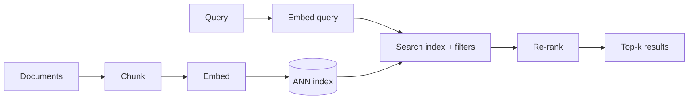

---
tags:
- engineering
- retrieval
aliases:
- 向量資料庫
- 語意搜尋
---

# Vector Databases and Semantic Search

A vector database stores embeddings, which are fixed-length numeric vectors produced by a neural encoder, and finds the stored vectors nearest to a query. It is the retrieval layer behind semantic search and most [retrieval-augmented generation](../rag/index.md) systems: meaning is compared as geometric distance, so a query can match a passage that shares no keywords with it.

## Overview

Keyword search matches words; semantic search matches meaning by embedding both queries and documents into the same space. The hard part is scale. Comparing a query with every stored vector is exact but costs time proportional to the collection size. Vector databases therefore trade a small amount of accuracy for large gains in speed and memory, using *approximate nearest neighbour* (ANN) search.

## Key concepts

- **Embedding**: a vector, often 384 to 4096 dimensions, whose geometry reflects similarity. Its quality depends on the encoder and the task. The representation theory is covered in [Theory](../../theory/index.md); a dedicated embeddings page is still open.
- **Similarity metric**: cosine similarity, dot product or Euclidean distance. Normalised vectors make cosine and dot product equivalent.
- **Exact vs. approximate search**: exact search scans every vector. ANN indexes return most of the true nearest neighbours while examining a small fraction of the data.
- **Recall**: the fraction of true nearest neighbours that the approximate index returns. It is the main quality measure for an index.
- **Filtering**: restricting results by metadata such as date, source or user permission. Filters interact badly with some indexes, because a graph or cluster may contain few matching items.
- **Hybrid search**: combining dense vector scores with keyword scores such as BM25, which often beats either alone.

## How it works

A typical pipeline has an offline and an online half:

Documents are chunked and embedded once, then stored in an index. At query time the query is embedded and the index returns candidates, which a re-ranker, often a cross-encoder, reorders. Re-ranking is slower per item but more accurate, so it runs only on the candidates.

## Key methods

### HNSW: hierarchical navigable small-world graphs (Malkov and Yashunin, 2016)

- **Problem:** tree-based and hash-based indexes lose accuracy or speed in high dimensions, and exact search is too slow for large collections.
- **Core idea:** build a multilayer proximity graph. Upper layers hold a sparse sample of points with long-range links, and the bottom layer holds all points with short-range links. A query starts at the top layer and descends, greedily moving to the closest neighbour at each step.
- **Equation or algorithm:** each insertion draws a layer from an exponentially decaying distribution, then connects the new point to up to $M$ neighbours chosen by a heuristic that favours diverse neighbours. Search keeps a candidate list of size $\mathrm{efSearch}$.
- **Results:** the paper reports higher recall-speed trade-offs than earlier graph and tree methods on several benchmark datasets, with search cost growing slowly with collection size.
- **Limitations:** the graph lives in memory and is costly to update when deleting points. Memory use grows with $M$, so large indexes need quantisation or disk-based variants.

### IVF-PQ in FAISS (Johnson, Douze and Jégou, 2017)

- **Problem:** storing and scanning full-precision vectors for billions of items exceeds the memory and time of a single GPU or server.
- **Core idea:** split the collection into $n_{\text{list}}$ cells with a coarse quantiser (inverted file, IVF), so a query only scans the few cells nearest to it. Inside each cell, compress each vector with product quantisation (PQ): split it into $m$ sub-vectors and store the index of the nearest centroid for each, using one byte per sub-vector.
- **Equation or algorithm:** distance to a compressed vector is approximated as $\lVert q - x \rVert^2 \approx \sum_{j=1}^{m} \lVert q_j - c_{j}(x_j) \rVert^2$, where $c_j(x_j)$ is the centroid stored for sub-vector $j$. Precomputed lookup tables make each term a table read.
- **Results:** the paper reports billion-scale similarity search on GPUs, with the trade-off between memory, speed and recall controlled by $m$ and the number of probed cells.
- **Limitations:** PQ error limits recall, so systems often re-rank the top candidates with exact distances. Training the quantiser needs representative data.

### ScaNN: anisotropic vector quantisation (Guo et al., 2020)

- **Problem:** standard quantisation minimises the reconstruction error evenly in every direction, but for inner-product search only the error parallel to the query direction changes which item ranks first.
- **Core idea:** use a score-aware loss that penalises the error component parallel to the data vector more heavily than the orthogonal component, so the quantiser keeps the parts of vectors that matter most for inner products.
- **Equation or algorithm:** the quantisation loss weights the residual's parallel component by a factor $\eta > 1$ relative to its orthogonal component, which is optimised jointly with the codebook.
- **Results:** the paper reports better recall at a given speed than prior quantisers on maximum inner-product search benchmarks.
- **Limitations:** the benefit is tied to inner-product ranking, and the method's tuning interacts with the partitioning step that precedes quantisation.

### Dense passage retrieval (Karpukhin et al., 2020)

- **Problem:** sparse keyword retrieval such as BM25 misses paraphrases and relevant passages with different wording.
- **Core idea:** train two BERT encoders, one for questions and one for passages, so that a question and its relevant passage have high dot-product similarity. Training uses in-batch negatives, which reuses other questions' positives as cheap negatives.
- **Equation or algorithm:** relevance is the dot product $\mathrm{sim}(q, p) = E_Q(q)^\top E_P(p)$, trained with a softmax loss over one positive and several negatives per question.
- **Results:** the paper reports higher top-k retrieval accuracy than BM25 on several open-domain question-answering datasets.
- **Limitations:** training needs labelled question-passage pairs, and dual encoders compress each passage into one vector, which can lose detail that late-interaction models keep.

## Connections

- Vector search is the retrieval step of [Retrieval-Augmented Generation](../rag/index.md); chunking and re-ranking decisions are covered there.
- Embedding quality comes from the training methods in [Training & Fine-tuning](../training/index.md) and the representation theory under [Theory](../../theory/index.md).
- Indexes that run on large collections depend on memory and bandwidth; see [AI Hardware](../hardware/index.md).
- Retrieval quality is measured with the benchmarks in [Evaluation & Benchmarks](../evaluation/index.md).

## Applications

- **Enterprise document search**: question answering over internal manuals and policies, with permission filters.
- **Recommendation and product search**: nearest-neighbour lookup over item and user embeddings.
- **Deduplication and near-duplicate detection**: finding similar images, code snippets or documents.
- **Memory for agents**: storing past interactions and retrieving the relevant ones for the next step.

## Open questions

- **Filtered search**: keeping recall high when a filter removes most candidates is still an active engineering problem.
- **Index updates**: graph and quantised indexes handle insertions well, but deletions and frequent re-embedding are costly.
- **Generalisation**: a retriever tuned on one domain can fall short on another. BEIR (Thakur et al., 2021) showed that many dense retrievers underperform BM25 zero-shot on out-of-domain tasks.
- **Late interaction**: ColBERT keeps one vector per token for finer matching at higher storage cost. Whether this beats single-vector models depends on the task and budget.

## References

### Seminal papers

- Malkov, Y. A. & Yashunin, D. A. (2016). *Efficient and Robust Approximate Nearest Neighbor Search Using Hierarchical Navigable Small World Graphs*. https://arxiv.org/abs/1603.09320 — Introduces the layered graph index that underlies HNSW, a widely used ANN method.
- Johnson, J., Douze, M. & Jégou, H. (2017). *Billion-scale similarity search with GPUs*. https://arxiv.org/abs/1702.08734 — Describes the FAISS library and GPU search at billion scale with inverted files and product quantisation.
- Guo, R. et al. (2020). *Accelerating Large-Scale Inference with Anisotropic Vector Quantization*. ICML 2020. https://arxiv.org/abs/1908.10396 — Proposes a score-aware quantisation loss for maximum inner-product search.
- Karpukhin, V. et al. (2020). *Dense Passage Retrieval for Open-Domain Question Answering*. EMNLP 2020. https://arxiv.org/abs/2004.04906 — Shows that trained dual encoders can outperform BM25 for passage retrieval.
- Khattab, O. & Zaharia, M. (2020). *ColBERT: Efficient and Effective Passage Search via Contextualized Late Interaction over BERT*. SIGIR 2020. https://arxiv.org/abs/2004.12832 — Keeps token-level embeddings and scores documents by late interaction, trading storage for accuracy.

### Benchmarks

- Thakur, N. et al. (2021). *BEIR: A Heterogenous Benchmark for Zero-shot Evaluation of Information Retrieval Models*. NeurIPS 2021 Datasets and Benchmarks. https://arxiv.org/abs/2104.08663 — Evaluates retrievers across 18 datasets to test zero-shot generalisation.
