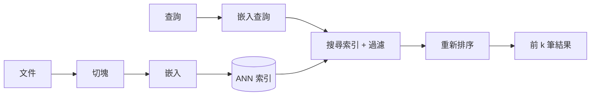

# 向量資料庫與語意搜尋

向量資料庫儲存嵌入向量（embedding）——由神經編碼器產生的固定長度數值向量——並找出與查詢最接近的已儲存向量。它是語意搜尋與多數[檢索增強生成](../rag/index.zh-TW.md)系統背後的檢索層：語意以幾何距離比較，因此查詢能匹配到與它沒有共同關鍵字的段落。

## 概述

關鍵字搜尋比對的是詞；語意搜尋則是把查詢與文件都嵌入同一個空間，比對語意。困難在於規模。把查詢與每個已儲存向量逐一比較雖然精確，但時間與資料量成正比。因此向量資料庫會用少量準確度，換取大幅的速度與記憶體效益，使用的是*近似最近鄰*（ANN）搜尋。

## 關鍵概念

- **嵌入向量**：一個向量，維度通常在 384 到 4096 之間，其幾何結構反映相似度。品質取決於編碼器與任務；表徵理論見[理論](../../theory/index.zh-TW.md)，專門的嵌入頁面仍待撰寫。
- **相似度度量**：餘弦相似度、內積或歐氏距離。若向量已正規化，餘弦相似度與內積等價。
- **精確與近似搜尋**：精確搜尋掃描每個向量；ANN 索引則只檢查一小部分資料，就能回傳大部分真正的最近鄰。
- **召回率**：近似索引回傳的真正最近鄰佔比，是衡量索引品質的主要指標。
- **過濾**：依日期、來源或使用者權限等中繼資料篩選結果。有些索引與過濾搭配不佳，因為圖形或分群中可能只剩很少符合條件的項目。
- **混合搜尋**：結合向量分數與 BM25 等關鍵字分數，通常比單獨使用任一種都好。

## 運作方式

典型的流程分成離線與線上兩半：

文件只需切塊並嵌入一次，然後存入索引。查詢時，查詢會被嵌入，索引回傳候選結果，再由重新排序器（常是交叉編碼器）重新排序。重新排序每個項目較慢，但更準確，因此只在候選結果上執行。

## 關鍵方法

### HNSW：階層式可導航小世界圖（Malkov and Yashunin, 2016）

- **問題**：樹狀與雜湊式索引在高維度下會失去準確度或速度，而對大型資料集做精確搜尋又太慢。
- **核心想法**：建立多層的鄰近圖。上層保存稀疏抽樣的點，並有長距離連結；最底層保存所有點與短距離連結。查詢從最上層出發，每一步貪婪地移到最近的鄰居，逐層下降。
- **方程式或演算法**：每次插入會從指數遞減的分布抽出層級，然後把新點連到至多 $M$ 個鄰居，鄰居由偏好多樣性的啟發式方法挑選。搜尋時維護一個大小為 $\mathrm{efSearch}$ 的候選清單。
- **結果**：論文指出，在多個基準資料集上，它的召回率與速度取捨優於早期的圖與樹狀方法，且搜尋成本隨資料量增加而緩慢成長。
- **限制**：圖結構保存在記憶體中，刪除點時更新成本高。記憶體用量隨 $M$ 增加，因此大型索引需要量化或磁碟式變體。

### FAISS 中的 IVF-PQ（Johnson, Douze and Jégou, 2017）

- **問題**：為數十億筆項目儲存並掃描全精度向量，超過單一 GPU 或伺服器的記憶體與時間。
- **核心想法**：用粗量化器把資料集分成 $n_{\text{list}}$ 個區格（倒排檔案，IVF），使查詢只掃描最近的少數區格。在每個區格內，用乘積量化（PQ）壓縮每個向量：把它切成 $m$ 個子向量，並為每個子向量儲存最近質心的索引，每個子向量只佔一個位元組。
- **方程式或演算法**：與壓縮向量的距離近似為 $\lVert q - x \rVert^2 \approx \sum_{j=1}^{m} \lVert q_j - c_{j}(x_j) \rVert^2$，其中 $c_j(x_j)$ 是第 $j$ 個子向量所儲存的質心。預先計算的查找表使每一項都只是一次表格讀取。
- **結果**：論文指出在 GPU 上完成十億規模的相似度搜尋，記憶體、速度與召回率之間的取捨由 $m$ 與探查的區格數控制。
- **限制**：PQ 的誤差會限制召回率，因此系統常以精確距離重新排序前幾名候選。訓練量化器需要有代表性的資料。

### ScaNN：非等向性向量量化（Guo et al., 2020）

- **問題**：一般量化會在各方向上平均地最小化重建誤差，但對內積搜尋而言，只有與查詢方向平行的誤差會改變排名第一的項目。
- **核心想法**：使用分數感知的損失函數，對平行於資料向量的誤差分量給予比正交分量更重的懲罰，使量化器保留對內積最重要的向量部分。
- **方程式或演算法**：量化損失把殘差的平行分量以係數 $\eta > 1$ 加權，相對於正交分量，並與碼本一起聯合最佳化。
- **結果**：論文指出，在最大內積搜尋基準上，相同速度下的召回率優於先前的量化器。
- **限制**：效益與內積排序綁定，且該方法的調校會與量化之前的分割步驟互相影響。

### 密集段落檢索（Karpukhin et al., 2020）

- **問題**：BM25 等稀疏關鍵字檢索會漏掉改寫過的說法，以及用詞不同的相關段落。
- **核心想法**：訓練兩個 BERT 編碼器，一個處理問題，一個處理段落，使問題與其相關段落的內積相似度很高。訓練使用批次內負樣本，把同一批次中其他問題的正樣本當作便宜的負樣本。
- **方程式或演算法**：相關性為內積 $\mathrm{sim}(q, p) = E_Q(q)^\top E_P(p)$，以每個問題一個正樣本與數個負樣本的 softmax 損失訓練。
- **結果**：論文指出，在多個開放領域問答資料集上，其前 k 筆檢索準確度高於 BM25。
- **限制**：訓練需要有標註的問題與段落配對；雙編碼器會把每個段落壓縮成一個向量，可能失去晚期互動模型保留的細節。

## 相關連結

- 向量搜尋是[檢索增強生成](../rag/index.zh-TW.md)的檢索步驟；切塊與重新排序的決策在該頁說明。
- 嵌入品質來自[訓練與微調](../training/index.zh-TW.md)的方法，以及[理論](../../theory/index.zh-TW.md)中的表徵理論。
- 處理大型資料集的索引依賴記憶體與頻寬，見 [AI 硬體](../hardware/index.zh-TW.md)。
- 檢索品質以[評估與基準](../evaluation/index.zh-TW.md)中的基準衡量。

## 應用

- **企業文件搜尋**：對內部手冊與政策做問答，並加上權限過濾。
- **推薦與商品搜尋**：對項目與使用者嵌入做最近鄰查詢。
- **去重與近似重複偵測**：找出相似的影像、程式碼片段或文件。
- **代理人記憶**：儲存過去的互動，並在下一步取回相關的部分。

## 開放問題

- **過濾搜尋**：當過濾條件移除大部分候選時，如何維持高召回率，仍是活躍的工程問題。
- **索引更新**：圖形與量化索引能處理插入，但刪除與頻繁重新嵌入的成本高。
- **泛化能力**：在某個領域調校的檢索器，換到另一個領域可能表現不佳。BEIR（Thakur et al., 2021）顯示，許多密集檢索器在零樣本的跨領域任務上表現不及 BM25。
- **晚期互動**：ColBERT 為每個 token 保留一個向量，以較高的儲存成本換取更細緻的比對。它是否勝過單向量模型，取決於任務與預算。

## 參考文獻

### 奠基性論文

- Malkov, Y. A. & Yashunin, D. A. (2016). *Efficient and Robust Approximate Nearest Neighbor Search Using Hierarchical Navigable Small World Graphs*. https://arxiv.org/abs/1603.09320 — 提出分層圖索引，即廣泛使用的 HNSW 近似最近鄰方法的基礎。
- Johnson, J., Douze, M. & Jégou, H. (2017). *Billion-scale similarity search with GPUs*. https://arxiv.org/abs/1702.08734 — 說明 FAISS 函式庫，以及使用倒排檔案與乘積量化在 GPU 上做十億規模搜尋。
- Guo, R. et al. (2020). *Accelerating Large-Scale Inference with Anisotropic Vector Quantization*. ICML 2020. https://arxiv.org/abs/1908.10396 — 為最大內積搜尋提出分數感知的量化損失。
- Karpukhin, V. et al. (2020). *Dense Passage Retrieval for Open-Domain Question Answering*. EMNLP 2020. https://arxiv.org/abs/2004.04906 — 顯示訓練過的雙編碼器在段落檢索上可以勝過 BM25。
- Khattab, O. & Zaharia, M. (2020). *ColBERT: Efficient and Effective Passage Search via Contextualized Late Interaction over BERT*. SIGIR 2020. https://arxiv.org/abs/2004.12832 — 保留 token 層級的嵌入，並以晚期互動為文件評分，以儲存空間換取準確度。

### 基準

- Thakur, N. et al. (2021). *BEIR: A Heterogeneous Benchmark for Zero-shot Evaluation of Information Retrieval Models*. NeurIPS 2021 Datasets and Benchmarks. https://arxiv.org/abs/2104.08663 — 在 18 個資料集上評估檢索器，以測試零樣本的泛化能力。
