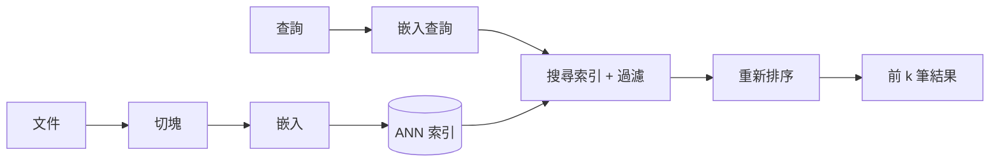

# 向量資料庫與語意搜尋

向量資料庫儲存嵌入向量（embedding）——由神經編碼器產生的固定長度數值向量——並找出與查詢最接近的已儲存向量。它是語意搜尋與多數[檢索增強生成](../rag/index.zh-TW.md)系統背後的檢索層：語意以幾何距離比較，因此查詢能匹配到與它沒有共同關鍵字的段落。

## 概述

關鍵字搜尋比對的是詞；語意搜尋則是把查詢與文件都嵌入同一個空間，比對語意。困難在於規模。把查詢與每個已儲存向量逐一比較雖然精確，但時間與資料量成正比。因此向量資料庫會用少量準確度，換取大幅的速度與記憶體效益，使用的是*近似最近鄰*（ANN）搜尋。

## 關鍵概念

- **嵌入向量**：一個向量，維度通常在 384 到 4096 之間，其幾何結構反映相似度。品質取決於編碼器與任務；表徵理論見[理論](../../theory/index.zh-TW.md)，專門的嵌入頁面仍待撰寫。
- **相似度度量**：餘弦相似度、內積或歐氏距離。若向量已正規化，餘弦相似度與內積等價。
- **精確與近似搜尋**：精確搜尋掃描每個向量；ANN 索引則只檢查一小部分資料，就能回傳大部分真正的最近鄰。
- **召回率**：近似索引回傳的真正最近鄰佔比，是衡量索引品質的主要指標。
- **過濾**：依日期、來源或使用者權限等中繼資料篩選結果。有些索引與過濾搭配不佳，因為圖形或分群中可能只剩很少符合條件的項目。
- **混合搜尋**：結合向量分數與 BM25 等關鍵字分數，通常比單獨使用任一種都好。

## 運作方式

典型的流程分成離線與線上兩半：

文件只需切塊並嵌入一次，然後存入索引。查詢時，查詢會被嵌入，索引回傳候選結果，再由重新排序器（常是交叉編碼器）重新排序。重新排序每個項目較慢，但更準確，因此只在候選結果上執行。

## 關鍵方法

每個方法都有自己的頁面。本節比較它們，並連結到細節。

| 方法 | 類別 | 優點 | 主要成本 | 頁面 |
|---|---|---|---|---|
| HNSW | 鄰近圖索引 | 低延遲下的高召回率 | 記憶體用量高，刪除成本高 | [HNSW](hnsw.zh-TW.md) |
| FAISS 中的 IVF-PQ | 倒排檔案加乘積量化 | 有限記憶體下的十億規模搜尋 | 量化誤差限制召回率 | [FAISS 中的 IVF-PQ](ivf-pq-faiss.zh-TW.md) |
| ScaNN | 非等向性量化 | 以內積排序時，每個位元組的召回率較高 | 效益依賴內積排序 | [ScaNN](scann.zh-TW.md) |
| 密集段落檢索 | 訓練過的雙編碼器 | 從有標註的配對中學習語意比對 | 需要標註資料；每個段落一個向量 | [密集段落檢索](dense-passage-retrieval.zh-TW.md) |
| ColBERT | 對 token 向量的晚期互動 | 保留細粒度的比對細節 | 索引大得多，需要多向量搜尋 | [ColBERT](colbert.zh-TW.md) |

前三者是回答「如何快速找到最近向量」的索引與壓縮方法；後兩者則是決定向量「代表什麼」的編碼器設計：每個段落一個向量，或每個 token 一個向量。典型的系統會把訓練過的編碼器與 ANN 索引結合，而圖索引與量化索引之間的選擇，取決於記憶體、更新頻率與召回率目標。

## 相關連結

- 向量搜尋是[檢索增強生成](../rag/index.zh-TW.md)的檢索步驟；切塊與重新排序的決策在該頁說明。
- 嵌入品質來自[訓練與微調](../training/index.zh-TW.md)的方法，以及[理論](../../theory/index.zh-TW.md)中的表徵理論。
- 處理大型資料集的索引依賴記憶體與頻寬，見 [AI 硬體](../hardware/index.zh-TW.md)。
- 檢索品質以[評估與基準](../evaluation/index.zh-TW.md)中的基準衡量。

## 應用

- **企業文件搜尋**：對內部手冊與政策做問答，並加上權限過濾。
- **推薦與商品搜尋**：對項目與使用者嵌入做最近鄰查詢。
- **去重與近似重複偵測**：找出相似的影像、程式碼片段或文件。
- **代理人記憶**：儲存過去的互動，並在下一步取回相關的部分。

## 開放問題

- **過濾搜尋**：當過濾條件移除大部分候選時，如何維持高召回率，仍是活躍的工程問題。
- **索引更新**：圖形與量化索引能處理插入，但刪除與頻繁重新嵌入的成本高。
- **泛化能力**：在某個領域調校的檢索器，換到另一個領域可能表現不佳。BEIR（Thakur et al., 2021）顯示，許多密集檢索器在零樣本的跨領域任務上表現不及 BM25。
- **晚期互動**：[ColBERT](colbert.zh-TW.md) 為每個 token 保留一個向量，以較高的儲存成本換取更細緻的比對。它是否勝過單向量模型，取決於任務與預算。

## 參考文獻

### 奠基性論文

- Malkov, Y. A. & Yashunin, D. A. (2016). *Efficient and Robust Approximate Nearest Neighbor Search Using Hierarchical Navigable Small World Graphs*. https://arxiv.org/abs/1603.09320 — 提出分層圖索引，即廣泛使用的 HNSW 近似最近鄰方法的基礎。
- Johnson, J., Douze, M. & Jégou, H. (2017). *Billion-scale similarity search with GPUs*. https://arxiv.org/abs/1702.08734 — 說明 FAISS 函式庫，以及使用倒排檔案與乘積量化在 GPU 上做十億規模搜尋。
- Guo, R. et al. (2019). *Accelerating Large-Scale Inference with Anisotropic Vector Quantization*. arXiv:1908.10396. https://arxiv.org/abs/1908.10396 — 為最大內積搜尋提出分數感知的量化損失。
- Karpukhin, V. et al. (2020). *Dense Passage Retrieval for Open-Domain Question Answering*. arXiv:2004.04906. https://arxiv.org/abs/2004.04906 — 顯示訓練過的雙編碼器在段落檢索上可以勝過 BM25。
- Khattab, O. & Zaharia, M. (2020). *ColBERT: Efficient and Effective Passage Search via Contextualized Late Interaction over BERT*. arXiv:2004.12832. https://arxiv.org/abs/2004.12832 — 保留 token 層級的嵌入，並以晚期互動為文件評分，以儲存空間換取準確度。

### 基準

- Thakur, N. et al. (2021). *BEIR: A Heterogenous Benchmark for Zero-shot Evaluation of Information Retrieval Models*. NeurIPS 2021 Datasets and Benchmarks. https://arxiv.org/abs/2104.08663 — 在 18 個資料集上評估檢索器，以測試零樣本的泛化能力。
