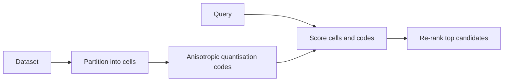

---
related:
- engineering/vector-databases
- engineering/training
tags:
- engineering
- retrieval
- vector search
- quantisation
aliases:
- ScaNN
- Anisotropic vector quantisation
---

# ScaNN: Anisotropic Vector Quantisation

ScaNN is a method for maximum inner-product search that changes how vectors are quantised. Guo et al. (2019) proposed a loss that penalises quantisation error according to its effect on inner products, rather than treating every direction of error equally.

## Overview

Standard quantisation minimises reconstruction error, which is the same in every direction. For inner-product ranking, though, only some of the error changes which item comes first. ScaNN targets that part of the error. Its quantiser keeps the components of a vector that matter most for the dot product with a query.

## Key concepts

- **Maximum inner-product search (MIPS)**: finding the stored vectors with the largest dot product with a query. It is common in recommendation and in some retrieval models.
- **Reconstruction error**: the difference between a vector and its quantised approximation.
- **Anisotropic loss**: a loss that weights the error component parallel to the data vector more heavily than the orthogonal component.
- **Partitioning**: ScaNN first partitions the collection into cells, then quantises the vectors inside each cell.

## How it works

## Key ideas

- **Problem:** standard quantisation minimises the reconstruction error evenly in every direction, but for inner-product search only the error parallel to the query direction changes which item ranks first.
- **Core idea:** use a score-aware loss that penalises the error component parallel to the data vector more heavily than the orthogonal component, so the quantiser keeps the parts of vectors that matter most for inner products.
- **Equation or algorithm:** the quantisation loss weights the residual's parallel component by a factor $\eta > 1$ relative to its orthogonal component, which is optimised jointly with the codebook.
- **Results:** the paper reports better recall at a given speed than prior quantisers on maximum inner-product search benchmarks.
- **Limitations:** the benefit is tied to inner-product ranking, and the method's tuning interacts with the partitioning step that precedes quantisation.

## Trade-offs

- **Metric fit**: the gain is largest when the application ranks by inner product. For pure Euclidean or cosine search, the gain over standard quantisation is smaller.
- **Tuning**: the weight on the parallel component and the partitioning both affect results, so the settings should be checked against recall on real queries.

## Open questions

- How should the loss weight be chosen for embeddings whose norms vary widely?
- Does the advantage over standard product quantisation persist for embeddings from newer retrieval models?

## References

- Guo, R. et al. (2019). *Accelerating Large-Scale Inference with Anisotropic Vector Quantization*. arXiv:1908.10396. https://arxiv.org/abs/1908.10396 — Proposes the score-aware quantisation loss for maximum inner-product search.
- Johnson, J., Douze, M. & Jégou, H. (2017). *Billion-scale similarity search with GPUs*. arXiv:1702.08734. https://arxiv.org/abs/1702.08734 — Describes the product-quantised search that the anisotropic loss improves on.
- Malkov, Y. A. & Yashunin, D. A. (2016). *Efficient and Robust Approximate Nearest Neighbor Search Using Hierarchical Navigable Small World Graphs*. arXiv:1603.09320. https://arxiv.org/abs/1603.09320 — Presents the graph-based index that ScaNN is often compared with.
- Aumüller, M., Bernhardsson, E. & Faithfull, A. (2018). *ANN-Benchmarks: A Benchmarking Tool for Approximate Nearest Neighbor Algorithms*. arXiv:1807.05614. https://arxiv.org/abs/1807.05614 — Provides a common benchmark for comparing ANN methods such as quantised indexes.
- Thakur, N. et al. (2021). *BEIR: A Heterogenous Benchmark for Zero-shot Evaluation of Information Retrieval Models*. NeurIPS 2021 Datasets and Benchmarks. https://arxiv.org/abs/2104.08663 — Evaluates retrievers across 18 datasets, where search quality depends on the index.
