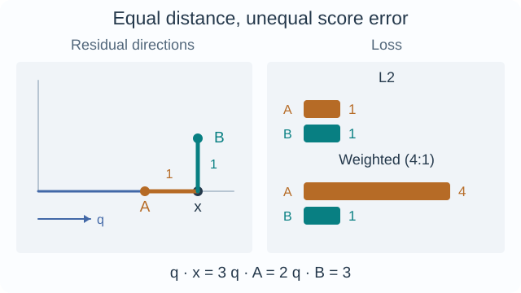

---
related:
- engineering/vector-databases
- engineering/training
tags:
- engineering
- retrieval
- vector search
- quantisation
aliases:
- ScaNN
- Anisotropic vector quantisation
---

# ScaNN: Anisotropic Vector Quantisation

ScaNN is a method for maximum inner-product search that changes how vectors are quantised. Guo et al. (2019) proposed a loss that penalises quantisation error according to its effect on inner products, rather than treating every direction of error equally.

## Overview

Standard quantisation minimises reconstruction error, which is the same in every direction. For inner-product ranking, score error depends on the projection of the residual onto the query; whether a ranking changes also depends on score margins. ScaNN gives more weight to errors on high-scoring query–data pairs. Its quantiser keeps the components of a vector that matter most for the dot product with a query.

## Key concepts

- **Maximum inner-product search (MIPS)**: finding the stored vectors with the largest dot product with a query. It is common in recommendation and in some retrieval models.
- **Reconstruction error**: the difference between a vector and its quantised approximation.
- **Anisotropic loss**: a loss that weights the error component parallel to the data vector more heavily than the orthogonal component.
- **Partitioning**: ScaNN first partitions the collection into cells, then quantises the vectors inside each cell.

## How it works

*Original teaching animation, CC BY-SA 4.0.* Let a stored vector be $x=(3,0)$ and two possible code vectors be $A=(2,0)$ and $B=(3,1)$. Both have squared Euclidean reconstruction error 1. The residual $e=x-\hat x$ decomposes along the **stored vector** as $e_\parallel=(e^\top u)u$, where $u=x/\|x\|$, and $e_\perp=e-e_\parallel$. For illustration, assign the parallel component four times the squared-error weight of the orthogonal component:

$$
L=4\|e_\parallel\|^2+\|e_\perp\|^2.
$$

The loss is 4 for A and 1 for B. For the particular unit query $q=(1,0)$, the exact score is 3, while the approximations give 2 and 3 respectively. The growing segments expose the two residuals; the bars then reveal the isotropic and anisotropic losses. The growth is a graphical reveal, not an optimisation trajectory. Other query directions can favour A instead; the paper (Guo et al., 2019, in References) derives the score-aware objective by weighting errors for high-inner-product query–data pairs under distributional assumptions. The 4:1 weight and vectors are chosen teaching values, **not ScaNN defaults, actual codebook training, or measured recall**.

MkDocs provides Play/Pause and reduced-motion support; on narrow screens swipe horizontally or focus the figure and use the left/right arrow keys. [GitHub static overview](../../assets/concept-animations/scann-anisotropic-residual-still.svg) · [Standalone animation](../../assets/concept-animations/scann-anisotropic-residual-motion.svg).

### When score error changes the ranking

Keep the illustrated $x$, $A$ and $B$, and add an exactly represented competitor $z=(2.5,0.5)$. The same stored vector has two possible query-dependent ranking outcomes:

| Query | Exact score of x | Score of z | Approximation A | Approximation B |
|---|---:|---:|---:|---:|
| $(1,0)$ | 3 | 2.5 | 2 (reversal) | 3 |
| $(0,1)$ | 0 | 0.5 | 0 | 1 (reversal) |

For a positive exact margin $m=q^\top(x-z)$, replacing only $x$ by $\hat x$ changes the margin to $m-q^\top e$. It reverses the pair if $q^\top e>m$ (equality is a tie). More generally the residual difference $e_x-e_z$ determines the perturbation when both candidates are quantised. The anisotropic loss prefers B in the figure, but it cannot guarantee the correct ordering for every query. These are synthetic pairwise scores, not a recall experiment.

## Key ideas

- **Problem:** standard quantisation minimises the reconstruction error evenly in every direction, but inner-product score error depends on the residual projection onto the query, and changes in ranking also depend on score margins.
- **Core idea:** use a score-aware loss that penalises the error component parallel to the data vector more heavily than the orthogonal component, so the quantiser keeps the parts of vectors that matter most for inner products.
- **Equation or algorithm:** the quantisation loss weights the residual's parallel component by a factor $\eta > 1$ relative to its orthogonal component, which is optimised jointly with the codebook.
- **Results:** the paper reports better recall at a given speed than prior quantisers on maximum inner-product search benchmarks.
- **Limitations:** the benefit is tied to inner-product ranking, and the method's tuning interacts with the partitioning step that precedes quantisation.

## Trade-offs

- **Metric fit**: the gain is largest when the application ranks by inner product. For pure Euclidean or cosine search, the gain over standard quantisation is smaller.
- **Tuning**: the weight on the parallel component and the partitioning both affect results, so the settings should be checked against recall on real queries.

## Open questions

- How should the loss weight be chosen for embeddings whose norms vary widely?
- Does the advantage over standard product quantisation persist for embeddings from newer retrieval models?

## References

- Guo, R. et al. (2019). *Accelerating Large-Scale Inference with Anisotropic Vector Quantization*. arXiv:1908.10396. https://arxiv.org/abs/1908.10396 — Proposes the score-aware quantisation loss for maximum inner-product search.
- Johnson, J., Douze, M. & Jégou, H. (2017). *Billion-scale similarity search with GPUs*. arXiv:1702.08734. https://arxiv.org/abs/1702.08734 — Describes the product-quantised search that the anisotropic loss improves on.
- Malkov, Y. A. & Yashunin, D. A. (2016). *Efficient and Robust Approximate Nearest Neighbor Search Using Hierarchical Navigable Small World Graphs*. arXiv:1603.09320. https://arxiv.org/abs/1603.09320 — Presents the graph-based index that ScaNN is often compared with.
- Aumüller, M., Bernhardsson, E. & Faithfull, A. (2018). *ANN-Benchmarks: A Benchmarking Tool for Approximate Nearest Neighbor Algorithms*. arXiv:1807.05614. https://arxiv.org/abs/1807.05614 — Provides a common benchmark for comparing ANN methods such as quantised indexes.
- Thakur, N. et al. (2021). *BEIR: A Heterogenous Benchmark for Zero-shot Evaluation of Information Retrieval Models*. NeurIPS 2021 Datasets and Benchmarks. https://arxiv.org/abs/2104.08663 — Evaluates retrievers across 18 datasets, where search quality depends on the index.
