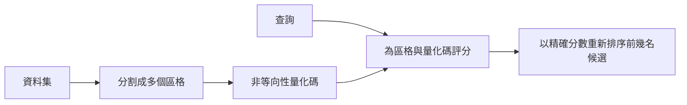

---
related:
- engineering/vector-databases
- engineering/training
tags:
- engineering
- retrieval
- vector search
- quantisation
aliases:
- ScaNN
- 非等向性向量量化
---

# ScaNN：非等向性向量量化

ScaNN 是一種用於最大內積搜尋的方法，它改變了向量量化的方式。Guo 等人（2019）提出一種損失函數，依照量化誤差對內積的影響來懲罰誤差，而不是對每個方向的誤差一視同仁。

## 概述

一般的量化會最小化重建誤差，而這個誤差在每個方向上都相同。然而，對內積排序而言，只有部分誤差會改變哪一個項目排在第一。ScaNN 針對的正是那部分誤差。它的量化器會保留向量中對於與查詢做內積最重要的成分。

## 關鍵概念

- **最大內積搜尋（MIPS）**：找出與查詢的內積最大的已儲存向量。它常見於推薦系統，也用於某些檢索模型。
- **重建誤差**：向量與其量化近似值之間的差異。
- **非等向性損失**：對平行於資料向量的誤差分量給予比正交分量更重權重的損失函數。
- **分割**：ScaNN 先把資料集分割成多個區格，再對每個區格內的向量做量化。

## 運作方式

## 關鍵想法

- **問題**：一般量化會在各方向上平均地最小化重建誤差，但對內積搜尋而言，只有與查詢方向平行的誤差會改變排名第一的項目。
- **核心想法**：使用分數感知的損失函數，對平行於資料向量的誤差分量給予比正交分量更重的懲罰，使量化器保留對內積最重要的向量部分。
- **方程式或演算法**：量化損失把殘差的平行分量以係數 $\eta > 1$ 加權，相對於正交分量，並與碼本一起聯合最佳化。
- **結果**：論文指出，在最大內積搜尋基準上，相同速度下的召回率優於先前的量化器。
- **限制**：效益與內積排序綁定，且該方法的調校會與量化之前的分割步驟互相影響。

## 取捨

- **度量匹配**：應用程式以內積排序時，收益最大。若只做歐氏距離或餘弦相似度搜尋，相對一般量化的收益較小。
- **調校**：平行分量的權重與分割方式都會影響結果，因此應以真實查詢上的召回率來檢驗設定。

## 開放問題

- 對於範數差異很大的嵌入向量，損失的權重應如何選擇？
- 相對於一般乘積量化的優勢，對於較新檢索模型產生的嵌入是否仍然成立？

## 參考文獻

- Guo, R. et al. (2019). *Accelerating Large-Scale Inference with Anisotropic Vector Quantization*. arXiv:1908.10396. https://arxiv.org/abs/1908.10396 — 為最大內積搜尋提出分數感知的量化損失。
- Johnson, J., Douze, M. & Jégou, H. (2017). *Billion-scale similarity search with GPUs*. arXiv:1702.08734. https://arxiv.org/abs/1702.08734 — 說明本方法所改進的乘積量化搜尋。
- Malkov, Y. A. & Yashunin, D. A. (2016). *Efficient and Robust Approximate Nearest Neighbor Search Using Hierarchical Navigable Small World Graphs*. arXiv:1603.09320. https://arxiv.org/abs/1603.09320 — 提出常被拿來與 ScaNN 比較的圖式索引。
- Aumüller, M., Bernhardsson, E. & Faithfull, A. (2018). *ANN-Benchmarks: A Benchmarking Tool for Approximate Nearest Neighbor Algorithms*. arXiv:1807.05614. https://arxiv.org/abs/1807.05614 — 提供比較量化式等 ANN 方法的共同基準。
- Thakur, N. et al. (2021). *BEIR: A Heterogenous Benchmark for Zero-shot Evaluation of Information Retrieval Models*. NeurIPS 2021 Datasets and Benchmarks. https://arxiv.org/abs/2104.08663 — 在 18 個資料集上評估檢索器，搜尋品質取決於索引。
