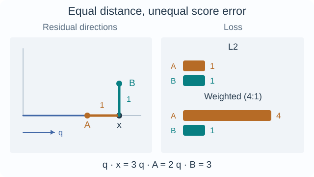

---
related:
- engineering/vector-databases
- engineering/training
tags:
- engineering
- retrieval
- vector search
- quantisation
aliases:
- ScaNN
- 非等向性向量量化
---

# ScaNN：非等向性向量量化

ScaNN 是一種用於最大內積搜尋的方法，它改變了向量量化的方式。Guo 等人（2019）提出一種損失函數，依照量化誤差對內積的影響來懲罰誤差，而不是對每個方向的誤差一視同仁。

## 概述

一般的量化會最小化重建誤差，而這個誤差在每個方向上都相同。然而，內積分數誤差取決於殘差在查詢方向上的投影；是否影響排名還取決於候選分數的差距。ScaNN 對高分配對的誤差給予較高權重。它的量化器會保留向量中對於與查詢做內積最重要的成分。

## 關鍵概念

- **最大內積搜尋（MIPS）**：找出與查詢的內積最大的已儲存向量。它常見於推薦系統，也用於某些檢索模型。
- **重建誤差**：向量與其量化近似值之間的差異。
- **非等向性損失**：對平行於資料向量的誤差分量給予比正交分量更重權重的損失函數。
- **分割**：ScaNN 先把資料集分割成多個區格，再對每個區格內的向量做量化。

## 運作方式

*原創教學動畫，CC BY-SA 4.0。* 設資料向量為 $x=(3,0)$，兩種候選量化向量為 $A=(2,0)$ 與 $B=(3,1)$，兩者的平方歐氏重建誤差皆為 1。將殘差 $e=x-\hat x$ 沿**資料向量**分解為 $e_\parallel=(e^\top u)u$，其中 $u=x/\|x\|$，以及 $e_\perp=e-e_\parallel$。示意設定平行分量的平方誤差權重為正交分量的四倍：

$
L=4\|e_\parallel\|^2+\|e_\perp\|^2.
$

A 的損失為 4，B 為 1。對特定單位查詢 $q=(1,0)$，精確內積為 3，兩個近似值分別為 2 與 3。逐漸延伸的線段揭露兩個殘差，長條再揭露等向性及非等向性損失；這是視覺揭露，而非實際最佳化軌跡。其他查詢方向可能反而偏好 A；原論文（參考文獻 Guo 等人，2019）在分布假設下，對高內積查詢與資料配對的誤差加權，推導出分數感知的目標函數。4:1 權重與向量皆為教學設定，**並非 ScaNN 預設參數、實際碼本訓練或召回率實測**。

MkDocs 提供播放／暫停與降低動態效果；窄螢幕可左右滑動或聚焦圖表後按左右方向鍵。 [GitHub 靜態總覽](../../assets/concept-animations/scann-anisotropic-residual-still.svg) · [獨立動畫](../../assets/concept-animations/scann-anisotropic-residual-motion.svg).

### 分數誤差何時改變排名

保留圖中的 $x$、$A$、$B$，再加入一個可精確表示的競爭向量 $z=(2.5,0.5)$。同一資料向量在不同查詢下會有不同排序結果：

| 查詢 | x 的精確分數 | z 的分數 | 近似值 A | 近似值 B |
|---|---:|---:|---:|---:|
| $(1,0)$ | 3 | 2.5 | 2（排序反轉） | 3 |
| $(0,1)$ | 0 | 0.5 | 0 | 1（排序反轉） |

若精確分數差 $m=q^\top(x-z)$ 為正，且僅將 $x$ 替換為 $\hat x$，差值會變成 $m-q^\top e$。當 $q^\top e>m$ 時，兩者排序反轉（相等時為同分）。若兩個候選都經量化，則由殘差差值 $e_x-e_z$ 決定分數差的擾動。圖中的非等向性損失偏好 B，但無法保證每個查詢下的排序皆正確。這些是人工構造的成對分數，並非召回率實驗。

## 關鍵想法

- **問題**：一般量化會在各方向上平均地最小化重建誤差，但內積分數誤差由殘差在查詢方向上的投影決定，排名是否改變則取決於分數差距。
- **核心想法**：使用分數感知的損失函數，對平行於資料向量的誤差分量給予比正交分量更重的懲罰，使量化器保留對內積最重要的向量部分。
- **方程式或演算法**：量化損失把殘差的平行分量以係數 $\eta > 1$ 加權，相對於正交分量，並與碼本一起聯合最佳化。
- **結果**：論文指出，在最大內積搜尋基準上，相同速度下的召回率優於先前的量化器。
- **限制**：效益與內積排序綁定，且該方法的調校會與量化之前的分割步驟互相影響。

## 取捨

- **度量匹配**：應用程式以內積排序時，收益最大。若只做歐氏距離或餘弦相似度搜尋，相對一般量化的收益較小。
- **調校**：平行分量的權重與分割方式都會影響結果，因此應以真實查詢上的召回率來檢驗設定。

## 開放問題

- 對於範數差異很大的嵌入向量，損失的權重應如何選擇？
- 相對於一般乘積量化的優勢，對於較新檢索模型產生的嵌入是否仍然成立？

## 參考文獻

- Guo, R. et al. (2019). *Accelerating Large-Scale Inference with Anisotropic Vector Quantization*. arXiv:1908.10396. https://arxiv.org/abs/1908.10396 — 為最大內積搜尋提出分數感知的量化損失。
- Johnson, J., Douze, M. & Jégou, H. (2017). *Billion-scale similarity search with GPUs*. arXiv:1702.08734. https://arxiv.org/abs/1702.08734 — 說明本方法所改進的乘積量化搜尋。
- Malkov, Y. A. & Yashunin, D. A. (2016). *Efficient and Robust Approximate Nearest Neighbor Search Using Hierarchical Navigable Small World Graphs*. arXiv:1603.09320. https://arxiv.org/abs/1603.09320 — 提出常被拿來與 ScaNN 比較的圖式索引。
- Aumüller, M., Bernhardsson, E. & Faithfull, A. (2018). *ANN-Benchmarks: A Benchmarking Tool for Approximate Nearest Neighbor Algorithms*. arXiv:1807.05614. https://arxiv.org/abs/1807.05614 — 提供比較量化式等 ANN 方法的共同基準。
- Thakur, N. et al. (2021). *BEIR: A Heterogenous Benchmark for Zero-shot Evaluation of Information Retrieval Models*. NeurIPS 2021 Datasets and Benchmarks. https://arxiv.org/abs/2104.08663 — 在 18 個資料集上評估檢索器，搜尋品質取決於索引。
