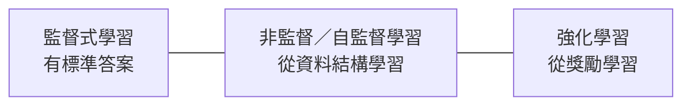

# 基礎理論

這一區涵蓋支撐所有 AI 技術的核心理論。

| 頁面 | 核心問題 |
|---|---|
| [數學基礎](math/index.md) | 線性代數、微積分、機率統計、資訊理論、最佳化各在 AI 中扮演什麼角色？ |
| [機器學習](machine-learning/index.md) | 如何從資料中學習？如何判斷學得好不好？ |
| [深度學習](deep-learning/index.md) | 為什麼多層神經網路這麼有效？怎麼訓練？ |
| [學習範式](paradigms/index.md) | 監督、非監督、半監督／弱監督、自監督、強化、模仿、遷移、元學習、持續、主動、線上、聯邦學習：學習訊號是什麼？資料怎麼來？ |
| [強化學習](paradigms/reinforcement-learning/index.md) | 如何從試誤與獎勵中學習行為？和大腦的多巴胺有什麼關係？ |
| [機率圖模型與貝氏方法](probabilistic/index.md) | 如何表達與推論不確定性？大腦是貝氏推論機器嗎？ |
| [符號 AI、搜尋與規劃](symbolic-ai/index.md) | 邏輯、知識表示、搜尋與規劃如何運作？在 LLM 時代還重要嗎？ |
| [演化計算與群體智慧](evolutionary/index.md) | 如何借用演化與群體行為來最佳化？ |

## 學習的三種基本範式

| 範式 | 訊號 | 典型任務 | 大腦對應（粗略類比） |
|---|---|---|---|
| 監督式 | 每個輸入都有正確標籤 | 分類、迴歸 | 小腦的誤差修正學習 |
| 非監督／自監督 | 資料本身的結構（例如預測下一個字） | 分群、表徵學習、語言模型預訓練 | 皮質的預測編碼、統計學習 |
| 強化學習 | 稀疏的獎勵 | 遊戲、控制、對齊 | 基底核與多巴胺系統 |

這個「小腦—監督、皮質—非監督、基底核—強化」的分工假說來自 Doya（1999），是 [NeuroAI](../brain-mind/neuroai/index.md) 的經典觀點之一。

完整的分類（含模仿、遷移、元學習、持續、主動、線上與聯邦學習）見 [學習範式](paradigms/index.md)。
