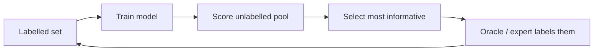

# Active Learning

## Idea

Let the model **choose which examples to label**. If labelling is expensive (an expert's time, a wet-lab experiment), asking for the most informative labels can reach the same accuracy with far fewer of them.

## Query strategies

| Strategy | Pick examples where… |
|---|---|
| Uncertainty sampling | The model is least confident (least confidence, margin, entropy) |
| Query-by-committee | An ensemble disagrees most |
| Expected model change | The gradient update would be largest |
| Expected error reduction | Labelling would most reduce future error |
| Bayesian (BALD) | Mutual information between the label and model parameters is highest |
| Diversity / core-set | Selected batch covers the data distribution |
| Hybrid (BADGE etc.) | Both uncertain and diverse |

## Related: Bayesian optimisation and optimal experimental design

When each "label" is an experiment (a molecule's activity, a material's property, a hyperparameter setting), **Bayesian optimisation** uses a surrogate model (often a Gaussian process) and an acquisition function (expected improvement, UCB) to pick the next experiment. This drives **self-driving laboratories** — see [Scientific Discovery](../../../applications/science/index.md).

## Pitfalls

- **Cold start**: uncertainty estimates are poor with very few labels — start with random or diverse samples.
- **Sampling bias**: the labelled set no longer represents the population; keep a random test set.
- **Outliers**: uncertainty sampling can chase noise.
- **Annotator cost varies**: some examples are much harder to label.
- With strong pre-trained models, gains over random sampling can be smaller than early literature suggested — always compare.

## Curiosity and question-asking

Active learning is the machine counterpart of **curiosity**:

- Humans preferentially seek information where uncertainty is intermediate and learning progress is fastest (Gottlieb, Oudeyer et al., 2013; Kidd & Hayden, 2015).
- Children's questions are informative in ways that optimal-experiment models predict (Ruggeri & Lombrozo, 2015).
- **Active sensing**: eye movements are chosen to maximise information about a scene (Yang, Lengyel & Wolpert, 2016).
- In RL, **intrinsic motivation** rewards (novelty, prediction error, information gain) play the same role; see [Reinforcement Learning](../reinforcement-learning/index.md).

## Further reading

- Settles (2009), "Active Learning Literature Survey"
- Ren et al. (2021), "A Survey of Deep Active Learning"
- Garnett, *Bayesian Optimization* (2023, free online)
- [modAL](https://modal-python.readthedocs.io/) library
