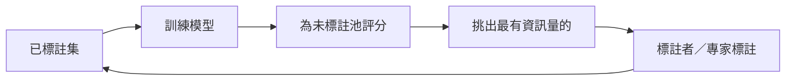

# 主動學習

## 概念

讓模型**自己選擇要標註哪些樣本**。當標註很昂貴（專家時間、濕實驗）時，只要求最有資訊量的標籤，可以用少得多的標註達到相同準確率。

## 查詢策略

| 策略 | 挑選…… |
|---|---|
| 不確定性取樣 | 模型最沒把握的（最低信心、邊界、熵） |
| 委員會查詢 | 整體模型意見最分歧的 |
| 預期模型改變 | 梯度更新會最大的 |
| 預期誤差降低 | 標註後最能降低未來誤差的 |
| 貝氏（BALD） | 標籤與模型參數之間互資訊最高的 |
| 多樣性／core-set | 讓選出的一批涵蓋資料分布 |
| 混合（BADGE 等） | 既不確定又多樣 |

## 相關：貝氏最佳化與最佳實驗設計

當每個「標籤」是一次實驗（分子活性、材料性質、超參數設定），**貝氏最佳化**用代理模型（常用高斯過程）和擷取函數（期望改善、UCB）挑選下一個實驗。這驅動了**自動駕駛實驗室**——見 [科學研究](../../../applications/science/index.md)。

## 陷阱

- **冷啟動**：標籤極少時不確定性估計很差——先隨機或多樣地取樣
- **取樣偏差**：已標註集不再代表母體；保留隨機的測試集
- **離群值**：不確定性取樣可能追著雜訊跑
- **標註成本不同**：有些樣本難標得多
- 有了強大的預訓練模型，相對隨機取樣的增益可能比早期文獻小——一定要比較

## 好奇心與提問

主動學習是**好奇心**的機器版本：

- 人類偏好在不確定性中等、學習進展最快的地方尋找資訊（Gottlieb, Oudeyer et al., 2013；Kidd & Hayden, 2015）
- 兒童的提問以最佳實驗模型預測的方式具資訊量（Ruggeri & Lombrozo, 2015）
- **主動感知**：眼動被選擇以最大化對場景的資訊（Yang, Lengyel & Wolpert, 2016）
- 強化學習中的**內在動機**獎勵（新奇性、預測誤差、資訊增益）扮演相同角色；見 [強化學習](../reinforcement-learning/index.md)

## 延伸閱讀

- Settles (2009), "Active Learning Literature Survey"
- Ren et al. (2021), "A Survey of Deep Active Learning"
- Garnett,《Bayesian Optimization》（2023，免費線上）
- [modAL](https://modal-python.readthedocs.io/) 函式庫
