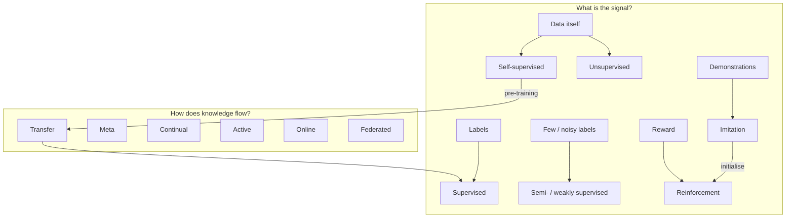

# Learning Paradigms

A **learning paradigm** describes *what kind of signal* a system learns from and *how* data arrives. Most real systems combine several: an LLM is pre-trained with self-supervision, fine-tuned with supervision (imitation of demonstrations), aligned with reinforcement learning, and adapted in context with few-shot examples.

## Overview

| Paradigm | Learning signal | Data arrival | Typical example |
|---|---|---|---|
| [Supervised](supervised.md) | A correct label for every input | Fixed dataset | Image classification, credit scoring |
| [Unsupervised](unsupervised.md) | Structure in the inputs alone | Fixed dataset | Clustering, dimensionality reduction, density estimation |
| [Semi- & weakly supervised](semi-supervised.md) | A few labels, or noisy/coarse labels, plus lots of unlabelled data | Fixed dataset | Medical imaging with few expert labels |
| [Self-supervised](self-supervised.md) | Labels manufactured from the data itself | Fixed (huge) dataset | Next-token prediction, masked image modelling, contrastive learning |
| [Reinforcement](../reinforcement-learning.md) | Scalar reward, often delayed | Generated by interacting | Games, robotics, RLHF |
| [Imitation](imitation.md) | Expert demonstrations of behaviour | Demonstration logs (+ optional interaction) | Robot manipulation, driving, SFT of LLMs |
| [Transfer / domain adaptation](transfer.md) | Knowledge from a source task or domain | Source then target | Fine-tuning a pre-trained model |
| [Meta-learning / few-shot](meta-learning.md) | Experience across many tasks | Task distribution | Learning a new class from five examples |
| [Continual](continual.md) | Sequence of tasks or a drifting stream | Sequential, non-stationary | Personal assistants, robots that keep learning |
| [Active](active.md) | Labels the learner chooses to request | Learner queries an oracle | Reducing annotation cost |
| [Online & bandits](online.md) | Feedback after each prediction or action | One sample at a time | Recommendation, ad selection, clinical trials |
| [Federated & private](federated.md) | Any of the above, but data stays distributed or protected | Across devices / institutions | Keyboard prediction, multi-hospital models |
| [Other paradigms](other.md) | Multi-task, curriculum, multiple-instance, PU learning, in-context learning, … | Varies | — |

## How they relate

The *signal* paradigms (left) say what the learner is told; the *setting* paradigms (right) say how tasks and data are organised over time, space and agents. They are orthogonal: you can do continual self-supervised learning, federated reinforcement learning, active semi-supervised learning, and so on.

## The brain uses all of them

| Paradigm | Biological / psychological analogue |
|---|---|
| Supervised | Cerebellar error-driven learning (climbing-fibre error signals); a teacher correcting a child |
| Unsupervised / self-supervised | Cortical statistical learning, predictive coding; infants segmenting speech from transition probabilities |
| Reinforcement | Basal ganglia and dopamine reward-prediction errors; operant conditioning |
| Imitation | Observational learning (Bandura's Bobo doll studies); the mirror-neuron debate; cultural transmission |
| Transfer | Applying old skills to new problems; analogical reasoning |
| Meta-learning | "Learning to learn" (Harlow's learning sets, 1949); prefrontal cortex as a meta-RL system (Wang et al., 2018) |
| Continual | Lifelong learning without catastrophic forgetting, supported by hippocampal–cortical consolidation |
| Active | Curiosity, question-asking, eye movements chosen to gain information |
| Online | Every moment of life is one sample at a time |

Doya (1999) proposed a division of labour — **cerebellum: supervised; cortex: unsupervised; basal ganglia: reinforcement** — that remains a useful first approximation. See [NeuroAI](../../brain-mind/neuroai.md) and [Memory & Learning](../../brain-mind/memory-learning.md).

## Choosing a paradigm

1. **Do you have labels?** Plenty → supervised. Few → semi-supervised, active, or transfer from a pre-trained model. None → self-supervised or unsupervised.
2. **Is the target behaviour easier to demonstrate or to score?** Demonstrate → imitation. Score → reinforcement learning.
3. **Does the data change over time?** Yes → online or continual learning, with drift monitoring.
4. **Can the data leave its owner?** No → federated learning, differential privacy.
5. **Do you need to adapt to many new tasks quickly?** → foundation model + in-context learning, or meta-learning.
