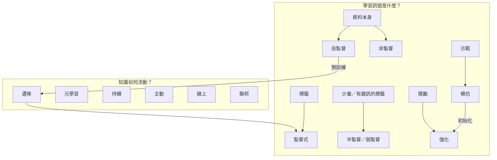

# 學習範式

**學習範式**描述系統從「什麼樣的訊號」學習，以及資料「如何」到來。大多數實際系統會組合多種範式：LLM 以自監督方式預訓練、以監督方式微調（模仿示範）、以強化學習對齊，再透過少量範例在上下文中適應新任務。

## 總覽

| 範式 | 學習訊號 | 資料到來方式 | 典型例子 |
|---|---|---|---|
| [監督式](supervised/index.md) | 每個輸入都有正確標籤 | 固定資料集 | 影像分類、信用評分 |
| [非監督式](unsupervised/index.md) | 只有輸入本身的結構 | 固定資料集 | 分群、降維、密度估計 |
| [半監督與弱監督](semi-supervised/index.md) | 少量標籤或有雜訊／粗略的標籤，加上大量未標註資料 | 固定資料集 | 只有少量專家標註的醫學影像 |
| [自監督](self-supervised/index.md) | 從資料本身製造的標籤 | 固定（巨量）資料集 | 下一個 token 預測、遮罩影像建模、對比學習 |
| [強化](reinforcement-learning/index.md) | 純量獎勵，常常延遲 | 由互動產生 | 遊戲、機器人、RLHF |
| [模仿](imitation/index.md) | 專家的行為示範 | 示範紀錄（可再加互動） | 機器人操作、駕駛、LLM 的 SFT |
| [遷移與領域適應](transfer/index.md) | 來源任務或領域的知識 | 先來源後目標 | 微調預訓練模型 |
| [元學習與少樣本](meta-learning/index.md) | 跨許多任務的經驗 | 任務分布 | 看五個例子就學會新類別 |
| [持續學習](continual/index.md) | 一連串任務或會漂移的資料流 | 依序、非平穩 | 個人助理、持續學習的機器人 |
| [主動學習](active/index.md) | 學習者主動要求的標籤 | 學習者向標註者查詢 | 降低標註成本 |
| [線上學習與吃角子老虎](online/index.md) | 每次預測或行動後的回饋 | 一次一筆 | 推薦、廣告選擇、臨床試驗 |
| [聯邦與隱私保護學習](federated/index.md) | 上述任一種，但資料分散或受保護 | 跨裝置／機構 | 鍵盤輸入預測、多醫院模型 |
| [其他範式](other/index.md) | 多任務、課程學習、多實例、PU 學習、上下文學習…… | 各異 | — |

## 範式之間的關係

左邊的「訊號」範式說明學習者被告知什麼；右邊的「情境」範式說明任務與資料如何在時間、空間與代理人之間組織。兩者正交：可以做持續的自監督學習、聯邦強化學習、主動的半監督學習等等。

## 大腦全部都用

| 範式 | 生物／心理學對應 |
|---|---|
| 監督式 | 小腦的誤差驅動學習（攀爬纖維傳遞誤差訊號）；老師糾正孩子 |
| 非監督／自監督 | 皮質的統計學習、預測編碼；嬰兒從音節轉移機率切分語音 |
| 強化 | 基底核與多巴胺的獎勵預測誤差；操作制約 |
| 模仿 | 觀察學習（Bandura 的波波玩偶實驗）；鏡像神經元的爭論；文化傳承 |
| 遷移 | 把舊技能用在新問題；類比推理 |
| 元學習 | 「學會學習」（Harlow 1949 的學習定勢）；前額葉作為元強化學習系統（Wang et al., 2018） |
| 持續 | 終身學習而不災難性遺忘，依賴海馬迴—皮質的鞏固 |
| 主動 | 好奇心、提問、為了獲取資訊而選擇的眼動 |
| 線上 | 生命中的每一刻都是一次一筆的樣本 |

Doya（1999）提出的分工——**小腦：監督；皮質：非監督；基底核：強化**——至今仍是很好的一階近似。見 [NeuroAI](../../brain-mind/neuroai/index.md) 與 [記憶與學習](../../brain-mind/memory-learning/index.md)。

## 如何選擇範式

1. **有標籤嗎？** 很多 → 監督式；很少 → 半監督、主動學習或從預訓練模型遷移；沒有 → 自監督或非監督。
2. **目標行為比較容易示範還是評分？** 示範 → 模仿學習；評分 → 強化學習。
3. **資料會隨時間改變嗎？** 會 → 線上或持續學習，並監控漂移。
4. **資料能離開擁有者嗎？** 不能 → 聯邦學習、差分隱私。
5. **需要快速適應很多新任務嗎？** → 基礎模型＋上下文學習，或元學習。
