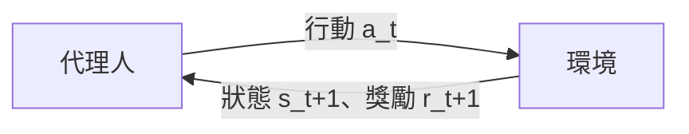

# 強化學習

## 直覺

代理人（agent）在環境中行動，得到**獎勵**，目標是學出能最大化**長期累積獎勵**的策略。沒有人告訴它正確答案，只能從試誤中學習。這和動物學習（操作制約）以及大腦的多巴胺系統有深刻的對應。

## 形式化：馬可夫決策過程（MDP）

MDP 由 \((S, A, P, R, \gamma)\) 組成：狀態、行動、轉移機率、獎勵函數、折扣因子。

- **策略** \(\pi(a\mid s)\)：在狀態 s 選行動 a 的機率
- **回報** \(G_t = \sum_{k=0}^\infty \gamma^k r_{t+k+1}\)
- **狀態價值** \(V^\pi(s) = \mathbb{E}_\pi[G_t\mid s_t=s]\)
- **行動價值** \(Q^\pi(s,a) = \mathbb{E}_\pi[G_t\mid s_t=s, a_t=a]\)

**貝爾曼方程**：

\[
Q^*(s,a) = \mathbb{E}\big[r + \gamma \max_{a'} Q^*(s',a')\big]
\]

## 核心演算法家族

| 家族 | 代表演算法 | 想法 |
|---|---|---|
| 動態規劃 | 價值迭代、策略迭代 | 已知環境模型時直接解貝爾曼方程 |
| 蒙地卡羅 | MC 控制 | 跑完整回合再用實際回報更新 |
| 時序差分（TD） | TD(0)、SARSA、Q-learning | 用「下一步估計」自舉更新 |
| 深度價值方法 | DQN、Double DQN、Rainbow | 用神經網路近似 Q |
| 策略梯度 | REINFORCE | 直接對策略參數做梯度上升 |
| Actor-Critic | A2C/A3C、PPO、SAC、TD3 | 策略（actor）＋價值估計（critic） |
| 模型式 RL | Dyna、MuZero、Dreamer | 學環境模型，在模型中規劃或想像 |
| 離線 RL | CQL、IQL、Decision Transformer | 只用既有資料學習，不與環境互動 |
| 多代理人 RL | MADDPG、QMIX、自我對弈 | 多個代理人互動 |

**TD 誤差**是關鍵量：

\[
\delta_t = r_{t+1} + \gamma V(s_{t+1}) - V(s_t)
\]

## 強化學習與大腦

### 多巴胺＝獎勵預測誤差

Schultz、Dayan 與 Montague（1997）發現：中腦多巴胺神經元的放電模式和 TD 誤差 \(\delta\) 幾乎一致——

- 意外得到獎勵 → 多巴胺爆發（\(\delta > 0\)）
- 學會預測後，獎勵本身不再引起反應，反應轉移到**預測線索**上
- 預期的獎勵沒來 → 多巴胺低於基線（\(\delta < 0\)）

這是計算理論與神經科學最成功的交會之一。後續的**分布式強化學習**（Distributional RL）也在多巴胺神經元中找到對應：不同神經元似乎編碼不同樂觀程度的預測（Dabney et al., 2020, *Nature*）。

### 其他對應

| RL 概念 | 大腦／心理學對應 |
|---|---|
| 無模型（model-free） | 習慣性行為，背外側紋狀體 |
| 模型式（model-based） | 目標導向行為，前額葉與背內側紋狀體 |
| Actor-Critic | 背側紋狀體（actor）與腹側紋狀體（critic）假說 |
| 經驗回放 | 海馬迴在睡眠與休息時的序列重播（replay） |
| 探索—利用權衡 | 正腎上腺素系統、前額葉；人類決策研究 |
| 好奇心／內在動機 | 新奇性驅動的探索、資訊尋求 |
| 折扣因子 | 延遲折扣、衝動性研究 |
| 繼承表徵（successor representation） | 海馬迴位置細胞的預測性地圖（Stachenfeld et al., 2017） |

心理學背景：Thorndike 效果律、Skinner 操作制約、Rescorla-Wagner 模型（1972，本身就是預測誤差學習規則）。

## 里程碑

- **TD-Gammon**（1992）
- **DQN**（2013/2015）：從像素學會玩 Atari
- **AlphaGo / AlphaZero / MuZero**（2016–2019）：自我對弈＋蒙地卡羅樹搜尋
- **OpenAI Five、AlphaStar**（2019）：Dota 2、星海爭霸 II
- **RLHF**（2017 起，2022 ChatGPT 普及）：用人類偏好訓練獎勵模型再以 PPO 微調 LLM
- **推理模型的 RL**（2024–2025）：以可驗證獎勵（數學答案、程式測試）訓練長思維鏈，例如 DeepSeek-R1 使用的 GRPO
- **機器人**：模擬到真實（sim-to-real）、四足與人形機器人行走

## 實務挑戰

- 樣本效率低
- 獎勵設計困難，容易出現**獎勵駭客**（reward hacking）：代理人找到獲得高分但違背設計者本意的捷徑（見 [AI 安全](../society/safety-alignment.md)）
- 探索困難（稀疏獎勵）
- 訓練不穩定、對超參數敏感
- 模擬與真實的差距

## 學習資源

- Sutton & Barto《Reinforcement Learning: An Introduction》第二版（免費 PDF）
- David Silver UCL RL 課程
- OpenAI [Spinning Up](https://spinningup.openai.com/)（MIT）
- Hugging Face Deep RL Course
- [Gymnasium](https://gymnasium.farama.org/)、[Stable-Baselines3](https://stable-baselines3.readthedocs.io/)
- Niv (2009) "Reinforcement learning in the brain"（神經科學觀點綜述）
