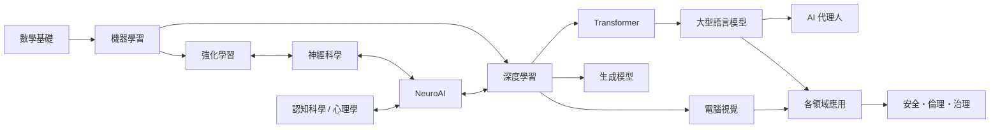

---
hide:
  - navigation
---

# AI Wiki 人工智慧知識庫

一個以**繁體中文**撰寫、持續擴充的人工智慧全景知識庫。從數學與機器學習基礎，到大型語言模型與 AI 代理人；從神經科學、認知科學與心理學如何啟發 AI，到 AI 在醫療、科學、教育、法律、藝術等各領域的實際應用；最後談工程實務與 AI 對社會的影響。

!!! tip "怎麼使用這個網站"
    - 第一次來：先看 [學習路線](start/learning-paths/index.md)，依你的背景挑一條路線。
    - 想找原始資源：看 [開源資源調查](start/open-source-survey/index.md)，整理了目前最完整的開源 AI 教材、知識庫與 awesome 清單，以及它們的授權。
    - 遇到看不懂的名詞：查 [名詞對照表](reference/glossary/index.md)，或把滑鼠停在縮寫上。
    - 右上角搜尋框支援中英文關鍵字。

## 知識地圖

## 六大區塊

-   :material-sigma: **[基礎理論](foundations/index.md)**

    ---
    數學、機器學習、深度學習、強化學習、機率模型、符號 AI、演化計算。

-   :material-cube-outline: **[模型與技術](models/index.md)**

    ---
    Transformer、LLM、擴散模型、電腦視覺、NLP、語音、多模態、GNN、代理人、世界模型。

-   :material-brain: **[腦與心智](brain-mind/index.md)**

    ---
    神經科學、計算神經科學、NeuroAI、脈衝神經網路、記憶、認知科學、認知架構、心理學、意識、腦機介面。

-   :material-earth: **[領域應用](applications/index.md)**

    ---
    醫療、生命科學、科學研究、心理健康、教育、金融、法律、機器人、自駕、製造、農業、氣候、創作、遊戲、資安、社會科學、軟體開發。

-   :material-tools: **[工程實務](engineering/index.md)**

    ---
    框架、資料、訓練與微調、提示工程、RAG、評估、MLOps、AI 硬體。

-   :material-scale-balance: **[AI 與社會](society/index.md)**

    ---
    安全與對齊、可解釋性、倫理與公平、法規治理、經濟與勞動、AI 哲學。

## 編寫原則

1. **正確優先**：重要論斷附上原始論文或權威來源；不確定的地方明確標示。
2. **跨領域連結**：每個主題盡量說明它和其他領域（尤其是腦科學與認知科學）的關係。
3. **由淺入深**：每頁開頭先給直覺，後面再給公式、細節與延伸閱讀。
4. **開放授權**：本站文字以 [CC BY-SA 4.0](https://creativecommons.org/licenses/by-sa/4.0/deed.zh_TW) 授權，可自由轉載與改作，請標示出處並以相同授權分享。

!!! note "時效性"
    AI 發展極快。本站內容以 2026 年 10 月為基準整理，涉及「最新模型」「目前最佳」的敘述請以原始來源為準。
