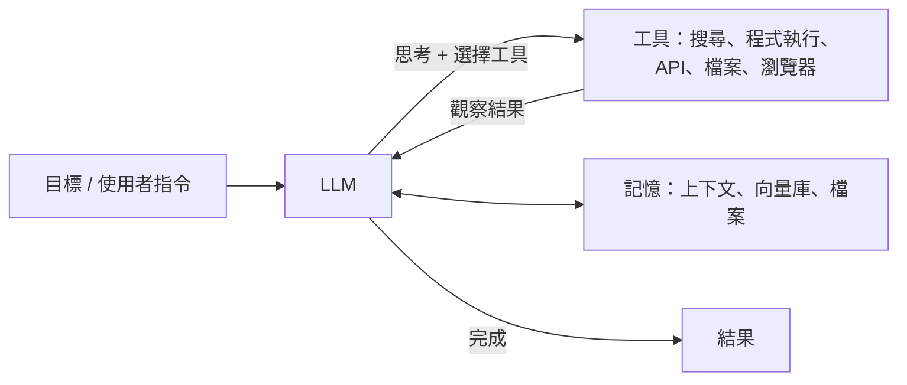

# AI 代理人（AI Agents）

## 定義

**代理人**＝能感知環境、做決策、採取行動以達成目標的系統。LLM 代理人以語言模型為「大腦」，透過**工具**與外界互動，在**迴圈**中自主完成多步任務。

## 核心元件

| 元件 | 說明 | 技術 |
|---|---|---|
| 推理與規劃 | 拆解目標、決定下一步 | 思維鏈、ReAct、計畫—執行、樹搜尋、推理模型 |
| 工具使用 | 呼叫外部能力 | Function calling、MCP（Model Context Protocol）、程式碼執行 |
| 記憶 | 跨步驟、跨對話保存資訊 | 上下文視窗、摘要、向量資料庫、檔案系統、知識圖譜 |
| 感知 | 理解多模態輸入 | VLM、螢幕截圖理解（電腦操作代理） |
| 反思與自我修正 | 檢查錯誤並重試 | Reflexion、驗證器、測試 |

## 常見模式

- **ReAct**（Yao et al., 2022）：交錯「思考 → 行動 → 觀察」
- **工作流 vs 代理人**：預先定義流程（提示鏈、路由、平行化）通常比完全自主的代理人更可靠；只有在步驟無法預先決定時才需要真正的代理人（Anthropic〈Building effective agents〉, 2024）
- **協調者—工作者**：一個主代理拆任務、分派給子代理
- **評估者—最佳化者**：一個產生、一個評分並給回饋
- **多代理辯論**：多個模型互相檢驗

## 代表性應用

| 類型 | 例子 |
|---|---|
| 程式代理人 | Claude Code、OpenAI Codex、GitHub Copilot agent、Cursor、Devin；SWE-bench 是常用評測 |
| 研究代理人 | Deep Research 類功能：自動搜尋、閱讀、整理成報告 |
| 電腦操作代理人 | 操作瀏覽器與桌面應用程式（Computer Use、Operator 等） |
| 科學代理人 | 自動提出假設、設計實驗、分析資料（見 [科學研究](../applications/science.md)） |
| 客服與流程自動化 | 處理工單、查詢系統、執行交易 |
| 遊戲與模擬中的代理人 | Voyager（Minecraft 終身學習）、Generative Agents（史丹佛小鎮 25 個 AI 居民模擬社會行為） |

## 協定與框架

- **MCP**：Anthropic 於 2024 年提出的開放協定，標準化 LLM 與工具、資料來源的連接，之後被多家廠商採用
- **A2A**：代理人之間溝通的協定
- 框架：LangGraph、LlamaIndex、CrewAI、AutoGen、OpenAI Agents SDK、Claude Agent SDK、smolagents

## 挑戰

- **錯誤累積**：每步 95% 正確，20 步後成功率只剩約 36%
- **長時程任務**：METR 的研究追蹤 AI 能自主完成的任務長度，發現約每 7 個月翻倍（2019–2025 期間）
- **安全**：提示注入、權限過大、不可逆操作、資料外洩（見 [AI 安全](../society/safety-alignment.md)）
- **評估**：結果多樣、環境不穩定
- **成本與延遲**

## 認知科學觀點

LLM 代理人的設計大量重現了認知架構的概念（見 [認知架構](../brain-mind/cognitive-architectures.md)）：

| 認知概念 | 代理人對應 |
|---|---|
| 工作記憶 | 上下文視窗 |
| 長期記憶（情節、語意、程序） | 對話紀錄、知識庫、技能庫／工具 |
| 執行功能（前額葉） | 規劃、任務切換、抑制 |
| 後設認知 | 自我評估、反思 |
| 心智理論 | 建模使用者與其他代理人的意圖 |

Sumers et al.（2023）〈Cognitive Architectures for Language Agents〉（CoALA）系統化地提出這個對應框架。

## 學習資源

- Anthropic〈Building effective agents〉
- Lilian Weng〈LLM Powered Autonomous Agents〉
- Hugging Face Agents Course
- Microsoft [AI-Agents-for-Beginners](https://github.com/microsoft/ai-agents-for-beginners)（MIT，含繁中）
- [Model Context Protocol 官方文件](https://modelcontextprotocol.io/)
