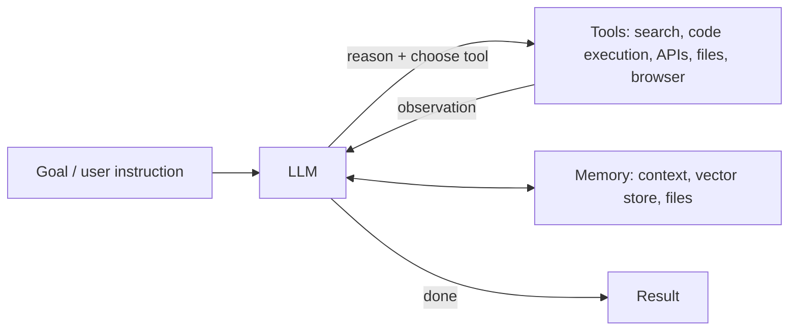

# AI Agents

## Definition

An **agent** perceives its environment, makes decisions and acts to achieve goals. An LLM agent uses a language model as its "brain", interacts with the world through **tools**, and works autonomously in a **loop** over multiple steps.

## Core components

| Component | Role | Techniques |
|---|---|---|
| Reasoning and planning | Decompose goals, choose the next step | Chain-of-thought, ReAct, plan-and-execute, tree search, reasoning models |
| Tool use | Call external capabilities | Function calling, Model Context Protocol (MCP), code execution |
| Memory | Keep information across steps and sessions | Context window, summaries, vector databases, file systems, knowledge graphs |
| Perception | Understand multimodal input | VLMs, screenshot understanding (computer-use agents) |
| Reflection and self-correction | Detect and fix errors | Reflexion, verifiers, tests |

## Common patterns

- **ReAct** (Yao et al., 2022): interleave reasoning, action and observation
- **Workflows vs agents**: predefined flows (prompt chaining, routing, parallelisation) are usually more reliable than fully autonomous agents; use true agents when steps cannot be known in advance (Anthropic, "Building effective agents", 2024)
- **Orchestrator–workers**: a lead agent splits work among sub-agents
- **Evaluator–optimiser**: one model generates, another scores and gives feedback
- **Multi-agent debate**: models check each other

## Applications

| Type | Examples |
|---|---|
| Coding agents | Claude Code, OpenAI Codex, GitHub Copilot agent, Cursor, Devin; SWE-bench is a common benchmark |
| Research agents | "Deep research" features that search, read and write reports |
| Computer-use agents | Operate browsers and desktop applications |
| Science agents | Generate hypotheses, design experiments, analyse data (see [Scientific Discovery](../../applications/science/index.md)) |
| Customer service and process automation | Handle tickets, query systems, execute transactions |
| Agents in games and simulations | Voyager (lifelong learning in Minecraft); Generative Agents (25 simulated townsfolk showing emergent social behaviour) |

## Protocols and frameworks

- **MCP**: open protocol introduced by Anthropic in 2024 to standardise how LLM applications connect to tools and data sources; later adopted across the industry
- **A2A**: an agent-to-agent communication protocol
- Frameworks: LangGraph, LlamaIndex, CrewAI, AutoGen, OpenAI Agents SDK, Claude Agent SDK, smolagents

## Challenges

- **Error compounding**: 95% per-step accuracy leaves ~36% success after 20 steps
- **Long-horizon tasks**: METR's measurements found the length of tasks AI agents can complete autonomously doubled roughly every seven months over 2019–2025
- **Security**: prompt injection, excessive permissions, irreversible actions, data exfiltration (see [Safety & Alignment](../../society/safety-alignment/index.md))
- **Evaluation**: diverse outcomes, unstable environments
- **Cost and latency**

## A cognitive-science view

LLM-agent designs re-create many ideas from [cognitive architectures](../../brain-mind/cognitive-architectures/index.md):

| Cognitive concept | Agent counterpart |
|---|---|
| Working memory | Context window |
| Long-term memory (episodic, semantic, procedural) | Conversation logs, knowledge bases, skill/tool libraries |
| Executive function (prefrontal cortex) | Planning, task switching, inhibition |
| Metacognition | Self-evaluation, reflection |
| Theory of mind | Modelling users' and other agents' intentions |

Sumers et al. (2023), "Cognitive Architectures for Language Agents" (CoALA), lays out this correspondence systematically.

## Resources

- Anthropic, "Building effective agents"
- Lilian Weng, "LLM Powered Autonomous Agents"
- Hugging Face Agents Course
- Microsoft [AI-Agents-for-Beginners](https://github.com/microsoft/ai-agents-for-beginners) (MIT)
- [Model Context Protocol documentation](https://modelcontextprotocol.io/)
