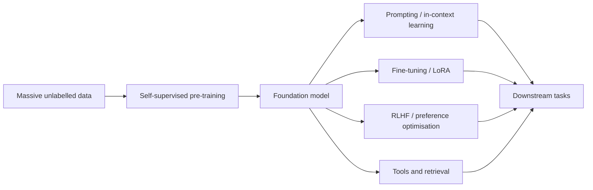

# Models

The main model families and technical directions of contemporary AI.

| Page | Focus |
|---|---|
| [Transformers & Attention](transformer/index.md) | The core architecture of modern AI, and alternatives such as Mamba |
| [Large Language Models](llm/index.md) | Pre-training, alignment, reasoning models, the open-weight ecosystem |
| [Generative Models](generative/index.md) | VAEs, GANs, diffusion, flow matching, autoregressive generation |
| [Computer Vision](computer-vision/index.md) | Classification, detection, segmentation, 3D, video |
| [Natural Language Processing](nlp/index.md) | From word vectors to LLMs |
| [Speech & Audio](speech/index.md) | Recognition, synthesis, music generation |
| [Multimodal Models](multimodal/index.md) | Vision-language models, text-to-image/video, omni models |
| [Graph Neural Networks](gnn/index.md) | Learning on molecules, social networks, knowledge graphs, connectomes |
| [AI Agents](agents/index.md) | Tool use, planning, memory, multi-agent systems |
| [World Models & Embodied AI](world-models/index.md) | Predicting environments, planning in imagination, robot foundation models |

## The foundation-model paradigm

In 2021 Stanford researchers coined "foundation models" for this pattern: pre-train once at scale, adapt everywhere. It changed the economics of AI — a few organisations train foundation models, and very many developers build on them.
