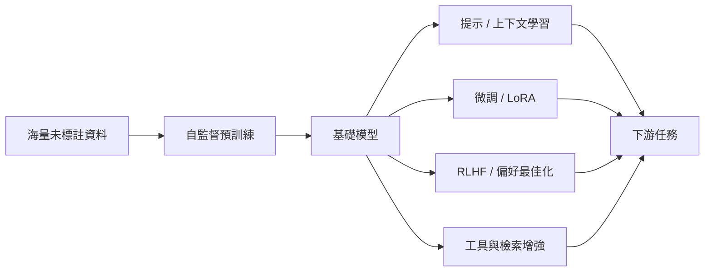

# 模型與技術

這一區介紹當代 AI 的主要模型家族，以及由它們組成的系統。這些模型背後的一般理論見[基礎理論](../foundations/index.md)。

| 頁面 | 重點 |
|---|---|
| [Transformer 與注意力](transformer/index.md) | 現代 AI 的核心架構，以及 Mamba 等替代方案 |
| [大型語言模型](llm/index.md) | 預訓練、對齊、推理模型、開放權重生態 |
| [生成模型](generative/index.md) | VAE、GAN、擴散模型、流匹配、自迴歸生成 |
| [電腦視覺](computer-vision/index.md) | 分類、偵測、分割、3D、影片理解 |
| [自然語言處理](nlp/index.md) | 從詞向量到 LLM 的 NLP 任務 |
| [語音與音訊](speech/index.md) | 語音辨識、語音合成、音樂生成 |
| [多模態模型](multimodal/index.md) | 視覺語言模型、文生圖／影片、全模態模型 |
| [圖神經網路](gnn/index.md) | 分子、社群、知識圖譜上的學習 |
| [AI 代理人](agents/index.md) | 工具使用、規劃、記憶、多代理系統 |
| [世界模型與具身智慧](world-models/index.md) | 預測環境、在想像中規劃、機器人基礎模型 |

## 「基礎模型」範式

2021 年 Stanford 提出「基礎模型」（foundation models）一詞，描述這種「一次大規模預訓練、多處適應」的模式。它改變了 AI 的研發經濟學：少數組織訓練基礎模型，大量開發者在其上建構應用。
