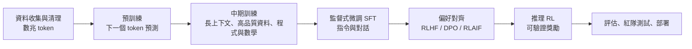

# 大型語言模型（LLM）

## 一句話

LLM 是在海量文字（與程式碼、多模態資料）上以**預測下一個 token** 為目標訓練的超大型 Transformer，再經過指令微調與偏好對齊，成為能對話、寫作、推理、寫程式、使用工具的通用模型。

## 生命週期

### 1. 分詞（Tokenization）

文字切成 token（BPE、SentencePiece、Unigram）。中文常常一字一 token 或多字一 token；分詞器設計影響多語言效率與算術能力。

### 2. 預訓練

目標：最小化 \(-\sum_t \log p_\theta(x_t\mid x_{<t})\)

資料來源：網頁（Common Crawl 經大量過濾）、書籍、論文、程式碼、多語言語料、合成資料。資料品質過濾與去重是關鍵競爭力。

### 3. 後訓練（Post-training）

| 階段 | 做法 | 目的 |
|---|---|---|
| SFT | 以高品質「指令—回答」範例微調 | 學會遵循指令與對話格式 |
| RLHF | 人類比較回答 → 訓練獎勵模型 → PPO 最佳化 | 更有幫助、誠實、無害 |
| DPO 及變體 | 直接用偏好對最佳化，不需獨立獎勵模型 | 更簡單穩定 |
| RLAIF / Constitutional AI | 由 AI 依一組原則產生偏好回饋 | 擴展監督規模 |
| 可驗證獎勵 RL（RLVR） | 用數學答案、程式測試等自動判分 | 訓練推理能力 |

## 關鍵能力與現象

- **上下文學習（in-context learning）**：只在提示中給幾個例子就能學會新任務（GPT-3 提出）
- **思維鏈（Chain-of-Thought）**：讓模型逐步推理顯著提升數學與邏輯表現（Wei et al., 2022）
- **推理模型**：經 RL 訓練在回答前產生長推理過程（OpenAI o 系列、DeepSeek-R1、Claude 的延伸思考、Gemini Thinking 等），在數學競賽、程式競賽與科學問答上大幅進步
- **工具使用**：呼叫搜尋、程式執行、API，見 [AI 代理人](agents.md)
- **長上下文**：從 2K token 擴展到百萬 token 等級
- **多模態**：見 [多模態模型](multimodal.md)

## 已知限制

| 問題 | 說明 | 緩解方式 |
|---|---|---|
| 幻覺 | 自信地產生錯誤資訊 | RAG、引用來源、校準、讓模型說「不知道」 |
| 知識截止 | 訓練資料有時間界線 | 搜尋工具、RAG |
| 推理脆弱 | 題目小幅改寫就可能失敗 | 推理訓練、工具輔助、驗證器 |
| 諂媚（sycophancy） | 傾向附和使用者 | 對齊訓練、評估 |
| 提示注入 | 外部內容中的指令劫持模型 | 權限隔離、輸入標記、監控 |
| 偏見 | 反映訓練資料中的社會偏見 | 資料處理、評估、對齊 |
| 成本與延遲 | 大模型推論昂貴 | 蒸餾、量化、MoE、推測解碼 |

## 模型生態（2026 年概況）

!!! note "變化很快"
    以下僅列家族，具體版本請查各官方網站與 [LMArena](https://lmarena.ai/)、[Artificial Analysis](https://artificialanalysis.ai/) 等排行榜。

| 類型 | 家族（舉例） |
|---|---|
| 封閉前沿模型 | OpenAI GPT 系列、Anthropic Claude、Google Gemini、xAI Grok |
| 開放權重模型 | Meta Llama、Alibaba Qwen、DeepSeek、Mistral、Google Gemma、Microsoft Phi、Moonshot Kimi、智譜 GLM、OpenAI gpt-oss |
| 繁體中文／台灣在地 | TAIDE（國科會）、Breeze（聯發科創新基地）、Taiwan-LLM 等，以在地語料強化繁中與台灣文化知識 |

## LLM 與人類語言認知

- **LLM 能預測大腦語言區活動**：模型下一字預測越好，越能預測人類語言網路的神經反應（Schrimpf et al., 2021, *PNAS*）
- **形式語言能力 vs 功能語言能力**：Mahowald, Fedorenko 等（2024）主張 LLM 已掌握語法等「形式能力」，但推理、世界知識、社會推理等「功能能力」在人腦中由語言網路以外的系統支持，在 LLM 中仍不穩定
- **兒童 vs LLM 的資料效率**：兒童約接觸 1 億字以內就掌握語言，LLM 用了數兆 token；BabyLM 挑戰賽研究小資料下的語言學習
- **心智理論（Theory of Mind）測驗**：LLM 能通過許多錯誤信念任務，但對擾動敏感，是否真正具備仍有爭議（Kosinski 2023 vs Ullman 2023）
- 詳見 [心理學與 AI](../brain-mind/psychology.md) 與 [NeuroAI](../brain-mind/neuroai.md)

## 學習資源

- [mlabonne/llm-course](https://github.com/mlabonne/llm-course)
- Sebastian Raschka《Build a Large Language Model (From Scratch)》
- Stanford CS336《Language Modeling from Scratch》
- 李宏毅《生成式 AI 導論》《機器學習 2025》
- Hugging Face [LLM Course](https://huggingface.co/learn/llm-course)
- Andrej Karpathy〈Intro to Large Language Models〉〈Deep Dive into LLMs like ChatGPT〉
