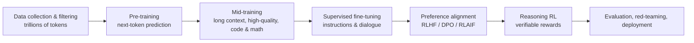

---
related:
- models/nlp
- models/agents
- engineering/prompting
- engineering/rag
- engineering/training
- brain-mind/psychology
- society/safety-alignment
---

# Large Language Models

## In one sentence

An LLM is a very large Transformer trained on enormous amounts of text (and code and other modalities) to **predict the next token**, then instruction-tuned and preference-aligned into a general model that can converse, write, reason, code and use tools.

## Lifecycle

### 1. Tokenisation

Text is split into tokens (BPE, SentencePiece, Unigram). Tokeniser design affects multilingual efficiency (Chinese characters may take one or more tokens each) and even arithmetic ability.

### 2. Pre-training

Objective: minimise \(-\sum_t \log p_\theta(x_t\mid x_{<t})\).

Data: filtered web crawls (Common Crawl), books, papers, code, multilingual corpora, synthetic data. Quality filtering and deduplication are major competitive advantages.

### 3. Post-training

| Stage | Method | Purpose |
|---|---|---|
| SFT | Fine-tune on high-quality instruction–response pairs | Follow instructions and dialogue format ([imitation](../../foundations/paradigms/imitation/index.md)) |
| RLHF | Humans compare answers → reward model → PPO | More helpful, honest, harmless |
| DPO and variants | Optimise directly on preference pairs without a separate reward model | Simpler, more stable |
| RLAIF / Constitutional AI | AI feedback guided by written principles | Scale oversight |
| RL with verifiable rewards (RLVR) | Automatic grading (math answers, unit tests) | Train reasoning |

## Capabilities and phenomena

- **In-context learning**: learn a task from a few examples in the prompt (GPT-3)
- **Chain-of-thought**: step-by-step reasoning greatly improves math and logic (Wei et al., 2022)
- **Reasoning models**: RL-trained to produce long reasoning before answering (OpenAI o-series, DeepSeek-R1, Claude extended thinking, Gemini thinking models, etc.); big gains on competition math, programming and science questions
- **Tool use**: search, code execution, APIs — see [AI Agents](../agents/index.md)
- **Long context**: from 2K tokens to the million-token range
- **Multimodality**: see [Multimodal Models](../multimodal/index.md)

## Known limitations

| Problem | Description | Mitigation |
|---|---|---|
| Hallucination | Confident, wrong output | RAG, citations, calibration, training to abstain |
| Knowledge cutoff | Training data ends at a date | Search tools, RAG |
| Brittle reasoning | Small rephrasings can break solutions | Reasoning training, tools, verifiers |
| Sycophancy | Tendency to agree with the user | Alignment training, evaluation |
| Prompt injection | Instructions hidden in external content hijack the model | Privilege separation, input marking, monitoring |
| Bias | Social biases from training data | Data curation, evaluation, alignment |
| Cost and latency | Large models are expensive to run | Distillation, quantisation, MoE, speculative decoding |

## The model ecosystem (2026 overview)

!!! note "Fast-moving"
    Only families are listed. Check official sites and leaderboards such as [LMArena](https://lmarena.ai/) and [Artificial Analysis](https://artificialanalysis.ai/) for current versions.

| Type | Families (examples) |
|---|---|
| Closed frontier models | OpenAI GPT, Anthropic Claude, Google Gemini, xAI Grok |
| Open-weight models | Meta Llama, Alibaba Qwen, DeepSeek, Mistral, Google Gemma, Microsoft Phi, Moonshot Kimi, Zhipu GLM, OpenAI gpt-oss |
| Regional / sovereign models | Many countries fund models tuned to local languages and culture (e.g. Taiwan's TAIDE and MediaTek's Breeze for Traditional Chinese) |

## LLMs and human language cognition

- **LLMs predict brain activity in language areas**: models that predict the next word better also predict human language-network responses better (Schrimpf et al., 2021, *PNAS*)
- **Formal vs functional linguistic competence**: Mahowald, Fedorenko and colleagues (2024) argue LLMs master formal competence (grammar), while functional competence (reasoning, world knowledge, social cognition) — supported by brain networks outside the language network — remains less reliable
- **Data efficiency**: children hear on the order of tens of millions of words by adolescence (well under 100 million); LLMs see trillions of tokens. The BabyLM challenge studies learning from child-scale data
- **Theory-of-mind tests**: LLMs pass many false-belief tasks but are sensitive to perturbations; whether they "have" theory of mind is contested (Kosinski, 2023 vs Ullman, 2023; Strachan et al., 2024)
- See [Psychology & AI](../../brain-mind/psychology/index.md) and [NeuroAI](../../brain-mind/neuroai/index.md)

## Resources

- [mlabonne/llm-course](https://github.com/mlabonne/llm-course)
- Raschka, *Build a Large Language Model (From Scratch)*
- Stanford CS336, *Language Modeling from Scratch*
- Hugging Face [LLM Course](https://huggingface.co/learn/llm-course)
- Karpathy, "Intro to Large Language Models" and "Deep Dive into LLMs like ChatGPT"
