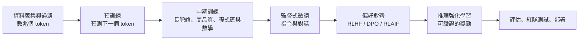

# 大型語言模型

## 一句話說明

LLM 是在海量文字（以及程式碼與其他模態）上訓練、用來**預測下一個 token** 的超大型 Transformer；再經過指令微調與偏好對齊，成為能對話、寫作、推理、寫程式與使用工具的通用模型。

## 生命週期

### 1. 分詞（Tokenisation）

文字會被切分成 token（BPE、SentencePiece、Unigram）。分詞器的設計會影響多語言的效率（一個中文字可能需要一個或多個 token），甚至影響算術能力。

### 2. 預訓練

目標：最小化 \(-\sum_t \log p_\theta(x_t\mid x_{<t})\)。

資料：經過過濾的網路爬取（Common Crawl）、書籍、論文、程式碼、多語言語料與合成資料。品質過濾與去重是主要的競爭優勢。

### 3. 後訓練

| 階段 | 方法 | 目的 |
|---|---|---|
| SFT | 在高品質的指令—回應配對上微調 | 遵循指令與對話格式（[模仿學習](../../foundations/paradigms/imitation/index.md)） |
| RLHF | 人類比較回答 → 獎勵模型 → PPO | 更有幫助、誠實、無害 |
| DPO 及其變體 | 直接在偏好配對上最佳化，不需獨立的獎勵模型 | 更簡單、更穩定 |
| RLAIF／憲法式 AI | 由依據成文原則的 AI 回饋引導 | 擴大監督規模 |
| 可驗證獎勵的強化學習（RLVR） | 自動評分（數學答案、單元測試） | 訓練推理能力 |

## 能力與現象

- **上下文學習**：從提示中的少量範例學會一項任務（GPT-3）
- **思維鏈**：逐步推理大幅提升數學與邏輯表現（Wei et al., 2022）
- **推理模型**：經強化學習訓練，在回答前產生很長的推理過程（OpenAI o 系列、DeepSeek-R1、Claude 的延伸思考、Gemini 的思考模型等）；在競賽數學、程式設計與科學問題上大幅進步
- **工具使用**：搜尋、程式執行、API——見 [AI 代理人](../agents/index.md)
- **長脈絡**：從 2K token 發展到百萬 token 等級
- **多模態**：見[多模態模型](../multimodal/index.md)

## 已知限制

| 問題 | 說明 | 緩解方式 |
|---|---|---|
| 幻覺 | 以肯定語氣輸出錯誤內容 | RAG、引用、校準、訓練模型學會拒答 |
| 知識截止 | 訓練資料在某個日期就結束 | 搜尋工具、RAG |
| 脆弱的推理 | 細微的改寫就可能讓解法失效 | 推理訓練、工具、驗證器 |
| 諂媚 | 傾向附和使用者 | 對齊訓練、評估 |
| 提示注入 | 外部內容中隱藏的指令劫持模型 | 權限分離、輸入標記、監控 |
| 偏見 | 訓練資料帶來的社會偏見 | 資料策展、評估、對齊 |
| 成本與延遲 | 大模型執行成本高 | 蒸餾、量化、MoE、推測解碼 |

## 模型生態系（2026 年概觀）

!!! note "變化快速"
    此處只列出模型家族。目前的版本請查閱官方網站，以及 [LMArena](https://lmarena.ai/) 與 [Artificial Analysis](https://artificialanalysis.ai/) 等排行榜。

| 類型 | 家族（例子） |
|---|---|
| 封閉的前沿模型 | OpenAI GPT、Anthropic Claude、Google Gemini、xAI Grok |
| 開放權重模型 | Meta Llama、阿里巴巴 Qwen、DeepSeek、Mistral、Google Gemma、Microsoft Phi、月之暗面 Kimi、智譜 GLM、OpenAI gpt-oss |
| 地區性／主權模型 | 許多國家資助針對在地語言與文化調校的模型（例如台灣的 TAIDE，以及聯發科針對繁體中文的 Breeze） |

## LLM 與人類語言認知

- **LLM 能預測語言區的腦活動**：預測下一個詞越準的模型，也越能預測人類語言網路的反應（Schrimpf et al., 2021, *PNAS*）
- **形式語言能力與功能語言能力**：Mahowald、Fedorenko 等人（2024）主張，LLM 掌握了形式能力（文法），但功能能力（推理、世界知識、社會認知）——由語言網路以外的腦網路支持——仍較不可靠
- **資料效率**：兒童到青少年時聽到的詞數約在數千萬量級（遠低於一億）；LLM 則看過數兆 token。BabyLM 挑戰研究的是在兒童規模資料上的學習
- **心智理論測試**：LLM 通過許多錯誤信念任務，但對微擾很敏感；它們是否「具有」心智理論仍有爭議（Kosinski, 2023 對 Ullman, 2023；Strachan et al., 2024）
- 見[心理學與 AI](../../brain-mind/psychology/index.md)與 [NeuroAI](../../brain-mind/neuroai/index.md)

## 關鍵方法

### GPT-3：從提示中進行少樣本學習（Brown 等人，2020）

- **問題：** 語言模型能否只靠提示中的少量範例學會新任務，而不需要任何梯度更新？
- **核心想法：** 將自迴歸 Transformer 擴大到 1,750 億參數，並在提示中提供零個、一個或少數幾個範例來測試。模型並未針對該任務微調。
- **演算法：**
    1. 在提示中寫入任務描述與幾組輸入–輸出範例。
    2. 接上新的輸入。
    3. 讓模型逐個 token 生成輸出。權重不變。
- **結果：** 在翻譯、問答與填空任務上表現強勁，也能做 3 位數的算術，摘要將後者列為即時推理任務之一。
- **限制：** 論文指出，在部分任務上，少樣本表現仍落後於針對該任務微調的模型。

### 運算最佳化訓練（Hoffmann 等人，2022）

- **問題：** 在固定的運算預算下，模型大小與訓練 token 數量應如何平衡？
- **核心想法：** 訓練超過 400 個語言模型，參數從 7,000 萬到 160 億以上，資料量從 50 億到 5,000 億 token 不等，再找出每個運算預算下的最佳大小。模型大小與資料量應一起成長。
- **規則：** 模型大小每加倍，訓練 token 數也加倍。
- **結果：** Chinchilla 有 700 億參數與四倍的資料，使用的運算量與 Gopher（2,800 億參數）相同，在廣泛的下游任務上勝過 Gopher、GPT-3 等模型。它在 MMLU 上達到 67.5% 的平均準確率。
- **限制：** 這個規則是根據作者所訓練的範圍擬合出來的。許多後來的模型刻意訓練到遠超過此比例，因為較小的模型提供服務的成本較低。

### InstructGPT：從人類回饋中進行強化學習（Ouyang 等人，2022）

- **問題：** 模型變大並不會自動更能遵循使用者的意圖，它仍可能不誠實、有毒性或沒有幫助。
- **核心想法：** 將 GPT-3 分三個階段微調：以人類示範做監督式學習、以模型輸出的排序訓練獎勵模型，再以該獎勵進行強化學習。
- **演算法：**
    1. 收集標註者的示範，並以監督式學習微調。
    2. 收集模型輸出的排序，並據此訓練獎勵模型。
    3. 以強化學習（PPO）針對獎勵模型最佳化策略。
- **結果：** 人類評分者偏好 13 億參數的 InstructGPT 所產生的輸出，勝過 1,750 億參數的 GPT-3。這些模型更誠實、產生的有毒內容較少，在公開的 NLP 資料集上只有極小的退步。
- **限制：** 作者指出，InstructGPT 仍會犯簡單的錯誤。獎勵反映的是一小群標註者的偏好，並非普世標準。

## 學習資源

- [mlabonne/llm-course](https://github.com/mlabonne/llm-course)
- Raschka，*Build a Large Language Model (From Scratch)*
- Stanford CS336，*Language Modeling from Scratch*
- Hugging Face [LLM Course](https://huggingface.co/learn/llm-course)
- Karpathy，"Intro to Large Language Models" 與 "Deep Dive into LLMs like ChatGPT"

## 參考文獻

### 開創性論文

- Brown, T. B., et al. (2020). *Language Models are Few-Shot Learners*. arXiv. https://arxiv.org/abs/2005.14165 — GPT-3 論文，顯示非常大的模型能從提示中給出的少量範例學會新任務。
- Kaplan, J., et al. (2020). *Scaling Laws for Neural Language Models*. arXiv. https://arxiv.org/abs/2001.08361 — 顯示隨著模型大小、資料與運算量增加，損失如何可預測地下降。
- Hoffmann, J., et al. (2022). *Training Compute-Optimal Large Language Models*. arXiv. https://arxiv.org/abs/2203.15556 — Chinchilla 研究，主張在固定運算預算下，模型大小與訓練 token 數應該同步成長。
- Ouyang, L., et al. (2022). *Training language models to follow instructions with human feedback*. arXiv. https://arxiv.org/abs/2203.02155 — InstructGPT，結合監督式微調與來自人類偏好的強化學習。
- Wei, J., et al. (2022). *Chain-of-Thought Prompting Elicits Reasoning in Large Language Models*. arXiv. https://arxiv.org/abs/2201.11903 — 顯示要求模型寫出中間推理步驟，可改善多步驟問題的解題能力。

### 綜述與教科書

- Zhao, W. X., et al. (2023). *A Survey of Large Language Models*. arXiv. https://arxiv.org/abs/2303.18223 — 對 LLM 的預訓練、適應與評估進行廣泛綜述，並附有模型時間線。

### 講座與影片

- Karpathy, A. (2023). *[1hr Talk] Intro to Large Language Models*. YouTube. https://www.youtube.com/watch?v=zjkBMFhNj_g — 一小時、非技術性的概述，介紹 LLM 如何訓練、能做什麼、在哪裡失敗。

### 文章與文件

- Hugging Face. *LLM Course*. https://huggingface.co/learn/llm-course — 使用 Hugging Face 函式庫來使用、微調與建構 LLM 的實作課程。
