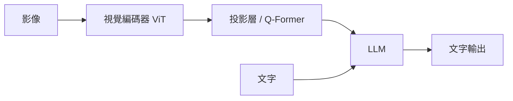

# 多模態模型

人類同時用視覺、聽覺、語言、觸覺理解世界。多模態模型試圖整合多種資料形式。

## 主要類型

| 類型 | 輸入 → 輸出 | 代表 |
|---|---|---|
| 對比式圖文模型 | 圖、文 → 共享嵌入空間 | CLIP、SigLIP、ALIGN |
| 視覺語言模型 VLM | 圖（＋文）→ 文 | LLaVA、Qwen-VL、InternVL、各家前沿模型的視覺能力 |
| 文生圖 | 文 → 圖 | DALL·E、Imagen、Stable Diffusion、Midjourney、Flux |
| 文生影片 | 文（＋圖）→ 影片 | Sora、Veo、Kling、Runway 等 |
| 文生 3D | 文／圖 → 3D | DreamFusion 類、各類 3D 生成模型 |
| 全模態（omni）模型 | 文、圖、音、影片 ↔ 多種輸出 | GPT-4o 類、Gemini 等原生多模態模型 |
| 視覺語言行動 VLA | 圖＋文 → 機器人動作 | RT-2、OpenVLA、π0 等，見 [世界模型與具身智慧](world-models.md) |

## 整合方式

- **晚期融合**：各模態先各自編碼再接起來（LLaVA 式）
- **早期融合**：把所有模態都切成 token，從頭一起訓練（原生多模態）
- **交叉注意力**：Flamingo 式，在 LLM 中插入對視覺特徵的注意力層

## CLIP 的關鍵想法

從網路上 4 億組圖文對，用對比學習讓「配對的圖和文」嵌入相近、不配對的遠離。結果：零樣本分類（用文字描述類別即可分類）、成為文生圖模型的文字理解元件、開放詞彙偵測的基礎。

## 挑戰

- **物體幻覺**：描述圖中不存在的東西
- **空間與計數推理**較弱
- **細粒度理解**：小字、圖表、醫學影像細節
- **影片的時間推理**
- **評估困難**

## 與大腦的多感官整合

- 大腦有多感官整合區（上顳溝、頂葉、上丘），遵循時間一致與空間一致原則
- **概念細胞**（Quian Quiroga et al., 2005）：人類內側顳葉有神經元對「珍妮佛·安妮斯頓」的照片、名字文字都反應——一種跨模態的抽象概念表徵；有研究發現 CLIP 中也存在類似的「多模態神經元」（Goh et al., 2021）
- **McGurk 效應**：視覺嘴型改變聽到的音節
- **具身認知**觀點認為概念根植於感覺運動經驗，這是純文字 LLM 被質疑「缺乏落地（grounding）」的理論依據，見 [認知科學](../brain-mind/cognitive-science.md)

## 學習資源

- Hugging Face Computer Vision Course 的多模態章節
- Chip Huyen〈Multimodality and Large Multimodal Models〉
- [Awesome-Multimodal-Large-Language-Models](https://github.com/BradyFU/Awesome-Multimodal-Large-Language-Models)
