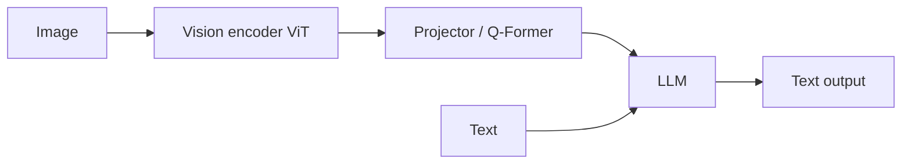

# Multimodal Models

Humans understand the world through vision, hearing, language and touch together. Multimodal models integrate several data types.

## Main types

| Type | Input → output | Examples |
|---|---|---|
| Contrastive image–text models | Image, text → shared embedding space | CLIP, SigLIP, ALIGN |
| Vision-language models (VLMs) | Image (+ text) → text | LLaVA, Qwen-VL, InternVL, frontier models' vision |
| Text-to-image | Text → image | DALL·E, Imagen, Stable Diffusion, Midjourney, Flux |
| Text-to-video | Text (+ image) → video | Sora, Veo, Kling, Runway, etc. |
| Text-to-3D | Text / image → 3D assets | DreamFusion-style and feed-forward 3D generators |
| Omni models | Text, image, audio, video ↔ multiple outputs | GPT-4o-style and Gemini-style natively multimodal models |
| Vision-language-action (VLA) | Image + text → robot actions | RT-2, OpenVLA, π0 — see [World Models & Embodied AI](../world-models/index.md) |

## How modalities are combined

- **Late fusion**: encode each modality separately, then connect (LLaVA style)
- **Early fusion**: tokenise everything and train jointly from scratch (natively multimodal)
- **Cross-attention**: insert attention-to-vision layers into an LLM (Flamingo style)

## CLIP's key idea

Train on ~400 million web image–caption pairs with a contrastive objective so matching pairs embed close together. Results: zero-shot classification by naming classes in text; the text encoder for text-to-image models; the basis of open-vocabulary detection.

## Challenges

- **Object hallucination**: describing things not in the image
- Weak **spatial reasoning and counting**
- **Fine-grained understanding**: small text, charts, medical-image detail
- **Temporal reasoning** in video
- **Evaluation** is hard

## Multisensory integration in the brain

- Multisensory regions (superior temporal sulcus, parietal cortex, superior colliculus) follow temporal- and spatial-coincidence principles
- **Concept cells** (Quian Quiroga et al., 2005): neurons in the human medial temporal lobe respond to a specific person's photos *and* written name — abstract, cross-modal representations. CLIP also contains "multimodal neurons" that respond to a concept across photos, drawings and text (Goh et al., 2021)
- The **McGurk effect**: seeing lip movements changes the syllable you hear
- **Embodied cognition** argues concepts are grounded in sensorimotor experience — the theoretical basis for questioning whether text-only LLMs "understand" (the **symbol grounding problem**, Harnad 1990). See [Cognitive Science](../../brain-mind/cognitive-science/index.md)

## Resources

- Chip Huyen, "Multimodality and Large Multimodal Models"
- [Awesome-Multimodal-Large-Language-Models](https://github.com/BradyFU/Awesome-Multimodal-Large-Language-Models)
- Hugging Face Computer Vision Course, multimodal chapters
