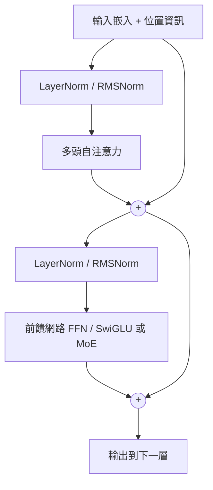

# Transformer 與注意力

## 直覺

處理一句話時，每個字的意思取決於上下文。「蘋果發表新手機」中的「蘋果」要看「手機」才知道是公司。**注意力機制**讓每個位置直接「查詢」所有其他位置，依相關程度加權整合資訊。

Transformer（Vaswani et al., 2017〈Attention Is All You Need〉）完全以注意力取代循環結構，可以高度平行化訓練，成為 LLM、ViT、語音、蛋白質模型等幾乎所有現代模型的基礎。

## 縮放點積注意力

每個 token 的向量經三個線性投影得到：

- **Query (Q)**：我在找什麼
- **Key (K)**：我有什麼可以被找
- **Value (V)**：被找到後提供的內容

\[
\text{Attention}(Q,K,V) = \text{softmax}\!\left(\frac{QK^\top}{\sqrt{d_k}}\right)V
\]

除以 \(\sqrt{d_k}\) 是為了避免內積過大使 softmax 飽和。

### 多頭注意力

把向量分成 h 個頭，各自做注意力再串接，讓模型同時關注不同類型的關係（語法、指代、位置）。

## Transformer 區塊

## 三種變體

| 類型 | 注意力 | 代表 | 用途 |
|---|---|---|---|
| 僅編碼器 | 雙向 | BERT、RoBERTa | 理解、分類、嵌入 |
| 編碼器—解碼器 | 編碼雙向＋交叉注意力 | 原始 Transformer、T5、Whisper | 翻譯、摘要、語音辨識 |
| 僅解碼器 | 因果（只看過去） | GPT、Llama、Claude、Gemini 等 | 生成、通用 LLM |

## 位置編碼

注意力本身不知道順序，必須加入位置資訊：

- 正弦位置編碼（原始論文）
- 可學習的絕對位置嵌入（BERT、GPT-2）
- **旋轉位置編碼 RoPE**（現今主流）
- ALiBi（線性偏置，利於外推）

## 效率改進

標準注意力的計算與記憶體複雜度是 \(O(n^2)\)，n 是序列長度。

| 技術 | 做法 |
|---|---|
| FlashAttention | 分塊計算、減少記憶體讀寫，精確且更快 |
| KV 快取 | 推論時快取過去 token 的 K、V |
| MQA / GQA | 多個 query 頭共享 K、V，減少 KV 快取 |
| MLA（多頭潛在注意力） | 壓縮 KV 到低維潛在向量（DeepSeek-V2 起） |
| 稀疏／滑動視窗注意力 | 只看部分位置（Longformer、Mistral） |
| 線性注意力 | 以核近似把複雜度降到 \(O(n)\) |
| 混合專家 MoE | FFN 換成多個專家，每個 token 只啟用少數，參數多但計算少 |

## 替代架構

- **狀態空間模型（SSM）**：S4、Mamba、Mamba-2，推論時每步 \(O(1)\)，長序列高效
- **現代 RNN**：RWKV、xLSTM、Griffin
- **混合架構**：Transformer 層與 SSM/線性注意力層交錯（如 Jamba 等），兼顧品質與效率
- 至 2026 年，主流前沿模型仍以 Transformer（多為 MoE）為主，混合架構在長上下文與邊緣裝置上逐漸增加

## 機制的理解（可解釋性觀點）

- **歸納頭（induction heads）**：「看到 A B … A 就預測 B」的雙頭電路，被認為是上下文學習的基礎機制之一（Olsson et al., 2022）
- **殘差串流**作為各層讀寫的共享通訊頻道
- **FFN 作為鍵值記憶**（Geva et al., 2021）
- 詳見 [可解釋性](../society/interpretability.md)

## 與大腦的關聯

- 注意力機制的名稱來自心理學的選擇性注意，但兩者機制並不相同
- 有研究指出 Transformer 的運算與**海馬迴**的計算有數學對應（Whittington et al., 2022：加上遞迴位置編碼的 Transformer 會出現類似位置細胞與網格細胞的表徵）
- 現代 Hopfield 網路的更新規則等價於注意力（Ramsauer et al., 2020〈Hopfield Networks is All You Need〉）
- 也有人把注意力類比為星形膠質細胞—神經元的互動（Kozachkov et al., 2023）
- LLM 的內部表徵能預測人腦語言區的 fMRI/ECoG 反應（Schrimpf et al., 2021；Goldstein et al., 2022），見 [NeuroAI](../brain-mind/neuroai.md)

## 學習資源

- Jay Alammar〈The Illustrated Transformer〉
- [The Annotated Transformer](https://nlp.seas.harvard.edu/annotated-transformer/)（Harvard NLP）
- Karpathy〈Let's build GPT: from scratch〉影片、nanoGPT
- 3Blue1Brown 深度學習系列第 5–7 集
- 李宏毅〈Transformer〉講解
