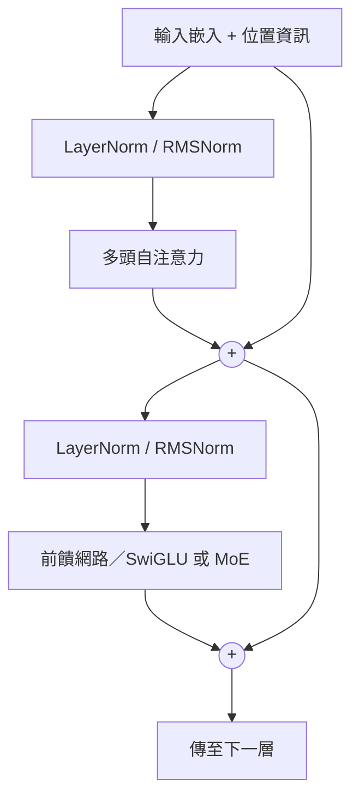

# Transformer 與注意力機制

## 直覺

每個詞的意義取決於上下文：在「Apple released a new phone」中，「Apple」是一家公司，是因為「phone」這個詞。**注意力**讓每個位置直接*查詢（query）*所有其他位置，並依相關性加權組合它們的資訊。

Transformer（Vaswani et al., 2017，"Attention Is All You Need"）完全以注意力取代了遞迴。它在訓練時很容易平行化，並成為 LLM、視覺 Transformer、語音模型、蛋白質模型等幾乎所有模型的骨幹。

## 縮放點積注意力

每個 token 的向量會被投影成三個向量：

- **查詢（Query, Q）**——我在尋找什麼？
- **鍵（Key, K）**——我能提供什麼，以便被找到？
- **值（Value, V）**——被找到時，我貢獻什麼？

\[
\text{Attention}(Q,K,V) = \text{softmax}\!\left(\frac{QK^\top}{\sqrt{d_k}}\right)V
\]

除以 \(\sqrt{d_k}\) 可以避免點積變得過大，使 softmax 飽和。

**多頭注意力**把向量切分成 h 個頭，各自獨立地計算注意力，最後串接起來，讓模型同時追蹤不同的關係（句法、指代、位置）。

## Transformer 區塊

## 三種變體

| 類型 | 注意力 | 例子 | 用途 |
|---|---|---|---|
| 僅編碼器 | 雙向 | BERT、RoBERTa | 理解、分類、嵌入 |
| 編碼器—解碼器 | 雙向編碼器加交叉注意力 | 原始 Transformer、T5、Whisper | 翻譯、摘要、語音辨識 |
| 僅解碼器 | 因果式（只看過去） | GPT、Llama、Claude、Gemini 等 | 生成、通用 LLM |

## 位置資訊

注意力本身與順序無關，因此必須注入位置資訊：

- 正弦位置編碼（原始論文）
- 可學習的絕對位置嵌入（BERT、GPT-2）
- **旋轉位置嵌入（RoPE）**——目前的預設選擇
- ALiBi（線性偏置；可外推到更長的序列）

## 效率

標準注意力的成本隨序列長度 n 呈 \(O(n^2)\) 成長。

| 技術 | 想法 |
|---|---|
| FlashAttention | 分塊、考量 IO 的精確注意力——更快、更省記憶體 |
| KV 快取 | 生成時儲存過去的鍵與值 |
| MQA／GQA | 多個查詢頭共用鍵／值頭，縮小 KV 快取 |
| 多頭潛在注意力（MLA） | 把 K／V 壓縮成低維的潛在表示（DeepSeek-V2 起採用） |
| 稀疏／滑動視窗注意力 | 只關注部分位置（Longformer、Mistral） |
| 線性注意力 | 以核函數近似，把成本降到 \(O(n)\) |
| 混合專家（MoE） | 以許多專家取代前饋網路，並把每個 token 路由到少數幾個專家——參數很多，但運算量適中 |

## 組件與變體

Transformer 的每個部分都有自己的變體家族，各有取捨與未解問題：

- [注意力變體](attention-variants/index.md)：稀疏與線性注意力、共享的鍵值頭，以及 IO 感知的精確注意力。
- [位置編碼](positional-encodings/index.md)：相對、旋轉式與偏置式編碼，以及延伸上下文長度的方法。
- [KV 快取管理](kv-cache/index.md)：記憶體分頁、淘汰、量化、潛在壓縮與卸載。

## 替代架構

- **狀態空間模型**：S4、Mamba、Mamba-2——每生成一個 token 的成本固定，在長序列上很有效率
- **現代 RNN**：RWKV、xLSTM、Griffin
- **混合式**：把 Transformer 層與 SSM 或線性注意力層交錯排列（例如 Jamba），在品質與效率之間取捨
- 截至 2026 年，前沿模型仍以 Transformer 為主（通常是 MoE）；混合式在長脈絡與裝置端應用中日益普遍

## 機制層面的理解

- **歸納頭（induction heads）**：一個兩頭電路，實現「在 A B … A 之後，預測 B」，被認為是大部分上下文學習的基礎（Olsson et al., 2022）
- **殘差流**作為共享的通訊通道，各層從中讀取並寫入
- **前饋層作為鍵—值記憶**（Geva et al., 2021）
- 見[可解釋性](../../society/interpretability/index.md)

## 與大腦的連結

- 「注意力」這個名稱來自心理學的選擇性注意，但兩者的機制並不相同
- 帶有遞迴位置編碼的 Transformer 會發展出類似位置細胞與網格細胞的表徵，暗示它與**海馬迴**運算之間有形式上的連結（Whittington et al., 2022）
- **現代 Hopfield 網路**的更新規則等同於注意力（Ramsauer et al., 2020，"Hopfield Networks is All You Need"）
- 有提案把注意力對應到神經元與星狀膠細胞的交互作用（Kozachkov et al., 2023）
- LLM 的內部表徵能預測人類語言區的 fMRI／ECoG 反應（Schrimpf et al., 2021；Goldstein et al., 2022）——見 [NeuroAI](../../brain-mind/neuroai/index.md)

## 學習資源

- Jay Alammar，"The Illustrated Transformer"
- [The Annotated Transformer](https://nlp.seas.harvard.edu/annotated-transformer/)（Harvard NLP）
- Karpathy，"Let's build GPT: from scratch"；nanoGPT
- 3Blue1Brown 深度學習系列，第 5–7 章

## 參考文獻

### 開創性論文

- Vaswani, A., et al. (2017). *Attention Is All You Need*. NeurIPS. https://arxiv.org/abs/1706.03762 — 提出 Transformer，以多頭自注意力取代遞迴。
- Bahdanau, D., Cho, K. & Bengio, Y. (2015). Neural Machine Translation by Jointly Learning to Align and Translate. ICLR. https://arxiv.org/abs/1409.0473 — 在序列到序列的翻譯中加入可學習的注意力，此想法後來被 Transformer 推廣。
- Elhage, N., et al. (2021). *A Mathematical Framework for Transformer Circuits*. Anthropic. https://transformer-circuits.pub/2021/framework/index.html — 把 Transformer 視為殘差流的讀寫之間的一組線性路徑，是機械式可解釋性研究的基礎。

### 綜述與教科書

- Tay, Y., et al. (2020). *Efficient Transformers: A Survey*. arXiv. https://arxiv.org/abs/2009.06732 — 綜述許多降低注意力二次方成本的嘗試，並提供方法分類。

### 講座與影片

- Karpathy, A. (2023). *Let's build GPT: from scratch, in code, spelled out*. YouTube. https://www.youtube.com/watch?v=kCc8FmEb1nY — 從空白檔案現場撰寫一個小型 GPT，寫的同時解說 Transformer 的每個部分。

### 文章與文件

- Alammar, J. *The Illustrated Transformer*. https://jalammar.github.io/illustrated-transformer/ — 注意力與編碼器—解碼器堆疊的逐步圖解。
- Harvard NLP. *The Annotated Transformer*. https://nlp.seas.harvard.edu/annotated-transformer/ — 逐篇對照原文的 PyTorch 實作，並附帶註解。
