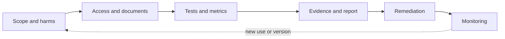

# Algorithmic Auditing and Impact Assessment

Algorithmic auditing examines an AI system's behaviour, documentation and governance, by people inside or outside the organisation that built it. Impact assessment asks who a system affects, and how, before and during use. Together they turn [ethical principles](index.md) into evidence that can be checked.

## Overview

A system can be accurate on average and still fail particular groups, or perform well in testing and badly in deployment. Audits search for such gaps. The [Gender Shades](../surveillance/gender-shades/index.md) audit showed how large they can be: commercial face-analysis systems had error rates that differed sharply by skin type and gender, although their overall accuracy looked high. Laws now require documentation and assessments. The EU AI Act is the most developed example (see [Law, Policy & Governance](../governance/index.md)).

## Key concepts

- **Internal audit**: carried out by the developer's or deployer's own staff, ideally a team separate from the one that built the system.
- **External audit**: carried out by outsiders such as researchers, journalists, regulators or accredited third parties. A *black-box* audit tests only the public interface; a *white-box* audit also gets access to code, weights or data.
- **Impact assessment**: an analysis of foreseeable effects on people and communities, including harms that accuracy tests miss.
- **Documentation**: model cards and datasheets, which state what a system or dataset is for, how it was evaluated and where it is known to fail.
- **Conformity assessment**: a check that a system meets legal requirements before it is placed on the market, self-assessed or carried out by an independent body.

## How it works

Most audits define the harms, secure access, test, write up the evidence and track remediation.

The scope sets the audit's value: an audit that does not name the harm it seeks will report only the metrics that are easy to compute. Metrics should be disaggregated, giving error rates for each subgroup, and the fairness criterion chosen is a value judgement (see [Fairness Definitions](fairness-definitions.md)). Raji et al. (2020) propose an internal audit in which each stage yields documents that together form one traceable report.

### The EU AI Act conformity path

The AI Act (Regulation (EU) 2024/1689) is risk-based. A provider of a high-risk system, such as one used for employment, credit or education, must keep a risk-management system, technical documentation and logs, design for human oversight, and meet accuracy and robustness requirements. It then completes a conformity assessment, issues an EU declaration of conformity, affixes the CE marking and registers the system in an EU database. For most high-risk systems the assessment is an internal control based on the provider's own quality system and technical file. Remote biometric identification is the main exception: it needs a notified body unless harmonised standards are applied. Some deployers, such as public bodies, must also carry out a fundamental rights impact assessment. Veale and Zuiderveen Borgesius (2021) analysed the Commission's 2021 draft. A 2025 proposal would postpone some high-risk obligations, so check current dates.

## Key methods

The approaches differ in who acts, what access they assume and what they must show.

| Approach | Who acts | Access | Typical output | Main limitation |
|---|---|---|---|---|
| Internal audit | Developer's own team | Full: data, code, weights | Staged audit report (Raji et al., 2020) | Independence |
| External black-box audit | Researchers, journalists | Public interface only | Disaggregated error rates (Buolamwini & Gebru, 2018) | A snapshot; cannot see causes |
| Model cards and datasheets | Developer | Self-reported | Standard documentation (Mitchell et al., 2019; Gebru et al., 2021) | Only as complete as the disclosure |
| Impact assessment | Deployer or reviewer | Context and stakeholders | Harms and mitigations (Metcalf et al., 2021) | Can become a formality |
| Conformity assessment | Provider or notified body | Technical file, quality system | Declaration and CE marking | Depends on the standards behind it |

Internal audits reach more but rest on independence; external audits need no cooperation but see only public access. Documentation makes claims inspectable without proving them.

### Auditing large language models

Language models are general-purpose, so no single benchmark describes what they will do. Mökander et al. (2023) propose three complementary layers: governance audits of the providers that design and release models, model audits before release, and application audits of products built on the model. Behavioural red-teaming is one practical method: Ganguli et al. (2022) describe attacks by human red-teamers on language models and release the resulting data. Shevlane et al. (2023) argue that dangerous-capability evaluations are needed before decisions on training and deployment; see [Dangerous Capability Evaluations](../safety-alignment/dangerous-capability-evals.md).

Auditors often cannot see training data, so much of their evidence comes from disclosure. The Foundation Model Transparency Index (Bommasani et al., 2023) scores developers on 100 indicators. Two cautions apply: behaviour can change with each update, so an audit is a snapshot; and when a model grades another model's output, as in [LLM-as-judge](../../engineering/evaluation/llm-as-judge.md) setups, the grader must be audited too.

## Connections

- **Ethics.** Fairness audits need protected attributes and a chosen criterion ([Fairness Definitions](fairness-definitions.md)). The harms they seek are catalogued in [Case Studies in Algorithmic Bias](bias-case-studies.md).
- **Governance and evaluation.** Audits are how the AI Act is enforced in practice. The methods are in [Evaluation and Benchmarks](../../engineering/evaluation/index.md), and dataset documentation is in [Data](../../engineering/data/index.md).
- **Privacy.** Disaggregated audits need attributes that privacy law may restrict. See [Privacy & Data Protection](../privacy/index.md).
- **Brain and mind.** Human oversight is both a legal requirement and an audit target. People tend to defer to automated recommendations, even wrong ones (see [Automation bias](../human-ai-interaction/automation-bias.md) and [heuristics and biases](../../brain-mind/cognitive-science/heuristics-and-biases/index.md)). An audit that tests the model alone, without the people who act on its output, misses this risk.

## Applications

- **Hiring and credit.** Systems that screen applicants or score borrowers are the usual high-risk cases under the AI Act.
- **Platform research.** Black-box audits of online platforms by researchers form a growing body of work; Bandy (2021) reviews 62 such studies.

## Open questions

- **Who audits the auditors?** Auditors need access, independence and accountability of their own (Costanza-Chock et al., 2022).
- **Can an audit show that harm is absent?** An audit usually shows that a harm was or was not found under particular tests. Whether it can support a safety claim is contested; Brundage et al. (2020) discuss how such claims might be made verifiable.
- **Access without exposure.** How can auditors see enough to find problems without revealing trade secrets or personal data?

## References

### Seminal papers

- Buolamwini, J. & Gebru, T. (2018). *Gender Shades: Intersectional Accuracy Disparities in Commercial Gender Classification*. PMLR. https://proceedings.mlr.press/v81/buolamwini18a.html — Audit of three commercial gender classifiers, with error rates that differ by skin type and gender.
- Raji, I. D. et al. (2020). *Closing the AI Accountability Gap: Defining an End-to-End Framework for Internal Algorithmic Auditing*. arXiv. https://arxiv.org/abs/2001.00973 — Internal audit framework applied across the development lifecycle.
- Mitchell, M. et al. (2019). *Model Cards for Model Reporting*. arXiv. https://arxiv.org/abs/1810.03993 — Proposes model cards with evaluation results across demographic and other groups.
- Gebru, T. et al. (2021). *Datasheets for Datasets*. Communications of the ACM. https://doi.org/10.1145/3458723 — Proposes datasheets for a dataset's motivation, composition, collection and uses.
- Metcalf, J. et al. (2021). *Algorithmic Impact Assessments and Accountability*. FAccT. https://doi.org/10.1145/3442188.3445935 — Examines what impact assessments can achieve as accountability tools.
- Brundage, M. et al. (2020). *Toward Trustworthy AI Development: Mechanisms for Supporting Verifiable Claims*. arXiv. https://arxiv.org/abs/2004.07213 — Steps stakeholders can take to make claims about safety and fairness verifiable.
- Shevlane, T. et al. (2023). *Model evaluation for extreme risks*. arXiv. https://arxiv.org/abs/2305.15324 — Argues for dangerous-capability and alignment evaluations to inform deployment decisions.
- Ganguli, D. et al. (2022). *Red Teaming Language Models to Reduce Harms*. arXiv. https://arxiv.org/abs/2209.07858 — Red-teaming of language models, with a released dataset of 38,961 attacks.

### Surveys and textbooks

- Bandy, J. (2021). *Problematic Machine Behavior: A Systematic Literature Review of Algorithm Audits*. Proceedings of the ACM on Human-Computer Interaction. https://doi.org/10.1145/3449148 — Reviews 62 algorithm audit studies by behaviour and audit method.
- Costanza-Chock, S., Raji, I. D. & Buolamwini, J. (2022). *Who Audits the Auditors? Recommendations from a field scan of the algorithmic auditing ecosystem*. FAccT. https://doi.org/10.1145/3531146.3533213 — Field scan of algorithmic auditors and how they can be held accountable.
- Bommasani, R. et al. (2023). *The Foundation Model Transparency Index*. arXiv. https://arxiv.org/abs/2310.12941 — Scores foundation-model developers on 100 transparency indicators.

### Articles and documentation

- Mökander, J., Schuett, J., Kirk, H. R. & Floridi, L. (2023). Auditing large language models: a three-layered approach. *AI and Ethics*. https://doi.org/10.1007/s43681-023-00289-2 — Governance, model and application audits as layers for auditing LLMs.
- Veale, M. & Zuiderveen Borgesius, F. (2021). *Demystifying the Draft EU Artificial Intelligence Act*. Computer Law Review International. https://doi.org/10.9785/cri-2021-220402 — Analyses the Commission's 2021 draft of the AI Act and its unclear elements.
