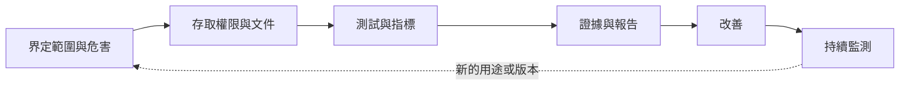

# 演算法稽核與影響評估

演算法稽核是對 AI 系統的行為、文件與治理進行系統性的檢視，檢視者可以來自建造該系統的組織內部或外部。影響評估則追問：系統在使用前與使用期間，會影響哪些人，以及以何種方式影響。兩者合起來，能把[倫理與公平](index.md)的原則轉化為可以查核的證據。

## 概述

一個系統平均而言可能很準確，卻仍然對特定群體失效；也可能在測試中表現良好，部署後卻表現很差。稽核就是用來尋找這類落差。[Gender Shades](../surveillance/gender-shades/index.md) 稽核顯示這些落差可以有多大：商業臉部分析系統對不同膚色與性別的錯誤率差異懸殊，儘管其整體準確率看起來很高。如今已有法律要求提供文件與評估。歐盟 AI 法是發展最完整的例子（見[法律、政策與治理](../governance/index.md)）。

## 關鍵概念

- **內部稽核**：由開發者或部署者自己的人員執行，最好由與建造系統的團隊分開的團隊負責。
- **外部稽核**：由研究人員、記者、主管機關或經認可的第三方等外部人員執行。**黑箱稽核**只測試公開介面；**白箱稽核**還能取得程式碼、權重或資料。
- **影響評估**：分析系統對人與社群可預見的影響，包括準確率測試無法捕捉的危害。
- **文件**：模型卡與資料集資料表等紀錄，說明系統或資料集的用途、評估方式，以及已知在哪些情況下會失效。
- **符合性評估**：在產品投入市場前，檢查系統是否符合法律要求的程序。可由供應商自我評估，也可由獨立機構執行。

## 運作方式

多數稽核會界定危害、取得存取權限、進行測試、撰寫證據報告，並追蹤改善的進度。

範圍決定稽核的價值：若不指明要尋找的危害，稽核就只會報告容易計算的指標。指標應依群體分別揭露，也就是針對每個子群體報告錯誤率；而所採用的公平性準則本身就是一種價值判斷（見[公平性定義與不可能性結果](fairness-definitions.md)）。Raji 等人（2020）提出一種內部稽核方式，每個階段都會產出文件，這些文件共同構成一份可追溯的報告。

### 歐盟 AI 法的符合性評估路徑

歐盟 AI 法（Regulation (EU) 2024/1689）採取以風險為基礎的做法。高風險系統（例如用於就業、信貸或教育的系統）的供應商，必須建立風險管理制度、保存技術文件與紀錄、設計人類監督機制，並符合準確性與穩健性的要求。之後，供應商須完成符合性評估、發布歐盟符合性聲明、標示 CE 標誌，並將系統登錄於歐盟資料庫。對多數高風險系統而言，評估是以供應商自身的品質制度與技術檔案為依據的內部管控。遠端生物辨識是主要的例外：除非採用了協調標準，否則須由公告機構（notified body）介入。部分部署者（例如公務機關）還須在首次使用前進行基本權利影響評估。Veale 與 Zuiderveen Borgesius（2021）分析了歐盟執委會 2021 年的草案。2025 年的一項提案將延後部分高風險義務的實施，因此應向官方來源核對目前的時程。

## 關鍵方法

各種方法在執行者、所假設的存取權限，以及必須證明的內容上各不相同。

| 方法 | 執行者 | 存取權限 | 典型產出 | 主要限制 |
|---|---|---|---|---|
| 內部稽核 | 開發者自己的團隊 | 完整：資料、程式碼、權重 | 分階段的稽核報告（Raji et al., 2020） | 獨立性 |
| 外部黑箱稽核 | 研究人員、記者 | 僅公開介面 | 分群錯誤率（Buolamwini & Gebru, 2018） | 只是某一時點的快照；看不到成因 |
| 模型卡與資料集資料表 | 開發者 | 自我揭露 | 標準化文件（Mitchell et al., 2019；Gebru et al., 2021） | 完整程度僅取決於所揭露的內容 |
| 影響評估 | 部署者或審查者 | 脈絡與利害關係人 | 危害與緩解措施（Metcalf et al., 2021） | 可能流於形式 |
| 符合性評估 | 供應商或公告機構 | 技術檔案、品質制度 | 符合性聲明與 CE 標誌 | 取決於背後的技術標準 |

內部稽核能觸及外部人員無法觸及的範圍，但其可信度取決於獨立性；外部稽核不需要開發者配合，卻只能看到公開可得的資訊。文件能讓主張可被檢視，但本身無法證明主張為真。

### 稽核大型語言模型

語言模型是通用型的，因此沒有任何單一基準能描述其行為。Mökander 等人（2023）提出三個互補的層級：對設計與發布模型的供應商進行治理稽核、在發布前對模型進行模型稽核，以及對建立於模型之上的產品進行應用稽核。紅隊測試是一種實用的方法：Ganguli 等人（2022）描述了人類紅隊成員對語言模型發動攻擊的過程，並公開了相關資料。Shevlane 等人（2023）主張，在決定訓練與部署之前，需要進行危險能力評估；詳見[危險能力評估與前沿安全框架](../safety-alignment/dangerous-capability-evals.md)。

稽核者往往無法看到訓練資料，因此大部分證據來自揭露。基礎模型透明度指數（Bommasani 等人，2023）依 100 項指標為開發者評分。有兩點需要留意：模型的行為可能隨每次更新而改變，因此稽核只是某一時點的快照；而當一個模型為另一個模型的輸出評分時（如 [LLM 作為評審與成對評估](../../engineering/evaluation/llm-as-judge.md)的設定），評分者本身也必須接受稽核。

## 關聯

- **倫理。** 公平性稽核需要受保護屬性，也需要選定的準則（見[公平性定義與不可能性結果](fairness-definitions.md)）。稽核所要尋找的危害，則整理於[演算法偏見案例研究](bias-case-studies.md)。
- **治理與評估。** 稽核是歐盟 AI 法在實務上的執行方式。方法見[評估與基準](../../engineering/evaluation/index.md)，資料集文件見[資料](../../engineering/data/index.md)。
- **隱私。** 分群稽核需要隱私法可能限制的屬性（見[隱私與資料保護](../privacy/index.md)）。
- **腦與心智。** 人類監督既是法律要求，也是稽核的對象。人們傾向於依賴自動化的建議，即使建議是錯的（見[自動化偏誤與過度依賴](../human-ai-interaction/automation-bias.md)與[啟發法與偏誤](../../brain-mind/cognitive-science/heuristics-and-biases/index.md)）。若稽核只測試模型本身，而忽略依據其輸出採取行動的人，就會漏掉這項風險。

## 應用

- **招聘與信貸。** 篩選應徵者或為借款人評分的系統，是歐盟 AI 法下常見的高風險案例。
- **平台研究。** 研究人員對線上平台進行的黑箱稽核，已形成一個日益增長的研究領域；Bandy（2021）回顧了其中 62 項研究。

## 開放問題

- **誰來稽核稽核者？** 稽核者自身也需要取得存取權限、保持獨立，並承擔責任（Costanza-Chock 等人，2022）。
- **稽核能否證明危害不存在？** 稽核通常只能說明在特定測試下是否發現了某項危害。它能否支持安全聲明仍有爭議；Brundage 等人（2020）討論了如何讓這類聲明可被驗證。
- **在不暴露的前提下取得存取權。** 稽核者如何在不洩露商業機密或個人資料的前提下，看到足夠多的內容以發現問題？

## 參考資料

### 開創性論文

- Buolamwini, J. & Gebru, T. (2018). *Gender Shades: Intersectional Accuracy Disparities in Commercial Gender Classification*. PMLR. https://proceedings.mlr.press/v81/buolamwini18a.html — 對三個商業性別分類器的稽核，其錯誤率因膚色與性別而有明顯差異。
- Raji, I. D. et al. (2020). *Closing the AI Accountability Gap: Defining an End-to-End Framework for Internal Algorithmic Auditing*. arXiv. https://arxiv.org/abs/2001.00973 — 一個貫穿開發生命週期的內部稽核框架。
- Mitchell, M. et al. (2019). *Model Cards for Model Reporting*. arXiv. https://arxiv.org/abs/1810.03993 — 提出模型卡，報告模型在不同人口群體等類別中的評估結果。
- Gebru, T. et al. (2021). *Datasheets for Datasets*. Communications of the ACM. https://doi.org/10.1145/3458723 — 提出資料集資料表，記載資料集的動機、組成、收集過程與建議用途。
- Metcalf, J. et al. (2021). *Algorithmic Impact Assessments and Accountability*. FAccT. https://doi.org/10.1145/3442188.3445935 — 探討影響評估作為問責工具能做到與做不到的事。
- Brundage, M. et al. (2020). *Toward Trustworthy AI Development: Mechanisms for Supporting Verifiable Claims*. arXiv. https://arxiv.org/abs/2004.07213 — 列出利害關係人可採取的步驟，使開發者關於安全與公平的主張可被驗證。
- Shevlane, T. et al. (2023). *Model evaluation for extreme risks*. arXiv. https://arxiv.org/abs/2305.15324 — 主張以危險能力與對齊評估，為訓練與部署決策提供依據。
- Ganguli, D. et al. (2022). *Red Teaming Language Models to Reduce Harms*. arXiv. https://arxiv.org/abs/2209.07858 — 對語言模型進行紅隊測試，並公開 38,961 次攻擊的資料集。

### 綜述與教科書

- Bandy, J. (2021). *Problematic Machine Behavior: A Systematic Literature Review of Algorithm Audits*. Proceedings of the ACM on Human-Computer Interaction. https://doi.org/10.1145/3449148 — 依行為類型與稽核方法，回顧 62 項演算法稽核研究。
- Costanza-Chock, S., Raji, I. D. & Buolamwini, J. (2022). *Who Audits the Auditors? Recommendations from a field scan of the algorithmic auditing ecosystem*. FAccT. https://doi.org/10.1145/3531146.3533213 — 對演算法稽核生態的實地調查，並探討稽核者本身應如何負責。
- Bommasani, R. et al. (2023). *The Foundation Model Transparency Index*. arXiv. https://arxiv.org/abs/2310.12941 — 依 100 項透明度指標為基礎模型開發者評分。

### 文章與文件

- Mökander, J., Schuett, J., Kirk, H. R. & Floridi, L. (2023). Auditing large language models: a three-layered approach. *AI and Ethics*. https://doi.org/10.1007/s43681-023-00289-2 — 以治理、模型與應用三個層級的稽核，作為稽核大型語言模型的框架。
- Veale, M. & Zuiderveen Borgesius, F. (2021). *Demystifying the Draft EU Artificial Intelligence Act*. Computer Law Review International. https://doi.org/10.9785/cri-2021-220402 — 分析歐盟執委會 2021 年的 AI 法草案，包括其中不清楚的部分。
