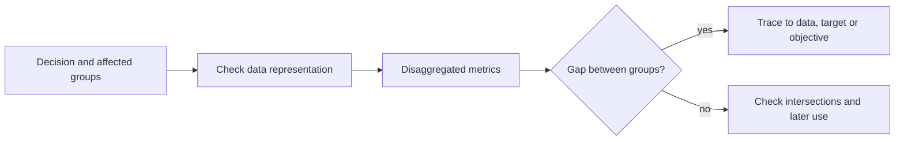

# Case Studies in Algorithmic Bias

Algorithmic bias case studies are documented cases in which an automated system gave systematically worse outcomes to some groups of people. Five well-studied cases, from criminal risk scores to language models, show where bias enters a system and what each one taught the researchers and engineers who examined it.

## Overview

The general sources of bias, such as historical data, unrepresentative samples, proxy targets and feedback loops, are described in [Ethics & Fairness](index.md). Case studies make those categories concrete. Most of the cases below were found by outsiders, such as journalists, academic auditors and researchers who probed a system from the outside, rather than by its builders. In several of them the overall accuracy looked acceptable, and the problem appeared only when results were broken down by group.

## Key concepts

- **Disaggregated evaluation**: reporting error rates separately for each group, and for intersections of groups, instead of one overall score.
- **Error-rate imbalance**: a difference between groups in false positive or false negative rates.
- **Proxy target**: a variable that is predicted in place of the quantity the decision should really serve, such as spending in place of need.
- **Stereotype benchmark**: a set of paired sentences or prompts that tests whether a language model prefers a stereotyped continuation.

## How it works

A typical audit follows four steps. First, name the decision and the people it affects. Second, choose the groups to compare and check how the evaluation data represent them. Third, measure outcomes for each group using the criteria in [Fairness Definitions and Impossibility Results](fairness-definitions.md). Fourth, trace any gap back to its source: the data, the label, the target or the objective.

## Key methods

The cases used different measurement approaches. Each one reveals some of the problem and hides the rest.

| Approach | Used in | What it compares | Main limit |
|---|---|---|---|
| Disaggregated error rates | Gender Shades, COMPAS | False positive and false negative rates per group | Depends on a benchmark with enough examples per group |
| Calibration and predictive parity check | COMPAS rebuttal | Whether a score means the same risk in each group | A score can pass this test while error rates still differ |
| Target audit | Obermeyer et al. | Whether the predicted label matches the need the decision is meant to serve | A better target must exist in the data |
| Paired-sentence benchmarks | StereoSet, CrowS-Pairs | Model probability for stereotyped and less stereotyped sentences | Artificial sentences may not match real use |
| Dialect probing | Hofmann et al. | Model judgements about the same content written in different dialects | Tests only the contrasts chosen |

## Connections

- [Ethics & Fairness](index.md) gives the taxonomy of bias sources that these cases illustrate.
- The COMPAS dispute is the main example of the impossibility results in [Fairness Definitions and Impossibility Results](fairness-definitions.md).
- Risk scores are used by people as well as by systems. [Automation bias](../human-ai-interaction/automation-bias.md) describes how decision-makers can defer to a score, which spreads the effect of a flawed score.
- The human side has parallels. People also neglect base rates when judging individual cases, as described in [Heuristics and biases](../../brain-mind/cognitive-science/heuristics-and-biases/index.md). A person who reads a score is exposed to the same statistical traps as the designer of the score.
- The language-model cases connect to [Large Language Models](../../theory/models/llm/index.md), to [InstructGPT and reinforcement learning from human feedback](../../theory/models/llm/instructgpt-rlhf/index.md), the kind of preference training discussed below, and to [Safety & alignment](../safety-alignment/index.md). Facial analysis connects to [Computer Vision](../../theory/models/computer-vision/index.md).

## Applications

### COMPAS and the recidivism debate

COMPAS is a risk-assessment tool developed by Northpointe and used in US courts to estimate how likely a defendant is to reoffend. In 2016 ProPublica analysed its scores on defendants in Broward County, Florida. It reported that a Black defendant who did not reoffend was nearly twice as likely as a white defendant to be rated high risk.[^1] Replies from the tool's defenders argued that the right test is calibration, which COMPAS satisfies, and Northpointe argued for predictive parity, which it also satisfies. Each reply was correct for the criterion it chose.

*What it taught:* the same tool can be defended and criticised as fair depending on the criterion chosen. When base rates differ between groups, calibration and error-rate balance cannot both hold, as Chouldechova (2017) and Kleinberg et al. (2016) showed. The choice of criterion is therefore a value judgement. Corbett-Davies et al. (2017) also showed that enforcing several of these criteria on pretrial decisions carries a public-safety cost.

### Gender Shades

Buolamwini and Gebru (2018) built a benchmark balanced by gender and by skin type, using the Fitzpatrick scale. They evaluated three commercial gender classifiers, from IBM, Microsoft and Face++. The two existing benchmarks they examined were 79.6% (IJB-A) and 86.2% (Adience) lighter-skinned subjects. Darker-skinned women were the most misclassified group, with error rates of up to 34.7%, while the maximum error rate for lighter-skinned men was 0.8%.[^2]

*What it taught:* an overall accuracy figure can hide large gaps between groups. The composition of a benchmark decides what can be seen, so representation bias is also a problem in evaluation. Splitting by intersections, such as gender and skin type together, showed gaps that single-attribute reporting had missed.

### Amazon's recruiting tool

Amazon built an experimental system to rank job applicants from their résumés. It was trained on résumés submitted over about ten years, a period in which most applicants and hires were men. According to Dastin's 2018 report, cited here through a 2022 book chapter with the same title, the system learned to penalise résumés that signalled a woman applicant.

*What it taught:* a model trained to imitate past decisions reproduces them. Removing explicit gender terms is not enough, because other words and features can carry the same signal. Raghavan et al. (2020) examined the claims of vendors of hiring assessments, including the choices they make about data and prediction targets, which carry risks and trade-offs.

### Healthcare risk scores

Obermeyer et al. (2019) examined a widely used commercial algorithm that identified patients for extra care. The algorithm used health costs as a proxy for health needs. Less money is spent on Black patients who have the same level of need, so at a given risk score Black patients were sicker than White patients. The authors estimated that this reduced the number of Black patients identified for extra care by more than half. Reformulating the algorithm so that it no longer used costs as a proxy removed the racial bias in predicting who needed extra care.

*What it taught:* the choice of label is a modelling decision with ethical weight. A model can be built correctly and still measure the wrong thing, so audits should examine the target as well as the predictions.

### Bias in language models

Bias in language models has been measured in several ways. Bolukbasi et al. (2016) showed that word embeddings trained on news text associate the word *receptionist* with *female*, and proposed a way to reduce such associations. StereoSet (Nadeem et al., 2020) and CrowS-Pairs (Nangia et al., 2020) test whether models prefer stereotyped sentences across domains such as gender, race and religion. Hofmann et al. (2024) found that language models associate speakers of African American English with more negative stereotypes than any recorded human stereotypes about African Americans, even while their overt stereotypes are more positive. They also reported that human preference alignment widened the gap between covert and overt stereotypes.

*What it taught:* a benchmark that measures overt stereotypes can show improvement while covert bias remains. The measured level of bias depends on which benchmark is used. Weidinger et al. (2021) place discrimination and exclusion among a wider set of risks from language models.

## Open questions

- Which fairness criterion should govern a given decision, and who should decide?
- Does removing a proxy or training against a benchmark reduce harm in use, or only on the test set? The Hofmann et al. result suggests that some fixes may hide the problem.
- Most audits depend on access. The cases above could be studied because the systems or their APIs were available to outsiders. How can audits proceed when access is limited?

[^1]: Chouldechova (2017), Section 1, which summarises the ProPublica analysis and the replies to it.
[^2]: Buolamwini & Gebru (2018), abstract.

## References

### Seminal papers

- Buolamwini, J. & Gebru, T. (2018). *Gender Shades: Intersectional Accuracy Disparities in Commercial Gender Classification*. Proceedings of Machine Learning Research 81. https://proceedings.mlr.press/v81/buolamwini18a.html — Introduces a gender- and skin-type-balanced benchmark and shows large error-rate gaps in three commercial gender classifiers.
- Chouldechova, A. (2017). Fair prediction with disparate impact: A study of bias in recidivism prediction instruments. *Big Data*. https://doi.org/10.1089/big.2016.0047 — Re-analyses the COMPAS data and shows why error-rate balance and predictive parity cannot both hold when recidivism rates differ across groups.
- Kleinberg, J., Mullainathan, S. & Raghavan, M. (2016). *Inherent Trade-Offs in the Fair Determination of Risk Scores*. arXiv preprint. https://arxiv.org/abs/1609.05807 — Proves that three natural fairness conditions can be satisfied together only in highly constrained special cases.
- Corbett-Davies, S., Pierson, E., Feller, A., Goel, S. & Huq, A. (2017). *Algorithmic decision making and the cost of fairness*. arXiv preprint. https://arxiv.org/abs/1701.08230 — Treats fairness in pretrial detection as constrained optimisation and shows that several common fairness constraints reduce public safety.
- Obermeyer, Z., Powers, B., Vogeli, C. & Mullainathan, S. (2019). Dissecting racial bias in an algorithm used to manage the health of populations. *Science*. https://doi.org/10.1126/science.aax2342 — Traces racial bias in a health-management algorithm to its use of health costs as a proxy for need.
- Raghavan, M., Barocas, S., Kleinberg, J. & Levy, K. (2020). *Mitigating Bias in Algorithmic Hiring: Evaluating Claims and Practices*. arXiv preprint. https://arxiv.org/abs/1906.09208 — Documents what vendors of hiring algorithms disclose about validation and bias testing, and discusses the trade-offs in their data and target choices.
- Bolukbasi, T., Chang, K.-W., Zou, J., Saligrama, V. & Kalai, A. (2016). *Man is to Computer Programmer as Woman is to Homemaker? Debiasing Word Embeddings*. arXiv preprint. https://arxiv.org/abs/1607.06520 — Shows gender stereotypes in word embeddings trained on news text and proposes a method to reduce them.
- Nangia, N., Vania, C., Bhalerao, R. & Bowman, S. R. (2020). *CrowS-Pairs: A Challenge Dataset for Measuring Social Biases in Masked Language Models*. arXiv preprint. https://arxiv.org/abs/2010.00133 — Provides 1,508 sentence pairs covering nine bias types, and finds that all three masked language models tested favour stereotyping sentences.
- Hofmann, V., Kalluri, P. R., Jurafsky, D. & King, S. (2024). AI generates covertly racist decisions about people based on their dialect. *Nature*. https://doi.org/10.1038/s41586-024-07856-5 — Shows covert dialect prejudice in language models, and that preference alignment can widen the gap between covert and overt stereotypes.

- Nadeem, M., Bethke, A. & Reddy, S. (2020). *StereoSet: Measuring stereotypical bias in pretrained language models*. arXiv preprint. https://arxiv.org/abs/2004.09456 — Large English benchmark of stereotype tests across gender, profession, race and religion, applied to BERT, GPT-2, RoBERTa and XLNet.

### Surveys and textbooks

- Mehrabi, N., Morstatter, F., Saxena, N., Lerman, K. & Galstyan, A. (2019). *A Survey on Bias and Fairness in Machine Learning*. arXiv preprint. https://arxiv.org/abs/1908.09635 — Surveys real-world applications with observed bias, the sources of bias, and a taxonomy of fairness definitions.
- Weidinger, L. et al. (2021). *Ethical and social risks of harm from Language Models*. arXiv preprint. https://arxiv.org/abs/2112.04359 — Structures the risk landscape for large language models, including discrimination, exclusion and toxicity.

### Articles and documentation

- Dastin, J. (2022). Amazon Scraps Secret AI Recruiting Tool that Showed Bias against Women. In *Ethics of Data and Analytics*. https://doi.org/10.1201/9781003278290-44 — Book chapter with the title of the 2018 report on Amazon's experimental résumé-screening system and its gender bias.
