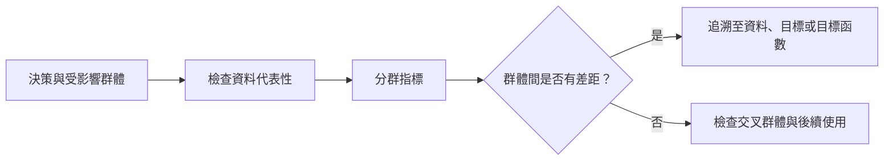

# 演算法偏見案例研究

演算法偏見案例研究，是指有文獻記錄的情況：自動化系統對某些人群持續給出較差的結果。本文介紹五個受到充分研究的案例，從刑事風險評分到語言模型，說明偏見如何進入系統，以及每個案例教會了研究者與工程師什麼。

## 概述

偏見的一般來源，例如歷史資料、樣本代表性不足、代理目標與回饋迴路，已在[倫理與公平](index.md)中說明。案例研究讓這些抽象類別變得具體。下文多數案例是由記者、學術稽核人員，以及從外部探查系統的研究者發現的，而非由系統的建造者發現。在其中數個案例裡，整體準確率看起來可以接受，問題只有在依群體拆開結果時才會浮現。

## 關鍵概念

- **分群評估（disaggregated evaluation）**：分別報告每個群體的錯誤率，以及群體交叉組合的錯誤率，而不是只給一個總分。
- **錯誤率失衡（error-rate imbalance）**：不同群體之間，偽陽性率或偽陰性率存在差異。
- **代理目標（proxy target）**：用來預測的變數，代替決策真正應該服務的量，例如以花費代替需求。
- **刻板印象基準（stereotype benchmark）**：一組成對的句子或提示，用來測試語言模型是否偏好帶刻板印象的續寫。

## 運作方式

典型的稽核分為四個步驟。第一，說明決策內容，以及受影響的人群。第二，選定要比較的群體，並檢查評估資料如何代表這些群體。第三，依[公平性定義與不可能性結果](fairness-definitions.md)中的準則，為每個群體量測結果。第四，把任何群體間的差距追溯到其來源：資料、標籤、目標或目標函數。

## 關鍵方法

各案例採用的量測方法不同。每一種方法都揭示了問題的一部分，也遮蔽了其餘部分。

| 方法 | 用於 | 比較的內容 | 主要限制 |
|---|---|---|---|
| 分群錯誤率 | Gender Shades、COMPAS | 每個群體的偽陽性率與偽陰性率 | 依賴於每個群體都有足夠樣本的基準 |
| 校準與預測均等檢驗 | COMPAS 的回應 | 同一分數在各群體中是否代表相同的風險 | 分數可以通過此檢驗，錯誤率仍然不同 |
| 目標稽核 | Obermeyer 等人 | 預測的標籤是否符合決策應服務的需求 | 資料中必須存在更好的目標 |
| 成對句子基準 | StereoSet、CrowS-Pairs | 模型對帶刻板印象與較不帶刻板印象句子的機率 | 人造句子可能與真實使用情況不符 |
| 方言探測 | Hofmann 等人 | 模型對以不同方言書寫之相同內容的判斷 | 只測試所選定的對比 |

## 關聯

- [倫理與公平](index.md)提供偏見來源的分類，本文案例即是其例證。
- COMPAS 之爭是[公平性定義與不可能性結果](fairness-definitions.md)中不可能性結果的主要例子。
- 風險評分也會被人使用。[自動化偏誤與過度依賴](../human-ai-interaction/automation-bias.md)說明決策者如何傾向順從分數，從而放大有缺陷的分數所造成的影響。
- 人的一面有類似之處。人在判斷個別案例時也會忽略基礎比率，見[啟發法與偏誤](../../brain-mind/cognitive-science/heuristics-and-biases/index.md)。讀取分數的人，與設計分數的人一樣，會落入相同的統計陷阱。
- 語言模型的案例連結到[大型語言模型](../../theory/models/llm/index.md)、[InstructGPT 與基於人類回饋的強化學習](../../theory/models/llm/instructgpt-rlhf/index.md)（即下文討論的偏好訓練），以及[安全與對齊](../safety-alignment/index.md)。臉部分析則連結到[電腦視覺](../../theory/models/computer-vision/index.md)。

## 應用

### COMPAS 與再犯預測之爭

COMPAS 是由 Northpointe 開發的風險評估工具，在美國法院中用來估計被告再次犯罪的可能性。2016 年，ProPublica 分析了佛羅里達州布勞沃德郡（Broward County）被告的分數，並報告：未再犯的黑人被告被評為高風險的機率，幾乎是白人被告的兩倍。[^1] 為該工具辯護的一方主張，正確的檢驗應是校準，而 COMPAS 通過了此項檢驗；Northpointe 則主張預測均等，COMPAS 同樣通過。每一方的回應，在其所選的準則下都是正確的。

*此案例的啟示：* 同一套工具，視所選準則不同，既可以被辯護為公平，也可以被批評為不公平。當各群體的基礎比率不同時，校準與錯誤率平衡無法同時成立，Chouldechova（2017）與 Kleinberg 等人（2016）對此都有證明。因此，準則的選擇是一種價值判斷。Corbett-Davies 等人（2017）也指出，在審前決策中強制執行其中數項準則，會帶來公共安全上的代價。

### Gender Shades

Buolamwini 與 Gebru（2018）建立了一個依性別與膚色類型（採用 Fitzpatrick 量表）平衡的基準，並評估了 IBM、Microsoft 與 Face++ 三家商業性別分類器。他們檢視的兩個既有基準，淺膚色受試者分別佔 79.6%（IJB-A）與 86.2%（Adience）。深膚色女性是最常被誤判的群體，錯誤率高達 34.7%；而淺膚色男性的最高錯誤率為 0.8%。[^2]

*此案例的啟示：* 整體準確率的數字，可能掩蓋群體之間的巨大差距。基準的組成決定了什麼能被看見，因此表徵偏見同樣也是評估上的問題。依交叉群體（例如性別與膚色的組合）拆分結果，能顯示單一屬性報告所遺漏的差距。

### 亞馬遜的招聘工具

亞馬遜曾打造一套實驗性的系統，依履歷為應徵者排序。該系統的訓練資料來自約十年間遞交的履歷，而在那段期間，多數應徵者與錄取者都是男性。根據 Dastin 於 2018 年的報導（本文引用的是 2022 年一本書中同名的章節），該系統學會了降低帶有女性特徵之履歷的評分。

*此案例的啟示：* 被訓練來模仿過往決策的模型，會重現這些決策。移除明確的性別詞彙並不足夠，因為其他詞語與特徵可能攜帶相同的訊號。Raghavan 等人（2020）檢視了招聘評估供應商的主張，包括其在資料與預測目標上的選擇，這些選擇都伴隨風險與取捨。

### 醫療風險評分

Obermeyer 等人（2019）檢驗了一個廣泛使用的商業演算法，該演算法用來辨識應獲得額外照護的病患。它以醫療花費作為健康需求的代理指標。相同需求程度的黑人病患，所花費的金額較少，因此在相同的風險分數下，黑人病患其實比白人病患病得更重。作者估計，這項偏見使獲得額外照護的黑人病患人數減少了一半以上。將演算法改為不再以花費作為代理指標後，預測誰需要額外照護時的種族偏見便消失了。

*此案例的啟示：* 標籤的選擇是一項具有倫理分量的建模決策。模型可能在技術上建構正確，卻量測了錯誤的東西，因此稽核應同時檢驗目標與預測結果。

### 語言模型中的偏見

語言模型中的偏見已以數種方式量測。Bolukbasi 等人（2016）指出，在新聞文本上訓練的詞嵌入，會把 *receptionist*（接待員）一詞與 *female*（女性）聯想在一起，並提出減少這類聯想的方法。StereoSet（Nadeem 等人，2020）與 CrowS-Pairs（Nangia 等人，2020）則測試模型是否偏好帶刻板印象的句子，涵蓋性別、種族與宗教等領域。Hofmann 等人（2024）發現，語言模型對使用非裔美國人英語者的負面刻板印象，比人類實驗中記錄到的任何對非裔美國人的刻板印象都更為負面，而其明示的刻板印象反而較為正面。他們也報告，人類偏好對齊使隱性與明示刻板印象之間的落差擴大。

*此案例的啟示：* 只量測明示刻板印象的基準可能顯示進步，而隱性偏見依然存在。被量測出的偏見程度，取決於所用的基準。Weidinger 等人（2021）則把歧視與排斥列為語言模型更廣泛風險中的一類。

## 未解問題

- 某項決策應由哪一種公平準則來規範？又由誰來決定？
- 移除代理指標或依基準進行訓練，是否能在實際使用中降低傷害，還是只在測試集上有效？Hofmann 等人的結果顯示，部分修正可能只是掩蓋了問題。
- 多數稽核仰賴取得系統的管道。上述案例之所以能被研究，是因為外部研究者能取得系統或其 API。當取得管道受限時，稽核該如何進行？

## 參考資料

### 開創性論文

- Buolamwini, J. & Gebru, T. (2018). *Gender Shades: Intersectional Accuracy Disparities in Commercial Gender Classification*. Proceedings of Machine Learning Research 81. https://proceedings.mlr.press/v81/buolamwini18a.html — 提出依性別與膚色平衡的基準，並顯示三個商業性別分類器之間存在巨大的錯誤率差距。
- Chouldechova, A. (2017). Fair prediction with disparate impact: A study of bias in recidivism prediction instruments. *Big Data*. https://doi.org/10.1089/big.2016.0047 — 重新分析 COMPAS 的資料，說明當各群體的再犯率不同時，錯誤率平衡與預測均等為何無法同時成立。
- Kleinberg, J., Mullainathan, S. & Raghavan, M. (2016). *Inherent Trade-Offs in the Fair Determination of Risk Scores*. arXiv preprint. https://arxiv.org/abs/1609.05807 — 證明三項自然的公平條件，只有在高度受限的特殊情況下才能同時滿足。
- Corbett-Davies, S., Pierson, E., Feller, A., Goel, S. & Huq, A. (2017). *Algorithmic decision making and the cost of fairness*. arXiv preprint. https://arxiv.org/abs/1701.08230 — 將審前羈押的公平性視為受限最佳化問題，並顯示若干常見的公平性限制會降低公共安全。
- Obermeyer, Z., Powers, B., Vogeli, C. & Mullainathan, S. (2019). Dissecting racial bias in an algorithm used to manage the health of populations. *Science*. https://doi.org/10.1126/science.aax2342 — 將一套健康管理演算法中的種族偏見，追溯至其以醫療花費作為健康需求代理指標的設計。
- Raghavan, M., Barocas, S., Kleinberg, J. & Levy, K. (2020). *Mitigating Bias in Algorithmic Hiring: Evaluating Claims and Practices*. arXiv preprint. https://arxiv.org/abs/1906.09208 — 考察招聘演算法供應商對驗證與偏見檢測所揭露的內容，並討論其資料與目標選擇的取捨。
- Bolukbasi, T., Chang, K.-W., Zou, J., Saligrama, V. & Kalai, A. (2016). *Man is to Computer Programmer as Woman is to Homemaker? Debiasing Word Embeddings*. arXiv preprint. https://arxiv.org/abs/1607.06520 — 顯示在新聞文本上訓練的詞嵌入中存在性別刻板印象，並提出減少這些刻板印象的方法。
- Nangia, N., Vania, C., Bhalerao, R. & Bowman, S. R. (2020). *CrowS-Pairs: A Challenge Dataset for Measuring Social Biases in Masked Language Models*. arXiv preprint. https://arxiv.org/abs/2010.00133 — 提供涵蓋九類偏見的 1,508 組句子配對，並發現所測試的三個遮罩語言模型都偏好帶刻板印象的句子。
- Hofmann, V., Kalluri, P. R., Jurafsky, D. & King, S. (2024). AI generates covertly racist decisions about people based on their dialect. *Nature*. https://doi.org/10.1038/s41586-024-07856-5 — 顯示語言模型中存在隱性的方言偏見，且偏好對齊可能擴大隱性與明示刻板印象之間的落差。

- Nadeem, M., Bethke, A. & Reddy, S. (2020). *StereoSet: Measuring stereotypical bias in pretrained language models*. arXiv preprint. https://arxiv.org/abs/2004.09456 — 性別、職業、種族與宗教等面向的大型英文刻板印象測試基準，並應用於 BERT、GPT-2、RoBERTa 與 XLNet。

### 綜述與教科書

- Mehrabi, N., Morstatter, F., Saxena, N., Lerman, K. & Galstyan, A. (2019). *A Survey on Bias and Fairness in Machine Learning*. arXiv preprint. https://arxiv.org/abs/1908.09635 — 綜述已觀察到偏見的真實應用、偏見的來源，以及公平性定義的分類。
- Weidinger, L. et al. (2021). *Ethical and social risks of harm from Language Models*. arXiv preprint. https://arxiv.org/abs/2112.04359 — 梳理大型語言模型的風險全貌，包括歧視、排斥與毒性。

### 文章與文件

- Dastin, J. (2022). Amazon Scraps Secret AI Recruiting Tool that Showed Bias against Women. In *Ethics of Data and Analytics*. https://doi.org/10.1201/9781003278290-44 — 書中章節與 2018 年關於亞馬遜實驗性履歷篩選系統及其性別偏見之報導同名。

[^1]: Chouldechova（2017），第 1 節，該節概述了 ProPublica 的分析及其所受到的回應。
[^2]: Buolamwini 與 Gebru（2018），摘要。
