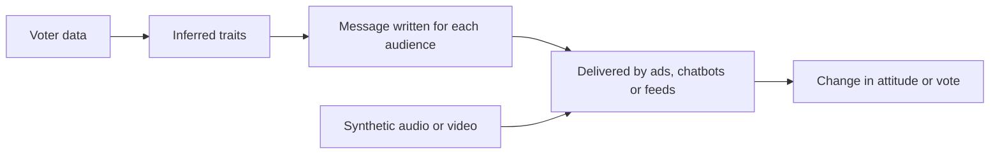

# AI, Elections and Democracy

Generative AI can write persuasive political messages, tailor them to individual voters and produce realistic audio and video of candidates. This page covers what those capabilities mean for democratic elections, what experiments have found so far, and which rules and platform policies have been adopted. The mechanics of false content are covered in [Misinformation and Deepfakes](../misinformation/index.md).

!!! info "Part of Law, Policy & Governance"
    This page belongs to [Law, Policy & Governance](index.md). It discusses the democratic stakes; the parent page covers the legal instruments.

## Overview

Elections depend on two things that AI puts under pressure: voters' ability to form opinions from shared information, and a contest between candidates that is broadly fair. Three uses attract most attention. Campaigns can use models to produce large volumes of persuasive text, to match messages to voter profiles and to answer questions in a conversational voice. Malicious actors can produce deepfakes of candidates or fabricated news. Researchers and pollsters can use models to simulate survey respondents, which affects how public opinion is measured.

The evidence is mixed. Several experiments show that AI-written political messages can shift stated opinions, but several others find that the added value of personal data is small. Deepfake studies suggest that their most common effect is uncertainty rather than outright belief. Most of the evidence comes from surveys and online experiments, not from real campaigns, so the size of any effect on an actual election is still unknown. Some researchers argue that fears about generative AI and misinformation are overblown (Simon et al., 2023).

## Key concepts

- **Political persuasion**: changing a person's stated attitude or vote intention through messages. Experiments usually measure it as a shift in agreement with a political claim.
- **Microtargeting**: delivering messages tailored to a person or a small group, using data such as demographics, online behaviour or inferred personality.
- **Deepfake**: synthetic audio or video of a real person (see [Misinformation and Deepfakes](../misinformation/index.md)). In elections the typical case is a candidate shown saying or doing something they did not.
- **Liar's dividend**: the ability to dismiss genuine evidence as fake. It matters for elections because a candidate caught on tape can claim the recording is synthetic.
- **Silicon sample**: a set of simulated survey responses produced by a language model that has been conditioned on demographic descriptions of real people.
- **Political advertising rules**: legal and platform rules on who may buy political ads, and whether ads must disclose how they were made or targeted.

## How it works

AI enters the electoral process at four points, and each has a different evidence base.

1. **Message production.** Models can draft many variants of a political message quickly and in fluent prose. Goldstein et al. (2024) found that text from GPT-3 was about as persuasive as real foreign propaganda in a survey experiment, and that light human editing made it more persuasive. Kreps et al. (2020) found that participants could barely tell GPT-2 news stories from human-written ones, and that partisanship shaped how credible the stories seemed.
2. **Personalization.** Combining messages with personal data could, in principle, target voters' psychological traits. Matz et al. (2017) showed that adapting appeals to the psychological characteristics of large groups can be effective. Simchon et al. (2024) found that political ads tailored to personality outperformed non-personalized ads. Hackenburg and Margetts (2024) tested GPT-4 messages tailored to individual demographic and political data and found that they were not more persuasive than untailored messages in aggregate.[^1] The disagreement shows how hard it is to measure the value of personal data for persuasion.
3. **Conversational persuasion.** A chatbot can answer questions and argue back, which may be more persuasive than a static advertisement. Hackenburg et al. (2025) tested 19 language models on 707 political issues and found that post-training and prompting for persuasion raised effects more than personalization or model size did. Where persuasion increased, the factual accuracy of the claims fell.[^2]
4. **Synthetic media.** Deepfakes change how voters judge evidence. Vaccari and Chadwick (2020) found that viewers of a political deepfake were more likely to feel uncertain than to be misled, and that this uncertainty lowered trust in news on social media. Barari et al. (2025) found that political deepfakes were about as credible as other forms of fake political media, and sometimes as credible as real media.

Taken together, the studies point to a pattern. The most robust finding is that AI can produce persuasive text at almost no cost. The effects of personalization and of deepfakes are smaller and more contested, and the effects of their use on real elections have not been measured directly.

## Key methods

The landmark studies use four research designs. Each answers a different question, and none directly measures votes in a real election.

| Design | Example studies | What it measures | Main limitation |
|---|---|---|---|
| Survey experiment on AI-written messages | Goldstein et al. (2024); Hackenburg et al. (2024); Hackenburg et al. (2025) | Agreement with a political claim after reading a message | Short-term effects; online samples may not match voters |
| Microtargeting trial | Hackenburg and Margetts (2024); Simchon et al. (2024); Matz et al. (2017) | Whether personal data adds to persuasion | Results depend on the traits inferred; small effects are hard to detect |
| Deepfake credibility experiment | Vaccari and Chadwick (2020); Barari et al. (2025) | Belief, uncertainty and trust in news after viewing | Judgements in a survey may differ from encounters in a social feed |
| Silicon sample | Argyle et al. (2023) | Whether simulated respondents reproduce the answers of real subgroups | Only as good as the match; bias can hide in the average |

## Connections

- The mechanics of fabricated media, detection and provenance are in [Misinformation and Deepfakes](../misinformation/index.md). Why false stories travel is covered in [How False News Spreads](../misinformation/spread-of-false-news.md).
- Personal data is the raw material of microtargeting. Kosinski et al. (2013) showed that Facebook Likes predict political views and other sensitive traits, which connects this page to [Privacy & Data Protection](../privacy/index.md).
- Language models can carry political leanings of their own. Potter et al. (2024) found that several models favoured one US presidential nominee in a voting simulation, which is discussed in [Ethics & Fairness](../ethics/index.md).
- The psychology of trust, emotion and persuasion that explains why these methods work is in [Psychology & AI](../../brain-mind/psychology/index.md).
- Simulated respondents also raise questions for empirical social science; see [Social Science](../../applications/social-science/index.md).

## Applications

- **Campaign operations.** Drafting, translation and voter outreach are the most common uses. The content-generation side of the evidence above is the most mature.
- **Measuring public opinion.** Argyle et al. (2023) showed that GPT-3, conditioned on sociodemographic backstories, could reproduce the response patterns of many human subgroups. Pollsters and researchers test silicon samples as cheap pilot tools, but they must be checked against real respondents before use.
- **Fact-checking and election administration.** Newsrooms and officials use verification workflows, in which models help find claims to check and humans make the decision (see [Misinformation and Deepfakes](../misinformation/index.md)).

### Rules and platform policies

Election law and platform rules are the main tools for these risks, and they differ by country and by company. Some jurisdictions ban deceptive deepfakes of candidates during a fixed period before an election, while others require disclosure of AI-altered political content. Platforms set their own rules on political ads, on impersonating candidates and on labelling synthetic media, and these rules change often. The national approaches are summarised on the [parent page](index.md).

Labels are not a neutral fix. Altay and Gilardi (2024) found that labelling a headline as AI-generated reduced its perceived accuracy and willingness to share it, whether the headline was true or false, and that the effect was about a third of the effect of a "false" label.[^3] Labelling therefore has side effects that policy must weigh.

## Open questions

- Do effects measured in one-off survey experiments carry over to real campaigns, where voters see many messages and counter-messages over weeks?
- How large is the effect of microtargeting relative to ordinary persuasion? The two microtargeting studies cited above reach different conclusions about the value of personal data.
- Does the liar's dividend change election outcomes, or only levels of trust? The uncertainty effect in Vaccari and Chadwick (2020) suggests the second, but evidence on votes is thin.
- Should AI labels be required when they reduce trust in accurate content? The answer depends on how the labels are designed.
- Can silicon samples be used for polling, and how would anyone detect that they had replaced real respondents?
- Can persuasive chatbots be made less inaccurate without losing persuasive force? Hackenburg et al. (2025) report a trade-off between the two.

## References

### Seminal papers

- Kosinski, M., Stillwell, D. & Graepel, T. (2013). Private traits and attributes are predictable from digital records of human behavior. *PNAS*. https://doi.org/10.1073/pnas.1218772110 — Shows that Facebook Likes predict sensitive traits, including political views, from a large volunteer sample.
- Matz, S. C., Kosinski, M., Nave, G. & Stillwell, D. J. (2017). Psychological targeting as an effective approach to digital mass persuasion. *PNAS*. https://doi.org/10.1073/pnas.1710966114 — Argues that adapting persuasive appeals to the psychological traits of large groups can be effective, and discusses the policy risks.
- Kreps, S., McCain, R. M. & Brundage, M. (2020). All the News That's Fit to Fabricate: AI-Generated Text as a Tool of Media Misinformation. *Journal of Experimental Political Science*. https://doi.org/10.1017/XPS.2020.37 — Three experiments showing that people struggle to tell GPT-2 news stories from human-written ones, and that partisanship shapes credibility.
- Vaccari, C. & Chadwick, A. (2020). Deepfakes and Disinformation: Exploring the Impact of Synthetic Political Video on Deception, Uncertainty, and Trust in News. *Social Media + Society*. https://doi.org/10.1177/2056305120903408 — A UK experiment showing that political deepfakes mainly produce uncertainty, which lowers trust in news.
- Goldstein, J. A. et al. (2024). How persuasive is AI-generated propaganda? *PNAS Nexus*. https://doi.org/10.1093/pnasnexus/pgae034 — A preregistered survey experiment comparing GPT-3 text with foreign propaganda, and the effect of human editing.
- Hackenburg, K. & Margetts, H. (2024). Evaluating the persuasive influence of political microtargeting with large language models. *PNAS*. https://doi.org/10.1073/pnas.2403116121 — A randomized experiment with 8,587 participants testing GPT-4 messages tailored to individual demographic and political data.
- Simchon, A., Edwards, M. & Lewandowsky, S. (2024). The persuasive effects of political microtargeting in the age of generative artificial intelligence. *PNAS Nexus*. https://doi.org/10.1093/pnasnexus/pgae035 — Studies showing that personality-tailored political ads outperform non-personalized ads, and that such ads can be generated automatically.
- Hackenburg, K. et al. (2025). The Levers of Political Persuasion with Conversational AI. arXiv preprint. https://arxiv.org/abs/2507.13919 — Three experiments with 19 language models that compare the drivers of persuasion and the factual accuracy of their claims.
- Hackenburg, K. et al. (2024). Evidence of a log scaling law for political persuasion with large language models. arXiv preprint. https://arxiv.org/abs/2406.14508 — A survey experiment with 24 models showing that persuasiveness gains diminish sharply with model size.
- Argyle, L. P. et al. (2023). Out of One, Many: Using Language Models to Simulate Human Samples. *Political Analysis*. https://doi.org/10.1017/pan.2023.2 — Shows that GPT-3 conditioned on demographic backstories can reproduce the response patterns of human subgroups.

### Articles and documentation

- Barari, S., Lucas, C. & Munger, K. (2025). Political Deepfakes Are as Credible as Other Fake Media and (Sometimes) Real Media. *The Journal of Politics*. https://doi.org/10.1086/732990 — Survey experiments comparing political deepfakes with other fake media and with real media.
- Potter, Y. et al. (2024). Hidden Persuaders: LLMs' Political Leaning and Their Influence on Voters. arXiv preprint. https://arxiv.org/abs/2410.24190 — Shows that language models lean toward one US presidential nominee, and that talking with them shifted some voters' support in an experiment.
- Simon, F. M., Altay, S. & Mercier, H. (2023). Misinformation reloaded? Fears about the impact of generative AI on misinformation are overblown. *Harvard Kennedy School Misinformation Review*. https://doi.org/10.37016/mr-2020-127 — Reviews evidence from communication, cognitive and political science and argues that fears about generative-AI misinformation are overstated.
- Altay, S. & Gilardi, F. (2024). People are skeptical of headlines labeled as AI-generated, even if true or human-made, because they assume full AI automation. *PNAS Nexus*. https://doi.org/10.1093/pnasnexus/pgae403 — Two preregistered experiments on how AI labels change perceived accuracy and willingness to share.

[^1]: Hackenburg and Margetts (2024) report an average shift of 4.83 percentage points for microtargeted messages and 6.20 for non-microtargeted messages, a difference that is not statistically significant (P = 0.226). Simchon et al. (2024) reach a different conclusion about personality-tailored ads, so the two studies should be read together.
[^2]: Hackenburg et al. (2025) report that post-training boosted persuasiveness by up to 51% and prompting by up to 27%. These are relative figures from one experimental setting and should not be read as effects on real votes.
[^3]: Altay and Gilardi (2024) report that the AI-label effect was three times smaller than the effect of labelling headlines as false. Their participants were US and UK online samples, so the result does not describe labels in real feeds.
