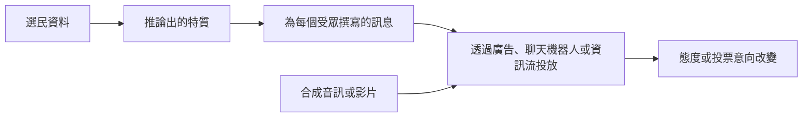

# AI、選舉與民主

生成式 AI 能撰寫具說服力的政治訊息、依個別選民量身調整內容，還能製作逼真的候選人音訊與影片。本頁說明這些能力對民主選舉的意義、目前實驗發現了什麼，以及已經採行哪些規範與平台政策。虛假內容的運作機制已在[錯誤資訊與深偽](../misinformation/index.md)一頁說明，這裡不再重複。

!!! info "屬於法律、政策與治理"
    本頁隸屬於[法律、政策與治理](index.md)。它討論的是民主面臨的風險；上層頁面則涵蓋各項法律制度。

## 概述

選舉仰賴兩件事，而 AI 正對這兩者造成壓力：選民能否從共享的資訊形成意見，以及候選人之間的競爭是否大致公平。最受關注的有三種用途。競選團隊可以用模型大量產出具說服力的文字、把訊息對應到選民畫像，並以對話的口吻回應公眾提問。惡意行為者則可能製作候選人的深偽內容或捏造新聞。研究人員與民調機構也可能用模型模擬問卷受訪者，這會影響公眾意見的測量方式。

證據並不一致。多項實驗顯示，AI 撰寫的政治訊息確實能改變受試者表達的意見，但也有多項研究發現，個人資料帶來的額外效果很小。深偽研究則指出，它最常造成的效果是不確定感，而非直接相信。多數證據來自問卷與線上實驗，而非真實競選，因此對實際選舉的影響有多大，目前仍不清楚。部分研究者認為，對生成式 AI 與錯誤資訊的疑慮可能被高估（Simon et al., 2023）。

## 關鍵概念

- **政治說服（political persuasion）**：透過訊息改變一個人表達的態度或投票意向。實驗通常以對某項政治主張的同意程度變化來衡量。
- **微目標（microtargeting）**：針對個人或小群體量身傳遞訊息，依據的資料包括人口特徵、網路行為或推論出的人格特質。
- **深偽（deepfake）**：對真實人物製作的合成音訊或影片（參見[錯誤資訊與深偽](../misinformation/index.md)）。在選舉中，典型情況是候選人被剪輯成說了或做了他們沒有做的事。
- **說謊者紅利（liar's dividend）**：把真實證據說成假的能力。它對選舉很重要，因為被錄到不當言行的候選人，可以主張錄影是合成的。
- **矽樣本（silicon sample）**：由語言模型模擬產生的問卷回答，模型以真實人群的人口統計描述為條件。
- **政治廣告規範（political advertising rules）**：關於誰可以購買政治廣告，以及廣告是否必須揭露其製作或投放方式的法律與平台規定。

## 運作方式

AI 會在四個環節進入選舉過程，每個環節的證據基礎不同。

1. **訊息生產。** 模型能快速寫出同一政治訊息的多種版本，而且文字流暢。Goldstein et al.（2024）在問卷實驗中發現，GPT-3 生成的文字與真實的外國宣傳幾乎一樣具說服力，而人工稍作編輯後說服力更高。Kreps et al.（2020）則發現，受試者幾乎無法分辨 GPT-2 生成的新聞與人類撰寫的新聞，而且黨派立場會影響他們對新聞可信度的判斷。
2. **個人化。** 把訊息與個人資料結合，原則上可以針對選民的心理特質。Matz et al.（2017）顯示，依據大群體的心理特徵調整訴求，可以是有效的說服方式。Simchon et al.（2024）發現，依人格量身設計的政治廣告，效果優於未個人化的廣告。Hackenburg and Margetts（2024）測試了依個人人口與政治資料量身撰寫的 GPT-4 訊息，發現整體而言，它們的說服力並未高於未量身設計的訊息。[^1] 這些分歧顯示，要衡量個人資料對說服的價值有多困難。
3. **對話式說服。** 聊天機器人能回答問題並與人辯論，其說服力可能勝過靜態廣告。Hackenburg et al.（2025）測試了 19 個語言模型、涵蓋 707 項政治議題，發現針對說服所做的後訓練與提示設計，所提升的效果大於個人化或模型規模。當說服效果增加時，主張的事實準確性反而下降。[^2]
4. **合成媒體。** 深偽會改變選民判斷證據的方式。Vaccari and Chadwick（2020）發現，看過政治深偽影片的受試者，比較可能感到不確定，而不是被誤導；這種不確定感又降低了他們對社群媒體新聞的信任。Barari et al.（2025）則發現，政治深偽的可信度與其他形式的虛假政治內容大致相當，有時甚至與真實媒體相當。

綜合來看，研究指向一個模式。最穩健的發現是：AI 幾乎不需成本就能大量產出具說服力的文字。個人化與深偽的效果則較小，也較有爭議；它們在真實選舉中的實際影響，尚未有直接測量。

## 關鍵方法

重要研究採用四種研究設計。每一種回答的問題不同，而且都沒有直接測量真實選舉中的投票結果。

| 設計 | 代表研究 | 測量內容 | 主要限制 |
|---|---|---|---|
| 針對 AI 撰寫訊息的問卷實驗 | Goldstein et al.（2024）；Hackenburg et al.（2024）；Hackenburg et al.（2025） | 閱讀訊息後，對某政治主張的同意程度 | 效果為短期；線上樣本未必代表真實選民 |
| 微目標實驗 | Hackenburg and Margetts（2024）；Simchon et al.（2024）；Matz et al.（2017） | 個人資料是否增加說服效果 | 結果取決於推論出的特質；小效果難以偵測 |
| 深偽可信度實驗 | Vaccari and Chadwick（2020）；Barari et al.（2025） | 觀看後的信念、不確定感與對新聞的信任 | 問卷中的判斷，未必與社群資訊流中的接觸相同 |
| 矽樣本 | Argyle et al.（2023） | 模擬受訪者是否能重現真實次群體的回答 | 效果取決於匹配程度；偏誤可能隱藏在平均值之中 |

## 與其他主題的連結

- 捏造媒體、偵測與來源證明的機制，見[錯誤資訊與深偽](../misinformation/index.md)。虛假消息為何傳播得快，則見[假新聞如何擴散](../misinformation/spread-of-false-news.md)。
- 個人資料是微目標的原料。Kosinski et al.（2013）顯示，Facebook 的「讚」能預測政治立場與其他敏感特質，這使本頁與[隱私與資料保護](../privacy/index.md)相連。
- 語言模型本身可能帶有政治傾向。Potter et al.（2024）發現，數個模型在模擬投票中偏好美國某一位總統候選人，相關討論見[倫理與公平](../ethics/index.md)。
- 讓這些方法奏效的信任、情緒與說服心理，見[心理學與 AI](../../brain-mind/psychology/index.md)。
- 模擬受訪者也對實證社會科學提出問題，見[社會科學](../../applications/social-science/index.md)。

## 應用

- **競選操作。** 草擬文案、翻譯與選民接觸是最常見的用途。上述證據中，關於內容生成的部分最為成熟。
- **測量公眾意見。** Argyle et al.（2023）顯示，以人口背景描述為條件的 GPT-3，能重現許多人類次群體的回答模式。民調機構與研究人員把矽樣本當作低成本的前導工具來測試，但使用前必須與真實受訪者比對。
- **事實查核與選務。** 新聞編輯室與官方單位使用查證流程，由模型協助找出值得查核的主張，最後的判斷由人負責（見[錯誤資訊與深偽](../misinformation/index.md)）。

### 規範與平台政策

選舉法與平台規定是處理這些風險的主要工具，但因國家與公司而異。有些司法管轄區在選舉前的特定期間內，禁止具欺騙性的候選人深偽內容；另一些則要求揭露經 AI 修改的政治內容。各平台也會自行訂定政治廣告、冒充候選人與合成媒體標示的規則，而且這些規則變動頻繁。各國的做法已在[上層頁面](index.md)摘要說明。

標示並非中性的解方。Altay and Gilardi（2024）發現，把標題標示為 AI 生成，會降低讀者對它的準確性判斷，以及分享它的意願，無論標題是真是假；其效果約為標示為「假」的三分之一。[^3] 因此，標示會帶來副作用，政策必須加以權衡。

## 開放問題

- 在一次性問卷實驗中測得的效果，能否延續到真實競選？在真實競選中，選民會在數週內看到許多訊息與反駁。
- 相對於一般說服，微目標的效果有多大？上述兩項微目標研究對個人資料的價值得出了不同結論。
- 說謊者紅利是否會改變選舉結果，還是只影響信任程度？Vaccari and Chadwick（2020）的不確定感發現指向後者，但關於選票的證據仍然有限。
- 當 AI 標示降低了對正確內容的信任時，是否仍應強制要求標示？答案取決於標示的設計方式。
- 矽樣本能否用於民調？若真實受訪者已被取代，要如何察覺？
- 具說服力的聊天機器人，能否在不喪失說服力的前提下減少不實主張？Hackenburg et al.（2025）指出，兩者之間存在取捨。

[^1]: Hackenburg and Margetts（2024）報告，微目標訊息的平均態度變化為 4.83 個百分點，非微目標訊息為 6.20 個百分點，差異未達統計顯著（P = 0.226）。Simchon et al.（2024）對依人格量身設計的廣告得出不同結論，因此兩項研究應併同閱讀。
[^2]: Hackenburg et al.（2025）報告，後訓練最多使說服力提升 51%，提示設計最多提升 27%。這些是某一實驗情境中的相對數字，不應被理解為對真實投票的效果。
[^3]: Altay and Gilardi（2024）報告，AI 標示的效果只有把標題標示為假的效果的三分之一。其受試者為美國與英國的線上樣本，因此結果並不描述真實資訊流中的標示。

## 參考資料

### 開創性論文

- Kosinski, M., Stillwell, D. & Graepel, T. (2013). Private traits and attributes are predictable from digital records of human behavior. *PNAS*. https://doi.org/10.1073/pnas.1218772110 — 顯示 Facebook 的「讚」能從大型自願者樣本中，預測包括政治立場在內的敏感特質。
- Matz, S. C., Kosinski, M., Nave, G. & Stillwell, D. J. (2017). Psychological targeting as an effective approach to digital mass persuasion. *PNAS*. https://doi.org/10.1073/pnas.1710966114 — 主張依大群體的心理特徵調整說服訴求可以有效，並討論其政策風險。
- Kreps, S., McCain, R. M. & Brundage, M. (2020). All the News That's Fit to Fabricate: AI-Generated Text as a Tool of Media Misinformation. *Journal of Experimental Political Science*. https://doi.org/10.1017/XPS.2020.37 — 三項實驗顯示，人們難以分辨 GPT-2 生成與人類撰寫的新聞，且黨派立場會影響可信度判斷。
- Vaccari, C. & Chadwick, A. (2020). Deepfakes and Disinformation: Exploring the Impact of Synthetic Political Video on Deception, Uncertainty, and Trust in News. *Social Media + Society*. https://doi.org/10.1177/2056305120903408 — 英國受試者的實驗顯示，政治深偽主要造成不確定感，並降低對新聞的信任。
- Goldstein, J. A. et al. (2024). How persuasive is AI-generated propaganda? *PNAS Nexus*. https://doi.org/10.1093/pnasnexus/pgae034 — 經預先註冊的問卷實驗，比較 GPT-3 文字與外國宣傳，並檢驗人工編輯的效果。
- Hackenburg, K. & Margetts, H. (2024). Evaluating the persuasive influence of political microtargeting with large language models. *PNAS*. https://doi.org/10.1073/pnas.2403116121 — 以 8,587 名受試者進行隨機對照實驗，測試依個人人口與政治資料量身撰寫的 GPT-4 訊息。
- Simchon, A., Edwards, M. & Lewandowsky, S. (2024). The persuasive effects of political microtargeting in the age of generative artificial intelligence. *PNAS Nexus*. https://doi.org/10.1093/pnasnexus/pgae035 — 研究顯示，依人格量身設計的政治廣告優於未個人化的廣告，且此類廣告可自動生成。
- Hackenburg, K. et al. (2025). The Levers of Political Persuasion with Conversational AI. arXiv preprint. https://arxiv.org/abs/2507.13919 — 以 19 個語言模型進行三項實驗，比較說服效果的驅動因素與其主張的事實準確性。
- Hackenburg, K. et al. (2024). Evidence of a log scaling law for political persuasion with large language models. arXiv preprint. https://arxiv.org/abs/2406.14508 — 以 24 個模型進行問卷實驗，顯示說服力隨模型規模增加而大幅遞減。
- Argyle, L. P. et al. (2023). Out of One, Many: Using Language Models to Simulate Human Samples. *Political Analysis*. https://doi.org/10.1017/pan.2023.2 — 顯示以人口背景描述為條件的 GPT-3，能重現人類次群體的回答模式。

### 文章與官方文件

- Barari, S., Lucas, C. & Munger, K. (2025). Political Deepfakes Are as Credible as Other Fake Media and (Sometimes) Real Media. *The Journal of Politics*. https://doi.org/10.1086/732990 — 問卷實驗，比較政治深偽與其他假媒體及真實媒體的可信度。
- Potter, Y. et al. (2024). Hidden Persuaders: LLMs' Political Leaning and Their Influence on Voters. arXiv preprint. https://arxiv.org/abs/2410.24190 — 顯示語言模型偏向美國某一位總統候選人，且與模型交談後，部分選民的支持度出現改變。
- Simon, F. M., Altay, S. & Mercier, H. (2023). Misinformation reloaded? Fears about the impact of generative AI on misinformation are overblown. *Harvard Kennedy School Misinformation Review*. https://doi.org/10.37016/mr-2020-127 — 整理傳播學、認知科學與政治學的證據，主張對生成式 AI 錯誤資訊的擔憂被誇大。
- Altay, S. & Gilardi, F. (2024). People are skeptical of headlines labeled as AI-generated, even if true or human-made, because they assume full AI automation. *PNAS Nexus*. https://doi.org/10.1093/pnasnexus/pgae403 — 兩項經預先註冊的實驗，探討 AI 標示如何改變讀者對準確性的判斷與分享意願。
