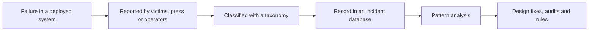

# AI Incident Databases and Case Studies

AI incident databases record real cases in which an AI system caused harm or failed, so that designers, researchers and regulators can learn from failures that have already happened. The main tools are a shared vocabulary for describing incidents, public collections such as the AI Incident Database and the OECD AI Incidents Monitor, and reporting duties that some laws now place on developers.

!!! info "Part of Law, Policy & Governance"
    This page belongs to [Law, Policy & Governance](index.md). It explains one governance tool in detail; the parent page covers the wider legal landscape.

## Overview

Mature safety fields keep records of their failures, as aviation does with accident reports. McGregor (2020) makes the same comparison for AI: intelligent systems cause real-world harm without a collective memory of their failings, so companies repeat the same mistakes in design, development and deployment. The AI Incident Database was started to build that memory as a public, searchable collection of reported failures.

Benchmarks test conditions that builders anticipated; incidents show what happened when a system met real users. For the anticipatory side, see [Dangerous capability evaluations](../safety-alignment/dangerous-capability-evals.md).

## Key concepts

- **AI incident**: a harm that has happened and in which an AI system played a role. The OECD (2024) separates this from an **AI hazard**, a plausible risk that has not yet caused harm.
- **Taxonomy**: a set of categories for describing incidents, such as the type of harm, the sector, the kind of system or the apparent cause.
- **Epistemic uncertainty**: the gap between what is known about an incident and what full classification would require, such as its true cause or the internal workings of the system. Paeth et al. (2024) argue that this uncertainty is unavoidable in incident reporting and must be managed.

## How it works

Incident data pass through a chain of steps, and each step filters what the final record contains.

1. **Occurrence and reporting.** An incident enters the record only if someone notices and reports it, so quiet harms are under-represented.
2. **Classification.** Curators apply a taxonomy. Paeth et al. (2024) apply two independent taxonomies to the same incidents and report structural ambiguities, such as unclear causes or uncertain severity, that make classification hard.
3. **Analysis.** Counts and patterns are the main output. Wei and Zhou (2022) analysed the AI Incident Database by content and found 13 application areas where unethical AI use appears, led by service robots, language and vision models, and autonomous driving.

A database is therefore a sample of reported failures, not a measure of how often AI fails.[^1]

## Key methods

Four approaches to organising AI failures are compared below. They answer different questions.

| Approach | What it records | Main strength | Main limitation |
|---|---|---|---|
| AI Incident Database (McGregor, 2020) | Public reports of real AI failures, searchable by facets and full text | Broad, open coverage of real cases | Depends on reporting and press attention; classification is uncertain |
| OECD AI Incidents Monitor (OECD, 2024) | Incidents from public sources, using OECD definitions of incident and hazard | Shared definitions that work across jurisdictions | Each jurisdiction decides what falls in scope, so counts are not directly comparable |
| Sociotechnical harms taxonomy (Shelby et al., 2022) | Types of harm from algorithmic systems, drawn from a scoping review of 172 papers | Helps practitioners anticipate harms before they occur | Built from research literature rather than observed cases |
| Language-model risk taxonomy (Weidinger et al., 2021) | 21 risks of large language models in six areas | A structured map of how language models can cause harm | Focused on one class of model, and written before many later deployment failures |

A larger effort, the AI Risk Repository (Slattery et al., 2024), finds that human decisions cause nearly as many of its 1,725 catalogued risks (38%) as the AI systems themselves (42%).

## Connections

- **Evaluation and safety.** Pre-deployment tests try to anticipate failures; incidents show which ones were missed. See [Safety & Alignment](../safety-alignment/index.md).
- **Bias.** Many documented failures are disaggregated errors, where overall accuracy hid large gaps between groups. See [Case Studies in Algorithmic Bias](../ethics/bias-case-studies.md).
- **Feedback.** Some failures grow because a system's own outputs change the data it learns from. See [Runaway feedback loops](../surveillance/runaway-feedback-loops/index.md).
- **Brain and mind.** Incident collections can mislead for a psychological reason. Vivid, widely reported failures are easier to recall than common, quiet ones, the kind of judgement error described in [Heuristics and biases](../../brain-mind/cognitive-science/heuristics-and-biases/index.md). Treating a database as a frequency count falls into that trap.

## Applications

- **Monitoring by governments.** The OECD AI Incidents Monitor gathers public reports under shared definitions.
- **Reporting duties in law.** Anderljung et al. (2023) argue that frontier developers should face registration and reporting requirements, and should monitor and respond to new information about capabilities and uses after deployment. The EU AI Act sets incident-reporting duties for general-purpose models with systemic risk, and California's SB 53 (2025) requires safety-incident reporting for frontier developers. Current dates and details are on the [parent page](index.md).

### Lessons from notable failures

- **Concentration.** Systems with physical consequences, such as autonomous vehicles, appear often in the record.
- **Feedback loops.** Ensign et al. (2017) show that a predictive policing system can keep sending police back to the same areas, because its own deployment generates the data it learns from. Reported incidents only reduce the effect; changing the system's inputs is needed to remove it.
- **Unverified outputs.** Dahl et al. (2024) find that language models hallucinate often on specific, checkable questions about court cases.[^2] This is the failure behind reported court filings that cited cases that do not exist (see [AI in Law](../../applications/law/index.md)). The lesson for professional use is to check every citation against its primary source.
- **Hidden disparities.** Many cases were found by outsiders who split results by group, after overall accuracy had looked acceptable.

## Open questions

- **Coverage.** Which harms are reported, and by whom? A database built from news coverage over-represents failures that attract attention.
- **Definitions.** Can the OECD distinction between incidents and hazards be applied the same way across countries and sectors?
- **Uncertain facts.** How should a record be written when its cause is unknown or disputed? Paeth et al. (2024) propose mitigations, but no settled practice has emerged.
- **Thresholds.** What severity should trigger a reporting duty, and who decides? These questions connect to the debate on compute thresholds in [Compute Governance and Export Controls](compute-governance.md).
- **Private failures.** Serious failures often stay inside companies. How can reporting reach them without exposing trade secrets?

[^1]: McGregor (2020) reports more than 1,000 incident reports archived at the time of the preprint. The database has grown since, so check its current totals before quoting a number.
[^2]: The rates in Dahl et al. (2024) apply to specific, verifiable questions about federal court cases and vary strongly between models. They should not be read as a general failure rate for legal work.

## References

### Seminal papers

- McGregor, S. (2020). *Preventing Repeated Real World AI Failures by Cataloging Incidents: The AI Incident Database*. arXiv preprint. https://arxiv.org/abs/2011.08512 — Introduces the AI Incident Database as a shared record of real AI failures.
- Weidinger, L. et al. (2021). *Ethical and social risks of harm from Language Models*. arXiv preprint. https://arxiv.org/abs/2112.04359 — Maps 21 risks of large language models across six areas, with mitigations.
- Shelby, R. et al. (2022). *Sociotechnical Harms of Algorithmic Systems: Scoping a Taxonomy for Harm Reduction*. arXiv preprint. https://arxiv.org/abs/2210.05791 — Scoping review of 172 papers yielding a five-theme harm taxonomy.
- Ensign, D. et al. (2017). *Runaway Feedback Loops in Predictive Policing*. arXiv preprint. https://arxiv.org/abs/1706.09847 — Explains how predictive policing enters a feedback loop and how to stop it.
- Anderljung, M. et al. (2023). *Frontier AI Regulation: Managing Emerging Risks to Public Safety*. arXiv preprint. https://arxiv.org/abs/2307.03718 — Proposes registration, reporting and monitoring duties for frontier AI developers.

### Articles and documentation

- OECD (2024). *Defining AI incidents and related terms*. OECD Artificial Intelligence Papers, No. 16. https://doi.org/10.1787/d1a8d965-en — Defines AI incidents as realized harms and AI hazards as potential ones.
- Slattery, P. et al. (2024). *The AI risk repository: A meta-review, database, and taxonomy of risks from artificial intelligence*. arXiv preprint. https://arxiv.org/abs/2408.12622 — Catalogues 1,725 risks from 74 frameworks in one taxonomy.
- Paeth, K. et al. (2024). *Lessons for Editors of AI Incidents from the AI Incident Database*. arXiv preprint. https://arxiv.org/abs/2409.16425 — Reviews 750+ incidents, identifying ambiguities that complicate incident indexing.
- Wei, M. & Zhou, Z. (2022). *AI Ethics Issues in Real World: Evidence from AI Incident Database*. arXiv preprint. https://arxiv.org/abs/2206.07635 — Content analysis of the database, finding 13 areas and eight forms of ethical issue.
- Dahl, M. et al. (2024). *Large Legal Fictions: Profiling Legal Hallucinations in Large Language Models*. arXiv preprint. https://arxiv.org/abs/2401.01301 — Measures legal hallucinations in large language models on verifiable case questions.
