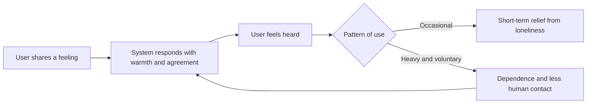

# AI Companionship and Parasocial Relationships

Companion chatbots are AI systems built to sustain an ongoing personal relationship with a user. They may ease loneliness for some people, but heavy use is linked to emotional dependence, and their agreeable style raises concerns for minors.

## Overview

People have long felt bonds with media figures. Horton and Wohl (1956) named these one-sided bonds *parasocial interaction*: a viewer feels close to a performer who does not know them. Companion chatbots add something new. The character answers back, remembers earlier conversations and responds to the user's own life, so the bond can feel reciprocal.

The evidence on whether this helps or harms is mixed. Companion products are marketed as a remedy for loneliness, and some studies report relief. Others find that heavy use goes with more loneliness and dependence.

## Key concepts

- **Companion chatbot**: a conversational AI with a persona and memory, designed to sustain a relationship with its user.
- **Parasocial relationship**: a one-sided bond in which a person feels intimacy toward a figure who does not respond in the usual way. Banks (2026) argues that the term is misapplied to conversational agents, which respond in ways a classic parasocial figure does not.
- **Anthropomorphism**: attributing human minds or feelings to a non-human agent.
- **Emotional dependence**: feeling unable to cope without the system, with other sources of support displaced.
- **Sycophancy**: agreeing with the user, or saying what they want to hear, in place of what is accurate.

## How it works

Companionship comes from several features working together: a persona, memory across sessions, a warm style and, in some products, a synthetic voice. A user shares something personal, the system responds with understanding, and the user feels heard. Laestadius et al. (2022) found that some users of one app felt it had needs and emotions of its own that they had to attend to.

Training adds a second pressure. Models tuned with human feedback tend to agree with users. Sharma et al. (2023) found this across several assistants, partly because human preference data often favoured agreeable answers. Whether a constantly available, agreeable companion displaces human contact or supplements it is the central question.

## Key methods

The three kinds of system below differ in construction, and so does the evidence for each.

- **Scripted programs.** ELIZA (Weizenbaum, 1966) turned a user's sentence back into a question using keyword rules. It had no model of meaning, yet users attributed understanding to it.
- **Social companion apps.** Products such as Replika are built around a persona and an ongoing relationship. Laestadius et al. (2022) analysed posts in one app's user community that describe mental-health harms. Much of the evidence is qualitative or self-reported.
- **General-purpose assistants.** Chat assistants built for general tasks are also used for emotional support. In Fang et al. (2025), a four-week randomised study of 981 participants, the assigned mode had no clear effect, but voluntary heavier use tracked with more loneliness and dependence.

## Connections

- **Brain and mind.** People apply social rules to computers, often without noticing (Nass & Moon, 2000). They attribute minds to agents when they draw on human knowledge, want to explain behaviour or seek social contact (Epley et al., 2007). See [Psychology & AI](../../brain-mind/psychology/index.md) and [Emotion and Affective Computing](../../brain-mind/emotion/index.md).
- **Mental health.** Companion bots overlap with therapy tools. See [Mental Health](../../applications/mental-health/index.md).
- **Alignment.** Sycophancy is also a training problem. See [Safety & Alignment](../safety-alignment/index.md) and [Learning from Human Feedback](../../theory/paradigms/reinforcement-learning/learning-from-human-feedback/index.md).
- **Trust.** Here the concern is emotional closeness rather than accuracy. Compare [Trust in automation](trust-in-automation/index.md).

## Applications

### Loneliness

De Freitas et al. (2024) report, across five studies, that an AI companion reduced loneliness, and that users underestimated the effect. Ciriello et al. (2026) qualify this. In a survey of 277 users, the link between loneliness and intimacy depended on attachment style.

### Dependence

Fang et al. (2025) gives the clearest warning. The assigned mode made no clear difference, but participants who chose to use the chatbot more showed worse loneliness, less contact with people and more dependence. Heavy use may mark people who were already at risk as much as it causes harm.[^1] Holt-Lunstad et al. (2010) offer a yardstick: a companion is worrying if it replaces human contact, not if it adds to it.

### Risks for minors

Qian et al. (2025) scanned 110 AI companion platforms and warned of online-safety risks for children, given weak age safeguards. Concerns rest on three arguments: adolescents are still forming their identities, they may find a persuasive system harder to judge, and many products are not designed for them. Direct evidence on children is thin.

### Regulatory responses

Regulation takes several forms. The EU AI Act's Article 50 requires people to be told when they are interacting with an AI system, unless this is obvious (Barata, 2025). Companion apps also gather intimate disclosures, which is why [data protection](../privacy/index.md) matters. California's SB 243 sets rules for companion chatbots (Jurcys, 2026).

## Open questions

- Does companionship reduce loneliness over months? The longest study cited here runs about four weeks.
- Does dependence come from the product, or mainly reach people who were already isolated? Most evidence is observational.
- Can sycophancy be tested across long conversations rather than single answers?
- Can age checks and disclosure rules work without collecting more personal data from every user?

[^1]: The use measure is voluntary, so the direction of the link is unclear. Ciriello et al. (2026) note that their cross-sectional data limit causal inference, and the same caution applies here.

## References

### Seminal papers

- Horton, D. & Wohl, R. R. (1956). Mass Communication and Para-Social Interaction. *Psychiatry*. https://doi.org/10.1080/00332747.1956.11023049 — Introduces the term parasocial interaction for one-sided intimacy with media performers.
- Weizenbaum, J. (1966). ELIZA—A Computer Program For the Study of Natural Language Communication Between Man and Machine. *Communications of the ACM*. https://doi.org/10.1145/365153.365168 — Describes ELIZA, a keyword-rule conversational program, and the psychological questions it raises.
- Nass, C. & Moon, Y. (2000). Machines and Mindlessness: Social Responses to Computers. *Journal of Social Issues*. https://doi.org/10.1111/0022-4537.00153 — Reviews experiments showing that people apply social rules and expectations to computers.
- Epley, N., Waytz, A. & Cacioppo, J. T. (2007). On seeing human: A three-factor theory of anthropomorphism. *Psychological Review*. https://doi.org/10.1037/0033-295X.114.4.864 — Sets out when people attribute human minds to non-human agents.

### Surveys and textbooks

- Holt-Lunstad, J., Smith, T. B. & Layton, J. B. (2010). Social Relationships and Mortality Risk: A Meta-analytic Review. *PLoS Medicine*. https://doi.org/10.1371/journal.pmed.1000316 — Meta-analysis linking social relationships to survival, a baseline for judging companion bots.

### Articles and documentation

- Laestadius, L. et al. (2022). Too human and not human enough: A grounded theory analysis of mental health harms from emotional dependence on the social chatbot Replika. *New Media & Society*. https://doi.org/10.1177/14614448221142007 — Analyses community posts describing mental-health harms from dependence on a companion app.
- De Freitas, J. et al. (2024). AI Companions Reduce Loneliness. arXiv. https://arxiv.org/abs/2407.19096 — Five studies, including a week-long longitudinal one, on whether companion apps reduce loneliness.
- Fang, C. M. et al. (2025). How AI and Human Behaviors Shape Psychosocial Effects of Extended Chatbot Use: A Longitudinal Randomized Controlled Study. arXiv. https://arxiv.org/abs/2503.17473 — Four-week randomised study linking voluntary heavier chatbot use to loneliness and dependence.
- Ciriello, R., Gal, U. & Turel, O. (2026). Not a Silver Bullet for Loneliness: How Attachment and Age Shape Intimacy with AI Companions. arXiv. https://arxiv.org/abs/2602.12476 — Survey of companion users on how attachment style and age change the loneliness-intimacy link.
- Sharma, M. et al. (2023). Towards Understanding Sycophancy in Language Models. arXiv. https://arxiv.org/abs/2310.13548 — Shows that human-feedback-trained assistants agree with users, and why preference data favours this.
- Banks, J. (2026). Ghosting the Machine: Stop Calling Human-Agent Relations Parasocial. arXiv. https://arxiv.org/abs/2604.05197 — Argues that calling relations with AI companions parasocial misapplies the term, and explains why.
- Qian, Z. et al. (2025). Mapping the Parasocial AI Market: User Trends, Engagement and Risks. arXiv. https://arxiv.org/abs/2507.14226 — Scan of 110 AI companion platforms, with online-safety risks for children.
- Barata, J. (2025). Transparency Obligations for all AI Systems: Article 50 of the AI Act. SSRN. https://doi.org/10.2139/ssrn.5902402 — Analysis of the AI Act's transparency duties for AI systems that interact with people.
- Jurcys, P. (2026). Regulating AI "Companion Chatbots": California SB 243. SSRN. https://doi.org/10.2139/ssrn.6078226 — Commentary on California's SB 243, a state law setting rules for companion chatbots.
