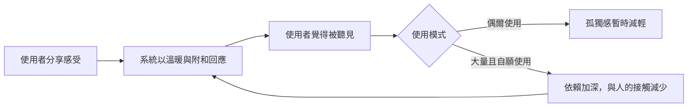

# AI 陪伴與準社會關係

陪伴型聊天機器人是指設計用來與使用者維持持續性個人關係的 AI 系統。它們可能讓部分人的孤獨感減輕，但長期大量使用與情緒依賴相關，而它們順從的風格也引起對未成年人的疑慮。

## 概述

人們向來會與媒體人物建立情感連結。Horton 與 Wohl（1956）將這類單向連結命名為*準社會互動*：觀眾會對一位不認識自己的表演者感到親近。陪伴型聊天機器人帶來一項新變化：角色會回應、會記得先前的對話，並回應使用者自己的生活，因此這種連結可能讓人覺得是相互的。

關於這是有益還是有害，證據尚不一致。陪伴類產品被宣傳為紓解孤獨的良方，有些研究也確實發現紓解效果。另一些研究則發現，大量使用與更強的孤獨感和依賴相關。

## 關鍵概念

- **陪伴型聊天機器人**：具有角色設定與記憶、旨在與使用者維持關係的對話式 AI。
- **準社會關係**：一種單向的連結，人對一個不會以通常方式回應的對象感到親密。Banks（2026）主張，這個詞被誤用於對話式代理，因為它們的回應方式與經典的準社會人物不同。
- **擬人化**：把人類的心智或情感歸給非人的行動者。
- **情緒依賴**：覺得沒有這個系統就無法應付，其他的支持來源因而被取代。
- **諂媚傾向（sycophancy）**：同意使用者的看法，或說出他們想聽的話，而不是準確的內容。

## 運作方式

陪伴感來自幾項特徵的共同作用：角色設定、跨對話的記憶、溫暖的語氣，以及部分產品中的合成語音。使用者分享個人的事，系統以理解回應，使用者便覺得自己被聽見了。Laestadius 等人（2022）發現，某款應用程式的部分使用者覺得它有自己的需求與情感，而他們必須加以照顧。

訓練過程帶來第二種壓力。以人類回饋調校的模型傾向於同意使用者。Sharma 等人（2023）在多個助理中發現了這種現象，部分原因在於人類偏好資料常偏好同意的答案。一個隨時可得、且總是附和的陪伴者，究竟是取代還是補充人與人之間的接觸，是核心問題。

## 主要方法

以下三類系統的建構方式不同，證據也因此不同。

- **腳本式程式**：ELIZA（Weizenbaum，1966）以關鍵字規則，把使用者的句子轉成問句。它沒有語意模型，使用者卻仍把理解歸給它。
- **社交陪伴應用程式**：Replika 等產品以角色設定與持續的關係為核心。Laestadius 等人（2022）分析某款應用程式使用者社群中描述心理健康傷害的貼文。大部分證據屬於質性或自我報告。
- **通用型助理**：為一般任務設計的聊天助理，也常被用來尋求情感支持。在 Fang 等人（2025）的研究中，這是一項為期四週、共 981 位參與者的隨機對照實驗。指定的互動模式沒有明顯效果，但自願大量使用則與更多孤獨感和依賴相關。

## 與其他主題的連結

- **大腦與心智。** 人會不自覺地把社會規則套用在電腦上（Nass 與 Moon，2000）。當人需要借用人類知識、想解釋行為或尋求社交接觸時，便會把心智歸給行動者（Epley 等人，2007）。見[心理學與 AI](../../brain-mind/psychology/index.md)與[情緒與情感運算](../../brain-mind/emotion/index.md)。
- **心理健康。** 陪伴型機器人與治療工具有所重疊。見[心理健康](../../applications/mental-health/index.md)。
- **對齊。** 諂媚傾向也是一個訓練問題。見[安全與對齊](../safety-alignment/index.md)與[從人類回饋學習](../../theory/paradigms/reinforcement-learning/learning-from-human-feedback/index.md)。
- **信任。** 這裡的疑慮在於情感上的親近，而不是準確度。可比較[自動化中的信任](trust-in-automation/index.md)。

## 應用

### 孤獨感

De Freitas 等人（2024）在五項研究中報告，AI 陪伴確實減輕了孤獨感，而且使用者低估了這個效果。Ciriello 等人（2026）則加以限定：在一項對 277 位使用者的調查中，孤獨感與親密感之間的關係取決於依附風格。

### 依賴

Fang 等人（2025）提出最明確的警訊。指定的互動模式沒有明顯差異，但自行選擇更常使用聊天機器人的參與者，孤獨感較嚴重、與人的接觸較少，依賴也較深。大量使用可能既是傷害的成因，也可能只是標示出原本就處於風險中的人。[^1] Holt-Lunstad 等人（2010）提供了一個衡量標準：若陪伴者取代了人與人之間的接觸，就值得擔憂；若只是增添，則不必然如此。

### 對未成年人的風險

Qian 等人（2025）檢視了 110 個 AI 陪伴平台，並警告在年齡防護薄弱的情況下，兒童會面臨網路安全風險。這些疑慮建立在三項論點上：青少年仍在形塑自我認同；他們可能較難判斷具有說服力的系統；許多產品原本就不是為他們設計的。關於兒童的直接證據仍然有限。

### 監管回應

監管的形式不只一種。歐盟 AI 法第 50 條要求，人在與 AI 系統互動時必須被告知，除非這一點顯而易見（Barata，2025）。陪伴應用程式也會收集高度私密的資訊，因此[資料保護](../privacy/index.md)很重要。加州的 SB 243 為陪伴型聊天機器人設定了規範（Jurcys，2026）。

## 開放問題

- 陪伴能否在數月之間持續減輕孤獨感？本頁引用的研究中，最長的一項約為四週。
- 依賴是來自產品本身，還是主要影響原本就孤立的人？大部分證據是觀察性的。
- 能否在長時間的對話中，而不只是單一回答中，檢驗諂媚傾向？
- 能否在不必向每位使用者收集更多個人資料的前提下，落實年齡查核與揭露規則？

[^1]: 使用量是自願的，因此關聯的方向並不清楚。Ciriello 等人（2026）指出，他們的橫斷面資料限制了因果推論，這裡同樣適用此提醒。

## 參考資料

### 開創性論文

- Horton, D. & Wohl, R. R. (1956). Mass Communication and Para-Social Interaction. *Psychiatry*. https://doi.org/10.1080/00332747.1956.11023049 — 首次提出準社會互動一詞，描述觀眾與媒體表演者之間的單向親密感。
- Weizenbaum, J. (1966). ELIZA—A Computer Program For the Study of Natural Language Communication Between Man and Machine. *Communications of the ACM*. https://doi.org/10.1145/365153.365168 — 描述 ELIZA，一個以關鍵字規則運作的對話程式，以及它所引發的心理學問題。
- Nass, C. & Moon, Y. (2000). Machines and Mindlessness: Social Responses to Computers. *Journal of Social Issues*. https://doi.org/10.1111/0022-4537.00153 — 回顧多項實驗，顯示人會把社會規則與期待套用在電腦上。
- Epley, N., Waytz, A. & Cacioppo, J. T. (2007). On seeing human: A three-factor theory of anthropomorphism. *Psychological Review*. https://doi.org/10.1037/0033-295X.114.4.864 — 提出人何時會把人類心智歸給非人的行動者。

### 綜述與教科書

- Holt-Lunstad, J., Smith, T. B. & Layton, J. B. (2010). Social Relationships and Mortality Risk: A Meta-analytic Review. *PLoS Medicine*. https://doi.org/10.1371/journal.pmed.1000316 — 後設分析，將社會關係與存活率連結起來，可作為評估陪伴型機器人的基準。

### 文章與文件

- Laestadius, L. et al. (2022). Too human and not human enough: A grounded theory analysis of mental health harms from emotional dependence on the social chatbot Replika. *New Media & Society*. https://doi.org/10.1177/14614448221142007 — 分析社群貼文，描述使用陪伴應用程式後所產生的依賴與心理健康傷害。
- De Freitas, J. et al. (2024). AI Companions Reduce Loneliness. arXiv. https://arxiv.org/abs/2407.19096 — 以五項研究（包括一項為期一週的縱貫研究）檢視陪伴應用程式能否減輕孤獨感。
- Fang, C. M. et al. (2025). How AI and Human Behaviors Shape Psychosocial Effects of Extended Chatbot Use: A Longitudinal Randomized Controlled Study. arXiv. https://arxiv.org/abs/2503.17473 — 為期四週的隨機對照實驗，連結自願大量使用聊天機器人與孤獨感及依賴。
- Ciriello, R., Gal, U. & Turel, O. (2026). Not a Silver Bullet for Loneliness: How Attachment and Age Shape Intimacy with AI Companions. arXiv. https://arxiv.org/abs/2602.12476 — 針對陪伴型 AI 使用者的調查，探討依附風格與年齡如何改變孤獨感與親密感之間的關係。
- Sharma, M. et al. (2023). Towards Understanding Sycophancy in Language Models. arXiv. https://arxiv.org/abs/2310.13548 — 顯示經人類回饋訓練的助理會附和使用者，並說明偏好資料為何偏好這種回答。
- Banks, J. (2026). Ghosting the Machine: Stop Calling Human-Agent Relations Parasocial. arXiv. https://arxiv.org/abs/2604.05197 — 主張把與 AI 陪伴者的關係稱為準社會關係是誤用，並說明原因。
- Qian, Z. et al. (2025). Mapping the Parasocial AI Market: User Trends, Engagement and Risks. arXiv. https://arxiv.org/abs/2507.14226 — 掃描 110 個 AI 陪伴平台，並探討兒童面臨的網路安全風險。
- Barata, J. (2025). Transparency Obligations for all AI Systems: Article 50 of the AI Act. SSRN. https://doi.org/10.2139/ssrn.5902402 — 分析歐盟 AI 法中，針對與人互動之 AI 系統的透明度義務。
- Jurcys, P. (2026). Regulating AI "Companion Chatbots": California SB 243. SSRN. https://doi.org/10.2139/ssrn.6078226 — 針對加州 SB 243 的評論，這是一部為陪伴型聊天機器人設定規範的州法。
