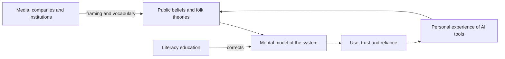

# AI Literacy and Public Understanding

AI literacy is the set of knowledge and skills that lets people understand, use and question AI systems. This page covers what the public believes about AI, how people form mental models of large language models, how literacy is defined and taught, and how media framing shapes all three.

!!! info "Part of Human-AI Interaction and Trust"
    This page belongs to [Human-AI Interaction and Trust](index.md). It looks at the trust question from the side of knowledge and public belief.

## Overview

Using an AI system well takes more than typing a prompt. A person needs some sense of what the system is doing, where it is likely to fail, and how its output should be checked. AI literacy is the name for this understanding. It has become a public concern as AI systems have moved into search, writing, health information and schooling.

Public understanding is the other side of the same question. What people believe about AI, from hopes of fast medical advances to fears of machines escaping human control, shapes which systems they accept and how they judge the claims of companies and the press. Research in this area asks how these beliefs form, how accurate they are, and whether teaching can improve them.

The topic draws on education research, cognitive psychology, communication studies and the philosophy of mind. Within [Human-AI Interaction and Trust](index.md) it sits beside the studies of overreliance, and the policy context is covered in [Law, Policy & Governance](../governance/index.md).

## Key concepts

- **AI literacy**: competencies that let a non-expert understand, use, evaluate and question AI systems. Most definitions include knowing what AI can and cannot do, and using it with judgement.
- **Mental model**: a person's simplified internal picture of how a system works, used to predict its behaviour and to decide how far to trust it.
- **Folk theory**: an informal, everyday explanation of a technology, built from experience and hearsay rather than from study.
- **Anthropomorphism**: attributing human qualities, such as beliefs, intentions or feelings, to a non-human system.
- **Framing**: the way an issue is presented, through the aspects that are emphasised and the labels that are used. Framing shapes how an audience understands the issue.

## How it works

Public understanding forms in a loop. Media, companies and institutions describe AI with particular frames and vocabulary. Readers combine these with their own experience of AI tools to form a mental model, which guides their use and trust. Their experience then feeds back into what they believe. Literacy education is an intervention in this loop: it aims to give people better models and the habit of testing them.

Two features make the loop hard to break. The first is language. Words such as "knows" or "believes" are natural shorthand for what a language model does, but they carry assumptions that may not hold. Shanahan (2022) argues that such terms, together with the human-like fluency of model output, encourage anthropomorphism, and he recommends reminding oneself how these systems actually work. Bender et al. (2021) make a related point: fluent text should not be taken as evidence of understanding.

The second is that expectations swing between excitement and disappointment. Mitchell (2021) argues that common assumptions among AI researchers lead to overconfident predictions. Fast and Horvitz (2016) trace the public side of these swings through three decades of *New York Times* coverage, tracking optimism, pessimism and specific concerns. Cave, Coughlan and Dihal (2019) show how popular stories about AI shape public responses to the technology.

## Key methods

Three approaches to literacy are compared below. Each starts from a different question.

| Approach | Core question | Typical output | Main reference |
|---|---|---|---|
| Competency framework | What should a literate person be able to do? | A list of competencies and design considerations | Long & Magerko (2020) |
| Curriculum guidelines | What should each grade learn about AI? | Big ideas and teaching resources | Touretzky et al. (2019) |
| Conceptual review | How is the term AI literacy used across studies? | A map of definitions and their components | Ng et al. (2021) |

Long and Magerko start from the learner and define competencies for non-experts. The curriculum approach starts from what schools teach at each level, and the review starts from the literature, which shows how little the field agrees on the term. A separate strand asks how to correct what people believe about one specific system. Kulesza et al. (2015) propose explaining an interactive machine-learning system to its users, so that they can form accurate mental models and correct the system when it goes wrong.

## Connections

- **Brain and mind.** Mental models are a core idea in cognitive science, and theory-of-mind research asks whether people attribute beliefs to machines. See the [psychology](../../brain-mind/psychology/index.md) overview, including [false-belief tests on language models](../../brain-mind/psychology/false-belief-llms/index.md), and the [cognitive science](../../brain-mind/cognitive-science/index.md) overview.
- **Misinformation.** Literacy is one response to false content, alongside technical detection. See [Misinformation and Deepfakes](../misinformation/index.md).
- **Interpretability.** Literacy is limited by what the systems can show about themselves. Methods for explaining models are covered in [Interpretability](../interpretability/index.md).
- **Trust and reliance.** Literacy is a partial remedy for overreliance, but knowledge alone does not guarantee appropriate reliance. See [Trust in automation](trust-in-automation/index.md) and [Cognitive forcing functions](cognitive-forcing/index.md).

## Applications

- **Schools and universities.** The AI for K-12 working group, formed by AAAI and CSTA, set out to define what students at each grade band should know about AI. Touretzky et al. (2019) describe that aim. See [Education](../../applications/education/index.md).
- **Public communication.** Entman (1993) defines framing as selecting aspects of a perceived reality and making them salient in a text. The same technology can be presented mainly as a risk or mainly as a benefit, depending on what is highlighted.
- **Workplace training.** People who use AI tools to draft or analyse need practical guidance on checking the output. The same need appears with [AI coding assistants](../../engineering/coding-assistants/index.md), where developers must decide whether to accept generated code.
- **Measuring public opinion.** Fast and Horvitz (2016) report that worries about loss of control, ethics and work grew in the period they studied, so literacy material may need to keep pace with public concerns.

## Open questions

- Does teaching people how a system works improve appropriate reliance, or does it mainly raise confidence in their own judgement?
- Which competencies should a literacy programme measure, and how can they be tested without rewarding memorised answers?
- How accurate do public beliefs about AI need to be for democratic decisions, and who decides what counts as accurate?
- Do the mental models people form of language models survive changes to the systems themselves?

## References

### Seminal papers

- Entman, R. M. (1993). Framing: Toward Clarification of a Fractured Paradigm. *Journal of Communication*. https://doi.org/10.1111/j.1460-2466.1993.tb01304.x — Defines framing as selecting aspects of reality and making them salient in a text.
- Long, D. & Magerko, B. (2020). What is AI Literacy? Competencies and Design Considerations. *CHI 2020*. https://doi.org/10.1145/3313831.3376727 — Defines AI literacy as competencies for non-experts and sets out design considerations for teaching it.
- Touretzky, D. et al. (2019). Envisioning AI for K-12: What Should Every Child Know about AI? *AAAI 2019*. https://doi.org/10.1609/aaai.v33i01.33019795 — Sets out the AI for K-12 working group's aim to define what each grade should learn about AI.
- Kulesza, T. et al. (2015). Principles of Explanatory Debugging to Personalize Interactive Machine Learning. *IUI 2015*. https://doi.org/10.1145/2678025.2701399 — Principles for explaining an interactive machine-learning system so users can form accurate mental models.

### Surveys and textbooks

- Ng, D. T. K. et al. (2021). Conceptualizing AI literacy: An exploratory review. *Computers and Education: Artificial Intelligence*. https://doi.org/10.1016/j.caeai.2021.100041 — Exploratory review of how researchers define AI literacy and which competencies they include.

### Articles and documentation

- Shanahan, M. (2022). Talking About Large Language Models. arXiv:2212.03551. https://arxiv.org/abs/2212.03551 — Argues that loaded words such as "knows" and "believes" encourage anthropomorphism of LLMs.
- Bender, E. M., Gebru, T., McMillan-Major, A. & Shmitchell, S. (2021). On the Dangers of Stochastic Parrots. *FAccT 2021*. https://doi.org/10.1145/3442188.3445922 — Argues that fluent language-model text should not be mistaken for understanding, and explains the risks of doing so.
- Fast, E. & Horvitz, E. (2016). Long-Term Trends in the Public Perception of Artificial Intelligence. arXiv:1609.04904. https://arxiv.org/abs/1609.04904 — Analyses thirty years of *New York Times* coverage of AI, tracking optimism, pessimism and specific concerns.
- Cave, S., Coughlan, K. & Dihal, K. (2019). "Scary Robots". *AIES 2019*. https://doi.org/10.1145/3306618.3314232 — Examines popular stories about AI and how they shape public responses to the technology.
- Mitchell, M. (2021). Why AI is Harder Than We Think. arXiv:2104.12871. https://arxiv.org/abs/2104.12871 — Describes four fallacies behind overconfident predictions about AI progress by researchers.
