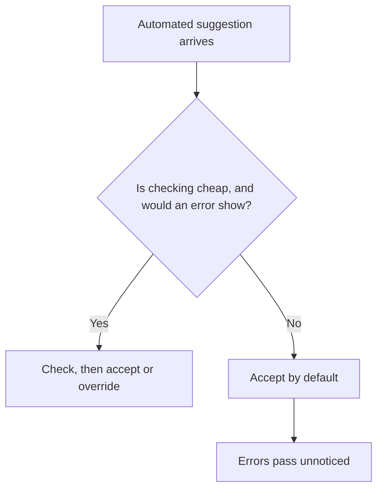

# Automation Bias and Overreliance

Automation bias is the tendency to accept an automated aid's suggestion in place of other evidence, including one's own judgement. Overreliance is the same tendency applied to AI output. Studies from aviation and medicine show that it predates language models.

## Overview

When a system is usually right, checking each output can look like wasted effort, and the people who stop checking also stop noticing when it is wrong. Early work on cockpit automation described this pattern. Later studies found it with clinical advisers and with generative AI, whose fluent answers are available for almost any task.

The topic belongs to [Human-AI Interaction and Trust](../index.md). It is close to [trust in automation](trust-in-automation/index.md), which asks how trust should match a system's reliability. Automation bias covers the case where that match fails and the output is accepted anyway.

## Key concepts

- **Automation bias**: a tendency to favour an automated aid's suggestion over other information, including one's own judgement. It produces omission errors (missing what the aid did not flag) and commission errors (acting on a wrong suggestion).
- **Overreliance**: accepting an AI output that is wrong, with too little checking. Parasuraman and Riley (1997) call the same pattern misuse of automation, which can cause monitoring failures and decision biases.
- **Calibration gap**: the difference between how confident people are in an LLM's answers and how confident the model is in them.
- **Out-of-the-loop problem**: a person who no longer does a task actively loses situation awareness and manual skill, and is slow to take over when the automation fails.
- **Cognitive offloading**: handing a mental task, such as remembering or reasoning, to an external tool. The concern is the skill that stops being practised.

## How it works

A person who receives a suggestion can check it, which costs time and attention, or accept it. Most suggestions are right, so accepting is usually a good bet, and people learn to accept by default. The sketch is simplified.

Buçinca, Malaya and Gajos (2021) argue that people rarely analyse each recommendation. They form general heuristics about when to follow the AI. This is the fast side of the dual-process account in the [psychology](../../brain-mind/psychology/index.md) overview, and the judgement shortcuts in [heuristics and biases](../../brain-mind/cognitive-science/heuristics-and-biases/index.md) are of the same kind.

Parasuraman and Manzey (2010) link the effect to attention. Complacency appears when manual tasks compete with the automated one, and automation bias appears when the aid is imperfect. Both occur in novices and experts, and training does not remove them.

The skill side has its own evidence. Endsley and Kiris (1995) found that operators who were passive during an automated navigation task lost situation awareness, and decided more slowly, when the automation failed.

## Key methods

Three designs have been tested for reducing overreliance without removing the aid.

| Approach | What it changes | What the studies found |
|---|---|---|
| Confidence displays and uncertainty expression | Shows how sure the system is, in a number, colour or words | In a pre-registered experiment with 404 participants, Kim et al. (2024) found that first-person phrases such as "I'm not sure, but..." reduced agreement with the system and raised accuracy, mainly by reducing overreliance on wrong answers. Spatharioti et al. (2023) found that colour-coded highlighting helped people catch errors. |
| Explanations | Shows why the system gave an output | Buçinca et al. (2021) note that explanations do not appear to reduce overreliance, and that some studies suggest they may increase it. Steyvers et al. (2025) found that longer LLM explanations raised confidence without raising accuracy. |
| Cognitive forcing | Requires the person to think before accepting | Buçinca et al. (2021) found that these designs significantly reduced overreliance, but participants rated them least favourably. See [cognitive forcing functions](cognitive-forcing/index.md). |

A signal helps only when it changes what the person does. A confident-sounding explanation can raise trust without raising accuracy.

## Connections

- **Brain and mind.** Automation bias is fast, pattern-based judgement winning over slower checking. See the [psychology](../../brain-mind/psychology/index.md) overview.
- **Parent topics.** The [trust in automation](trust-in-automation/index.md) page covers calibration, and the [human-AI interaction](../index.md) overview compares the landmark works.
- **Interpretability and safety.** Explanations for people are a design problem as well as a technical one ([Interpretability](../interpretability/index.md)). Human oversight protects only when the overseer can see errors ([Safety & Alignment](../safety-alignment/index.md)).
- **Ethics, work and learning.** Responsibility for a wrong recommendation is shared ([Ethics & Fairness](../ethics/index.md)). Skill effects are discussed in [Economics & Work](../economics/index.md) and [Education](../../applications/education/index.md).

## Applications

- **Aviation.** Casner et al. (2014) tested 16 airline pilots in a simulator. Instrument scanning and manual control were mostly intact, but the cognitive tasks of manual flying showed more problems.
- **Medicine.** Dratsch et al. (2023) found that less experienced radiologists were more likely than experienced ones to follow incorrect AI suggestions when reading mammograms. Budzyń et al. (2025) reported that the detection rate of colonoscopies without AI fell after AI was introduced.[^1] See [Healthcare](../../applications/healthcare/index.md).
- **LLM use.** In a randomised experiment, Spatharioti et al. (2023) found that people overrelied on wrong LLM answers, while accuracy matched traditional search when the answers were right.

## Open questions

- Do confidence displays keep their effect in real workflows, and does it last as users learn the system?
- Do skills lost to offloading or automation return when people work unaided again?
- How much of the skill loss in medicine is caused by AI, as opposed to changes in patients or practice?

[^1]: The Budzyń study is observational, so it cannot by itself show that AI exposure caused the drop. The authors describe it as a possible negative effect on endoscopist behaviour. Check the paper for the exact figures before quoting them.

## References

### Seminal papers

- Parasuraman, R. & Riley, V. (1997). Humans and Automation: Use, Misuse, Disuse, Abuse. *Human Factors*. https://doi.org/10.1518/001872097778543886 — Defines use, misuse, disuse and abuse of automation by human operators.
- Endsley, M. R. & Kiris, E. O. (1995). The Out-of-the-Loop Performance Problem and Level of Control in Automation. *Human Factors*. https://doi.org/10.1518/001872095779064555 — Shows that passive operators of an automated navigation task had low situation awareness after the automation failed.
- Sparrow, B., Liu, J. & Wegner, D. M. (2011). Google Effects on Memory: Cognitive Consequences of Having Information at Our Fingertips. *Science*. https://doi.org/10.1126/science.1207745 — Reports that people who can search for information remember where to find it more than the information itself.
- Buçinca, Z., Malaya, M. B. & Gajos, K. Z. (2021). To Trust or to Think: Cognitive Forcing Functions Can Reduce Overreliance on AI in AI-assisted Decision-making. *CSCW 2021*. https://arxiv.org/abs/2102.09692 — Experiment with 199 participants comparing cognitive forcing designs with explanation-based designs and a no-AI baseline.

### Surveys and textbooks

- Parasuraman, R. & Manzey, D. H. (2010). Complacency and Bias in Human Use of Automation: An Attentional Integration. *Human Factors*. https://doi.org/10.1177/0018720810376055 — Reviews studies of complacency and automation bias and proposes one attention-based model that accounts for both.

### Articles and documentation

- Casner, S. M., Geven, R. W., Recker, M. P. & Schooler, J. W. (2014). The Retention of Manual Flying Skills in the Automated Cockpit. *Human Factors*. https://doi.org/10.1177/0018720814535628 — Simulator study of airline pilots showing that instrument and control skills mostly survive automation, while cognitive manual-flying tasks do less well.
- Dratsch, T. et al. (2023). Automation Bias in Mammography: The Impact of Artificial Intelligence BI-RADS Suggestions on Reader Performance. *Radiology*. https://doi.org/10.1148/radiol.222176 — Study of radiologists reading mammograms with AI suggestions, in which less experienced readers followed incorrect suggestions most often.
- Budzyń, K. et al. (2025). Endoscopist deskilling risk after exposure to artificial intelligence in colonoscopy: a multicentre, observational study. *The Lancet Gastroenterology & Hepatology*. https://doi.org/10.1016/S2468-1253(25)00133-5 — Observational study from four Polish endoscopy centres, comparing colonoscopies without AI before and after AI was introduced.
- Kim, S. S. Y. et al. (2024). "I'm Not Sure, But...": Examining the Impact of Large Language Models' Uncertainty Expression on User Reliance and Trust. *FAccT 2024*. https://arxiv.org/abs/2405.00623 — Pre-registered experiment (N=404) on how uncertainty phrases in LLM answers change reliance and accuracy on medical questions.
- Steyvers, M. et al. (2025). What large language models know and what people think they know. *Nature Machine Intelligence*. https://doi.org/10.1038/s42256-024-00976-7 — Experiments on the gap between user confidence and model confidence, and on how explanation length changes it.
- Spatharioti, S. E. et al. (2023). Comparing Traditional and LLM-based Search for Consumer Choice: A Randomized Experiment. arXiv. https://arxiv.org/abs/2307.03744 — Randomised online experiments in which people overrelied on wrong LLM answers, and colour-coded highlighting helped them catch errors.
