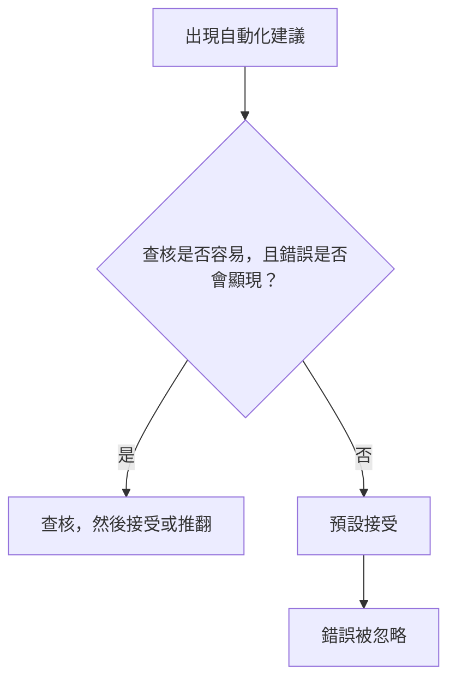

# 自動化偏誤與過度依賴

自動化偏誤是指人會接受自動化輔助工具的建議，而不採信其他證據，包括自己的判斷。過度依賴則是同一種傾向套用在 AI 輸出上。航空與醫療領域的研究顯示，這個現象早在語言模型出現之前就已存在。

## 概述

當一個系統通常是對的，逐一查核它的每個輸出看起來就像白費力氣，而停止查核的人也會不再注意它何時出錯。早期關於駕駛艙與製程自動化的研究描述過這種模式。之後的研究在臨床建議工具中也發現了它，接著又在生成式 AI 中發現，因為它流暢的回答幾乎任何任務都能取得。

本主題屬於[人機互動與信任](../index.md)。它與[自動化中的信任](../trust-in-automation/index.md)十分接近，後者探討信任應如何與系統的可靠度相符。自動化偏誤所涵蓋的，則是這種相符失敗、而輸出仍被接受的情況。

## 關鍵概念

- **自動化偏誤**：傾向於偏好自動化輔助工具的建議，勝過其他資訊，包括自己的判斷。它會產生遺漏型錯誤（沒有察覺輔助工具未標示的問題）與作為型錯誤（依照錯誤的建議行事）。
- **過度依賴**：接受一個錯誤的 AI 輸出，且查核不足。Parasuraman 與 Riley（1997）把同樣的模式稱為自動化的誤用，它可能導致監控失效與決策偏誤。
- **校準差距**：人對 LLM 答案的信心，與模型本身對這些答案的信心之間的差距。
- **脫離迴路問題**：一個人不再主動執行某項任務時，會失去情境意識與手動技能，並且在自動化失效時反應遲緩。
- **認知卸載**：把記憶或推理等心智工作交給外部工具。令人擔心的是那些不再被練習的技能。

## 運作方式

一個人收到建議時，可以查核它（這會花費時間與注意力），也可以直接接受。大多數建議是對的，因此接受通常是比較好的賭注，人們也因此逐漸養成預設接受的習慣。下圖是簡化的示意。

Buçinca、Malaya 與 Gajos（2021）主張，人很少會逐一分析每個建議，而是會形成關於何時該聽從 AI 的一般性捷思。這就是[心理學](../../brain-mind/psychology/index.md)總覽中雙歷程理論的快速那一側，而[捷思與偏誤](../../brain-mind/cognitive-science/heuristics-and-biases/index.md)中所描述的判斷捷徑，也屬於同一類。

Parasuraman 與 Manzey（2010）把這個效應與注意力連結起來。當手動工作與自動化工作競爭注意力時會出現自滿，而當輔助工具不完美時則會出現自動化偏誤。兩者在新手與專家身上都會發生，而且單純的練習與指示無法消除它們。

技能層面也有自己的證據。Endsley 與 Kiris（1995）發現，在一項自動化導航任務中被動的操作者，在自動化失效後失去了情境意識，判斷也變得較慢。

## 主要方法

有三種設計被測試過，目的是在不移除輔助工具的情況下降低過度依賴。

| 做法 | 改變了什麼 | 研究發現 |
|---|---|---|
| 信心顯示與不確定性表達 | 以數字、顏色或文字顯示系統有多確定 | 在一項有 404 位參與者的預先註冊實驗中，Kim 等人（2024）發現，「我不確定，但……」這類第一人稱說法，減少了人對系統答案的認同並提高了準確度，主要是因為減少了對錯誤答案的過度依賴。Spatharioti 等人（2023）發現，以顏色標示可能錯誤的內容，有助於人發現錯誤。 |
| 解釋 | 顯示系統為何給出某個輸出 | Buçinca 等人（2021）指出，解釋似乎無法減少過度依賴，而且有些研究認為它甚至可能增加過度依賴。Steyvers 等人（2025）發現，較長的 LLM 解釋提高了信心，卻沒有提高準確度。 |
| 認知強制 | 要求人在接受前先思考 | Buçinca 等人（2021）發現，這些設計顯著減少了過度依賴，但參與者對它們的評價最低。見[認知強制功能](../cognitive-forcing/index.md)。 |

只有當某個訊號改變了人的行為時，它才有幫助。一個聽起來很有把握的解釋，可能在沒有提高準確度的情況下提高信任。

## 與其他主題的連結

- **大腦與心智。** 自動化偏誤是快速、依樣式的判斷戰勝了較慢的查核。見[心理學](../../brain-mind/psychology/index.md)總覽。
- **上層主題。** [自動化中的信任](../trust-in-automation/index.md)頁面涵蓋校準，而[人機互動與信任](../index.md)總覽則比較各個里程碑式的研究。
- **可解釋性與安全。** 對人的解釋既是設計問題，也是技術問題（[可解釋性](../interpretability/index.md)）。只有當監督者能察覺錯誤時，人的監督才有保護作用（[安全與對齊](../safety-alignment/index.md)）。
- **倫理、工作與學習。** 對錯誤建議的責任是共同承擔的（[倫理與公平](../ethics/index.md)）。技能的影響則在[經濟與工作](../economics/index.md)與[教育](../../applications/education/index.md)中討論。

## 應用

- **航空。** Casner 等人（2014）在模擬機中測試了 16 位航空公司飛行員。儀表掃視與手動操控大致保持完好，但手動飛行中的認知任務表現出較多問題。
- **醫療。** Dratsch 等人（2023）發現，在閱讀乳房攝影時，經驗較少的放射科醫師比經驗豐富的同行更容易採納錯誤的 AI 建議。Budzyń 等人（2025）報告，在引入 AI 之後，未使用 AI 的大腸鏡檢查的偵測率下降了。[^1]見[醫療保健](../../applications/healthcare/index.md)。
- **LLM 的使用。** 在一項隨機化實驗中，Spatharioti 等人（2023）發現，人們會過度依賴錯誤的 LLM 答案；而當答案正確時，其準確度與使用傳統搜尋時相當。

## 開放問題

- 信心顯示在真實工作流程中是否仍然有效？當使用者逐漸熟悉系統後，效果是否會持續？
- 因卸載或自動化而流失的技能，當人重新獨立工作時能否恢復？
- 醫療中的技能流失，有多少是由 AI 造成的，又有多少是因病人或做法的改變？

## 參考資料

### 開創性論文

- Parasuraman, R. & Riley, V. (1997). Humans and Automation: Use, Misuse, Disuse, Abuse. *Human Factors*. https://doi.org/10.1518/001872097778543886 — 定義人類操作者對自動化的使用、誤用、棄用與濫用。
- Endsley, M. R. & Kiris, E. O. (1995). The Out-of-the-Loop Performance Problem and Level of Control in Automation. *Human Factors*. https://doi.org/10.1518/001872095779064555 — 顯示在自動化導航任務中被動的操作者，在自動化失效後情境意識偏低。
- Sparrow, B., Liu, J. & Wegner, D. M. (2011). Google Effects on Memory: Cognitive Consequences of Having Information at Our Fingertips. *Science*. https://doi.org/10.1126/science.1207745 — 指出能夠搜尋資訊的人，比起記住資訊本身，更會記住資訊可以在哪裡找到。
- Buçinca, Z., Malaya, M. B. & Gajos, K. Z. (2021). To Trust or to Think: Cognitive Forcing Functions Can Reduce Overreliance on AI in AI-assisted Decision-making. *CSCW 2021*. https://arxiv.org/abs/2102.09692 — 有 199 位參與者的實驗，比較認知強制設計、以解釋為基礎的設計與無 AI 的基準。

### 綜述與教科書

- Parasuraman, R. & Manzey, D. H. (2010). Complacency and Bias in Human Use of Automation: An Attentional Integration. *Human Factors*. https://doi.org/10.1177/0018720810376055 — 回顧關於自滿與自動化偏誤的研究，並提出一個以注意力為基礎、能同時解釋兩者的模型。

### 文章與文件

- Casner, S. M., Geven, R. W., Recker, M. P. & Schooler, J. W. (2014). The Retention of Manual Flying Skills in the Automated Cockpit. *Human Factors*. https://doi.org/10.1177/0018720814535628 — 針對航空公司飛行員的模擬機研究，顯示儀表與操控技能大致在自動化下保留，而手動飛行的認知任務保留較差。
- Dratsch, T. et al. (2023). Automation Bias in Mammography: The Impact of Artificial Intelligence BI-RADS Suggestions on Reader Performance. *Radiology*. https://doi.org/10.1148/radiol.222176 — 研究放射科醫師在 AI 建議下閱讀乳房攝影的情況，經驗較少的讀片者最常採納錯誤建議。
- Budzyń, K. et al. (2025). Endoscopist deskilling risk after exposure to artificial intelligence in colonoscopy: a multicentre, observational study. *The Lancet Gastroenterology & Hepatology*. https://doi.org/10.1016/S2468-1253(25)00133-5 — 來自波蘭四個內視鏡中心的觀察性研究，比較引入 AI 前後未使用 AI 的大腸鏡檢查。
- Kim, S. S. Y. et al. (2024). "I'm Not Sure, But...": Examining the Impact of Large Language Models' Uncertainty Expression on User Reliance and Trust. *FAccT 2024*. https://arxiv.org/abs/2405.00623 — 預先註冊的實驗（N=404），探討 LLM 答案中不同的不確定性用語如何改變醫療問題上的依賴與準確度。
- Steyvers, M. et al. (2025). What large language models know and what people think they know. *Nature Machine Intelligence*. https://doi.org/10.1038/s42256-024-00976-7 — 實驗探討使用者信心與模型信心之間的差距，以及解釋長度如何改變這個差距。
- Spatharioti, S. E. et al. (2023). Comparing Traditional and LLM-based Search for Consumer Choice: A Randomized Experiment. arXiv. https://arxiv.org/abs/2307.03744 — 隨機化的線上實驗，顯示人會過度依賴錯誤的 LLM 答案，而以顏色標示的提示有助於他們發現錯誤。

[^1]: Budzyń 的研究屬於觀察性研究，因此無法單憑它證明是 AI 的接觸造成了這個下降。作者將其描述為對內視鏡醫師行為可能的負面影響。引用確切數字前，請查閱原文。
