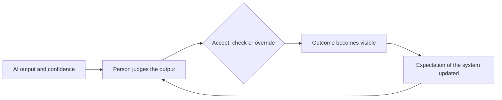

# Human-AI Interaction and Trust

Human-AI interaction studies how people use, trust, over-trust and are changed by AI systems. Its central question is when a person should rely on an AI output and when they should not.

## Overview

People have always had to decide whether to rely on machines they cannot fully inspect, from autopilots to spell checkers. AI systems raise the stakes. Their outputs are fluent and fast, their errors are often hard to see, and they are used in clinics, classrooms, offices and private conversations. The field asks what makes reliance on an AI system appropriate, why people sometimes accept wrong outputs, and how repeated use changes the people who use it.

The topic sits between engineering, psychology and design. Its judgement side draws on the [psychology](../../brain-mind/psychology/index.md) of decision-making, and its policy side is covered in [Law, Policy & Governance](../governance/index.md) and the wider [AI & Society](../index.md) overview.

## Key concepts

- **Trust**: a person's expectation that a system will help them reach a goal in a situation of uncertainty. In automation research it is treated as an attitude that can be measured and that shapes reliance.
- **Appropriate reliance**: relying on a system when it is likely to be right, and not relying on it when it is likely to be wrong.
- **Overreliance**: accepting AI outputs even when they are wrong, with too little checking.
- **Underreliance** (disuse): rejecting a system that would have helped, for example after seeing it fail once.
- **Automation bias**: a tendency to favour suggestions from an automated aid over other information, including one's own judgement.
- **Explanation**: information that tells a person why a system produced an output. It can help people judge outputs, but it can also raise trust that the system has not earned.
- **Human-in-the-loop**: a design in which a person reviews, corrects or approves a system's decisions, or supplies feedback to it.
- **Deskilling**: loss of a skill that follows when a task is handed to a system and the person stops practising it.
- **Cognitive forcing**: an interface change that makes a person form their own judgement before they see or accept an AI suggestion.

## How it works

Using an AI system is a loop. The system gives an output, often with a confidence signal or an explanation. The person decides whether to accept it, check it or override it. Sometimes the outcome becomes visible, and the person revises what they expect from the system.

Lee and See (2004) describe the quality of this loop with three terms. *Calibration* is how closely trust matches the system's real reliability. *Resolution* is whether trust is higher in the cases where the system is in fact right. *Specificity* is whether trust is tied to the functions that the system performs well, rather than to the system as a whole.

Three features make the loop hard to get right. First, people judge under limited effort, and much of that judgement runs on heuristics. This is the fast, pattern-based side of the dual-process account of thinking, which the [psychology](../../brain-mind/psychology/index.md) overview and the [heuristics and biases](../../brain-mind/cognitive-science/heuristics-and-biases/index.md) page describe. Second, feedback is often missing or delayed, so people learn from smooth results rather than from errors. Third, explanations and confidence displays change how people judge without necessarily making their judgement more accurate. Buçinca et al. (2021) report that adding explanations does not appear to reduce overreliance, and that some studies suggest it may increase it.

## Key methods

Two landmark works frame much of the field. Each has its own page.

- [Trust in automation (Lee & See, 2004)](trust-in-automation/index.md): a conceptual framework that defines appropriate reliance as trust matched to what a system can actually do, and that sets out what a designer must show users.
- [Cognitive forcing functions (Buçinca et al., 2021)](cognitive-forcing/index.md): an experiment comparing interface designs that make people engage before accepting an AI suggestion. The designs reduced overreliance, but participants rated them least favourably.

The first work is a theory of trust and gives no measurements of its own. The second is an empirical test of one design choice. Together they show the two sides of the problem: what people should expect from a system, and how the interface can help them act on it.

## Sub-topics

This umbrella page introduces three sub-chapters: automation bias and overreliance, AI companionship and parasocial relationships, and AI literacy and public understanding. Each takes one part of the trust question in more depth.

- [Automation bias and overreliance](automation-bias.md): when people accept automated or AI outputs without checking them, and how explanations, confidence displays and cognitive forcing change this.
- [AI companionship and parasocial relationships](ai-companionship.md): companion chatbots, loneliness and emotional dependence, risks for minors, sycophancy and regulatory responses.
- [AI literacy and public understanding](ai-literacy.md): what the public believes about AI, mental models of LLMs, literacy frameworks, and the role of media framing.

## Connections

- **Brain and mind.** The dual-process account gives a useful frame. Quick, pattern-based judgement is where heuristics operate, and slower, effortful reasoning is what a forcing design tries to bring in. The [psychology](../../brain-mind/psychology/index.md) overview compares this frame with reasoning models that "think longer" before answering. The biases of human judgement, such as anchoring and representativeness, are described in [heuristics and biases](../../brain-mind/cognitive-science/heuristics-and-biases/index.md). They are the kind of shortcut that cognitive forcing designs try to interrupt.
- **Interpretability.** Explanations for people are a design problem as well as a technical one. The technical methods for explaining models are in [Interpretability](../interpretability/index.md).
- **Safety and alignment.** Human oversight is a safety measure only when the people doing the overseeing can detect errors. See [Safety & Alignment](../safety-alignment/index.md).
- **Ethics and accountability.** When a person follows a wrong AI recommendation, responsibility is shared between the person, the designer and the deploying organisation. See [Ethics & Fairness](../ethics/index.md).
- **Work and skills.** Deskilling links the topic to [Economics & Work](../economics/index.md), where the effects on jobs and skills are discussed.
- **Human feedback in training.** People also shape AI systems in the other direction, by giving feedback that trains them. See [learning from human feedback](../../theory/paradigms/reinforcement-learning/learning-from-human-feedback/index.md).

## Applications

- **Clinical decision support.** Clinicians use AI advice for diagnosis and triage. Gaube et al. (2021) found that clinicians were influenced by AI advice, including advice that was wrong. Budzyń et al. (2025) study whether endoscopists' performance changes after exposure to AI in colonoscopy, which is a deskilling question. See [Healthcare](../../applications/healthcare/index.md).
- **Education.** Tutoring and writing support raise the question of when the tool does the thinking and when the learner does. Kasneci et al. (2023) review the opportunities and challenges of large language models in education. See [Education](../../applications/education/index.md).
- **Coding assistants.** Developers accept, edit or reject generated code, which is a daily form of the reliance problem. See [Coding assistants](../../engineering/coding-assistants/index.md).
- **Human-in-the-loop machine learning.** Mosqueira-Rey et al. (2022) survey how people label, correct and guide learning systems.

## Open questions

- When do explanations improve appropriate reliance, and when do they only raise confidence?
- How can designers measure appropriate reliance directly, rather than only the accuracy of the final decision?
- Does long-term use of an AI assistant reduce the skills it replaces, and can those skills be recovered?
- What should an interface show about the uncertainty of a language model, given that fluent output can look reliable whether or not it is?
- The EU AI Act sets human-oversight duties for some high-risk systems. How much human oversight is needed to make those duties meaningful in practice?

## References

### Seminal papers

- Lee, J. D. & See, K. A. (2004). Trust in Automation: Designing for Appropriate Reliance. *Human Factors*. https://doi.org/10.1518/hfes.46.1.50_30392 — Defines trust in automation, its calibration, resolution and specificity, and gives design guidance for appropriate reliance.
- Parasuraman, R. & Riley, V. (1997). Humans and Automation: Use, Misuse, Disuse, Abuse. *Human Factors*. https://doi.org/10.1518/001872097778543886 — Defines the use, misuse, disuse and abuse of automation and the human factors behind each.
- Bainbridge, L. (1983). Ironies of automation. *Automatica*. https://doi.org/10.1016/0005-1098(83)90046-8 — Argues that automating routine work can leave operators unpractised for the rare, hard interventions that remain, an early account of deskilling.
- Skitka, L. J., Mosier, K. L. & Burdick, M. (1999). Does automation bias decision-making? *International Journal of Human-Computer Studies*. https://doi.org/10.1006/ijhc.1999.0252 — Experiments in which people using automated aids made errors of omission and commission, the core evidence for automation bias.
- Dietvorst, B. J., Simmons, J. P. & Massey, C. (2015). Algorithm aversion: People erroneously avoid algorithms after seeing them err. *Journal of Experimental Psychology: General*. https://doi.org/10.1037/xge0000033 — Shows that people abandon a forecasting algorithm after seeing it make mistakes, even when it outperforms the human alternative.
- Horvitz, E. (1999). Principles of mixed-initiative user interfaces. *CHI '99*. https://doi.org/10.1145/302979.303030 — An early account of when a system should act on its own and when it should defer to the user, based on uncertainty and the cost of error.

### Surveys and textbooks

- Hoff, K. A. & Bashir, M. (2014). Trust in Automation: Integrating Empirical Evidence on Factors That Influence Trust. *Human Factors*. https://doi.org/10.1177/0018720814547570 — Reviews empirical studies of the operator, situational and learned factors that shape trust in automated systems.
- Vaccaro, M., Almaatouq, A. & Malone, T. (2024). When combinations of humans and AI are useful: A systematic review and meta-analysis. *Nature Human Behaviour*. https://doi.org/10.1038/s41562-024-02024-1 — Meta-analysis of experiments comparing human and AI combinations with humans or AI working alone.[^1]
- Mosqueira-Rey, E. et al. (2022). Human-in-the-loop machine learning: a state of the art. *Artificial Intelligence Review*. https://doi.org/10.1007/s10462-022-10246-w — Survey of the ways people take part in machine learning, through labelling, feedback and correction.

### Articles and documentation

- Amershi, S. et al. (2019). Guidelines for Human-AI Interaction. *CHI '19*. https://doi.org/10.1145/3290605.3300233 — Design guidelines for AI products across first use and repeated interaction, checked with user studies.
- Shneiderman, B. (2020). Human-Centered Artificial Intelligence: Reliable, Safe & Trustworthy. *International Journal of Human-Computer Interaction*. https://doi.org/10.1080/10447318.2020.1741118 — Argues for systems that combine high automation with meaningful human control, for reliability and trust.
- Gaube, S. et al. (2021). Do as AI say: susceptibility in deployment of clinical decision-aids. *npj Digital Medicine*. https://doi.org/10.1038/s41746-021-00385-9 — Studies how clinicians are influenced by AI advice, including advice that is incorrect.
- Budzyń, K. et al. (2025). Endoscopist deskilling risk after exposure to artificial intelligence in colonoscopy: a multicentre, observational study. *The Lancet Gastroenterology & Hepatology*. https://doi.org/10.1016/S2468-1253(25)00133-5 — Observational study of whether endoscopists' performance changes after AI exposure, examining the risk of deskilling.
- Kasneci, E. et al. (2023). ChatGPT for good? On opportunities and challenges of large language models for education. *Learning and Individual Differences*. https://doi.org/10.1016/j.lindif.2023.102274 — Perspective review of how language models could support learning, and the risks they bring to it.

[^1]: The meta-analysis reports that, on average, human and AI combinations did worse than the better of the two alone on decision tasks, and that results differed for creative tasks. Check the paper for the exact effect sizes before quoting them.
