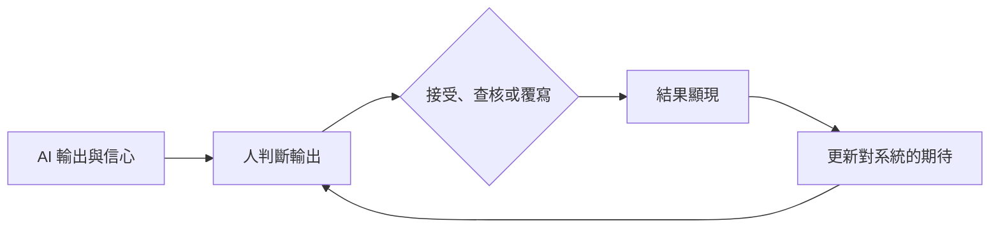

# 人機互動與信任

人機互動研究人如何使用、信任、過度信任 AI 系統，以及 AI 系統如何改變人。它的核心問題是：什麼時候人應該依賴 AI 的輸出，什麼時候不應該。

## 概述

人們一直都得判斷是否要依賴自己無法完全檢視的機器，從自動駕駛儀到拼字檢查都是如此。AI 系統讓這個問題的賭注更高。它的輸出流暢又快速，錯誤卻往往難以察覺；它被用在診所、教室、辦公室與私人對話中。這個領域探討：什麼樣的依賴才是適當的、人為什麼有時會接受錯誤的輸出，以及長期使用會如何改變使用者。

這個主題介於工程、心理學與設計之間。它的判斷面借鏡決策的[心理學](../../brain-mind/psychology/index.md)研究，政策面則在[法律、政策與治理](../governance/index.md)以及更廣的 [AI 與社會](../index.md)總覽中討論。

## 關鍵概念

- **信任**：人對某個系統能在不確定的情境中幫助自己達成目標的預期。在自動化研究中，它被視為一種可以測量、並會影響依賴程度的態度。
- **適當依賴**：當系統很可能正確時依賴它，當它很可能出錯時則不依賴。
- **過度依賴**：即使 AI 的輸出是錯的，仍然接受，且查核不足。
- **依賴不足**（棄用）：拒絕一個其實會有幫助的系統，例如在它出錯一次後就全盤放棄。
- **自動化偏誤**：傾向於重視自動化輔助工具的建議，勝過其他資訊，包括自己的判斷。
- **解釋**：告訴人一個系統為何產生某個輸出的資訊。它可以幫助人判斷輸出，但也可能提高系統並未贏得的信任。
- **人在迴路中**：由人審查、修正或核可系統的決定，或向系統提供回饋的設計。
- **去技能化**：當任務交給系統處理、人不再練習時，所隨之而來的技能流失。
- **認知強制**：在人看到或接受 AI 建議之前，改變介面以迫使人先形成自己判斷的做法。

## 運作方式

使用 AI 系統是一個循環。系統給出輸出，通常附帶信心訊號或解釋。人決定接受、查核或覆寫它。結果有時會顯現出來，人便修正自己對系統的期待。

Lee 與 See（2004）用三個詞來描述這個循環的品質。*校準*指信任與系統實際可靠度的吻合程度。*解析度*指在系統確實正確的情況下，信任是否較高。*特定性*指信任是否繫於系統表現良好的功能，而不是整個系統。

有三個特點使這個循環難以做好。第一，人在有限的努力下判斷，而大部分判斷依賴捷思法。這是雙歷程思考理論中快速、依樣式運作的那一側，[心理學](../../brain-mind/psychology/index.md)總覽與[捷思與偏誤](../../brain-mind/cognitive-science/heuristics-and-biases/index.md)頁面對此有所描述。第二，回饋經常缺席或延遲，因此人往往從順利的結果學習，而不是從錯誤學習。第三，解釋與信心顯示會改變人的判斷方式，但未必讓判斷更準確。Buçinca 等人（2021）指出，加入解釋似乎並不會減少過度依賴，而有些研究顯示它甚至可能增加過度依賴。

## 主要方法

兩項里程碑式的研究構成了這個領域的大部分框架。每一項都有自己的頁面。

- [自動化中的信任（Lee & See，2004）](trust-in-automation/index.md)：一個概念性框架，將適當依賴定義為與系統實際能力相符的信任，並說明設計者必須向使用者展示什麼。
- [認知強制功能（Buçinca 等人，2021）](cognitive-forcing/index.md)：一項實驗，比較讓人在接受 AI 建議前先投入思考的介面設計。這些設計降低了過度依賴，但參與者對它們的評價最低。

第一項研究是一套信任理論，本身並未提供測量結果。第二項則是對某一種設計選擇的實證檢驗。兩者合起來說明了這個問題的兩面：人應該對系統抱持什麼樣的期待，以及介面如何幫助人據此行動。

## 子主題

這個總覽頁面介紹三個子章節：自動化偏誤與過度依賴、AI 陪伴與社會性依附關係，以及 AI 素養與大眾理解。每一章都會更深入地探討信任問題的某一部分。

- [自動化偏誤與過度依賴](automation-bias.md)：人在未查核的情況下接受自動化或 AI 輸出的情形，以及解釋、信心顯示與認知強制如何改變這種情形。
- [AI 陪伴與準社會關係](ai-companionship.md)：陪伴型聊天機器人、孤獨感與情緒依賴、未成年人的風險、諂媚傾向與監管回應。
- [AI 素養與大眾理解](ai-literacy.md)：大眾對 AI 的信念、對大型語言模型的心智模型、素養框架，以及媒體框架化的角色。

## 與其他主題的連結

- **大腦與心智。** 雙歷程理論提供了一個有用的框架。快速、依樣式的判斷是捷思法運作的地方，而較慢、需要費力的推理，正是認知強制設計試圖引入的部分。[心理學](../../brain-mind/psychology/index.md)總覽將這個框架與會「思考更久」才回答的推理模型相比較。人類判斷中的偏誤，例如錨定與代表性捷思，在[捷思與偏誤](../../brain-mind/cognitive-science/heuristics-and-biases/index.md)中有所描述。它們正是認知強制設計試圖打斷的那類捷徑。
- **可解釋性。** 針對人的解釋既是技術問題，也是設計問題。解釋模型的技術方法請見[可解釋性](../interpretability/index.md)。
- **安全與對齊。** 只有當負責監督的人能察覺錯誤時，人的監督才是有效的安全措施。見[安全與對齊](../safety-alignment/index.md)。
- **倫理與問責。** 當人接受了錯誤的 AI 建議，責任由人、設計者與部署該系統的機構共同承擔。見[倫理與公平](../ethics/index.md)。
- **工作與技能。** 去技能化把本主題與[經濟與工作](../economics/index.md)連結起來，後者討論對工作與技能的影響。
- **訓練中的人類回饋。** 人也會以另一個方向塑造 AI 系統，透過提供用於訓練的回饋。見[從人類回饋學習](../../theory/paradigms/reinforcement-learning/learning-from-human-feedback/index.md)。

## 應用

- **臨床決策支援。** 臨床人員使用 AI 建議來進行診斷與分流。Gaube 等人（2021）發現，臨床人員會受到 AI 建議的影響，包括錯誤的建議。Budzyń 等人（2025）研究內視鏡醫師在結腸鏡檢查中接觸 AI 後，表現是否改變，這是一個去技能化的問題。見[醫療保健](../../applications/healthcare/index.md)。
- **教育。** 輔導與寫作支援引出一個問題：什麼時候是工具在思考，什麼時候是學習者在思考。Kasneci 等人（2023）回顧了大型語言模型在教育中的機會與挑戰。見[教育](../../applications/education/index.md)。
- **程式碼助手。** 開發者接受、編輯或拒絕生成的程式碼，這是每天都會發生的依賴問題。見[程式碼助手](../../engineering/coding-assistants/index.md)。
- **人在迴路中的機器學習。** Mosqueira-Rey 等人（2022）調查人們如何標註、修正並引導學習系統。

## 開放問題

- 什麼時候解釋能改善適當依賴，什麼時候它只是提高信心？
- 設計者如何直接測量適當依賴，而不只是測量最終決定的準確度？
- 長期使用 AI 助手是否會削弱它所取代的技能，而這些技能能否重新培養？
- 考慮到流暢的輸出無論是否正確都可能看起來可靠，介面應該如何呈現語言模型的不確定性？
- 歐盟 AI 法對部分高風險系統設有人類監督的義務。要讓這些義務在實務上有意義，需要多少程度的人類監督？

## 參考資料

### 開創性論文

- Lee, J. D. & See, K. A. (2004). Trust in Automation: Designing for Appropriate Reliance. *Human Factors*. https://doi.org/10.1518/hfes.46.1.50_30392 — 定義自動化中的信任、其校準、解析度與特定性，並提出適當依賴的設計指引。
- Parasuraman, R. & Riley, V. (1997). Humans and Automation: Use, Misuse, Disuse, Abuse. *Human Factors*. https://doi.org/10.1518/001872097778543886 — 定義自動化的使用、誤用、棄用與濫用，以及導致各種情形的人因。
- Bainbridge, L. (1983). Ironies of automation. *Automatica*. https://doi.org/10.1016/0005-1098(83)90046-8 — 主張將例行工作自動化，可能讓操作者對剩下的罕見而困難的介入缺乏練習，是去技能化風險的早期論述。
- Skitka, L. J., Mosier, K. L. & Burdick, M. (1999). Does automation bias decision-making? *International Journal of Human-Computer Studies*. https://doi.org/10.1006/ijhc.1999.0252 — 使用自動化輔助工具的人會出現遺漏與作為型錯誤的實驗，是自動化偏誤的核心證據。
- Dietvorst, B. J., Simmons, J. P. & Massey, C. (2015). Algorithm aversion: People erroneously avoid algorithms after seeing them err. *Journal of Experimental Psychology: General*. https://doi.org/10.1037/xge0000033 — 顯示人在看到演算法犯錯後就放棄它，即使它的預測優於人類的替代方案。
- Horvitz, E. (1999). Principles of mixed-initiative user interfaces. *CHI '99*. https://doi.org/10.1145/302979.303030 — 早期探討系統何時應自行行動、何時應讓使用者決定，依據是不確定性與出錯的代價。

### 綜述與教科書

- Hoff, K. A. & Bashir, M. (2014). Trust in Automation: Integrating Empirical Evidence on Factors That Influence Trust. *Human Factors*. https://doi.org/10.1177/0018720814547570 — 回顧影響自動化系統信任的操作者、情境與習得性因素的實證研究。
- Vaccaro, M., Almaatouq, A. & Malone, T. (2024). When combinations of humans and AI are useful: A systematic review and meta-analysis. *Nature Human Behaviour*. https://doi.org/10.1038/s41562-024-02024-1 — 對人與 AI 組合和單獨的人或 AI 進行比較的實驗做後設分析。[^1]
- Mosqueira-Rey, E. et al. (2022). Human-in-the-loop machine learning: a state of the art. *Artificial Intelligence Review*. https://doi.org/10.1007/s10462-022-10246-w — 關於人如何透過標註、回饋與修正參與機器學習的綜述。

### 文章與文件

- Amershi, S. et al. (2019). Guidelines for Human-AI Interaction. *CHI '19*. https://doi.org/10.1145/3290605.3300233 — 涵蓋首次使用與重複互動的 AI 產品設計指引，並以使用者研究加以檢驗。
- Shneiderman, B. (2020). Human-Centered Artificial Intelligence: Reliable, Safe & Trustworthy. *International Journal of Human-Computer Interaction*. https://doi.org/10.1080/10447318.2020.1741118 — 主張結合高度自動化與有意義的人類控制，以追求可靠且值得信任的系統。
- Gaube, S. et al. (2021). Do as AI say: susceptibility in deployment of clinical decision-aids. *npj Digital Medicine*. https://doi.org/10.1038/s41746-021-00385-9 — 研究臨床人員如何受到 AI 建議影響，包括不正確的建議。
- Budzyń, K. et al. (2025). Endoscopist deskilling risk after exposure to artificial intelligence in colonoscopy: a multicentre, observational study. *The Lancet Gastroenterology & Hepatology*. https://doi.org/10.1016/S2468-1253(25)00133-5 — 多中心觀察性研究，探討內視鏡醫師在接觸 AI 後表現是否改變，檢視去技能化的風險。
- Kasneci, E. et al. (2023). ChatGPT for good? On opportunities and challenges of large language models for education. *Learning and Individual Differences*. https://doi.org/10.1016/j.lindif.2023.102274 — 對大型語言模型如何支持學習、以及它帶來的風險所做的觀點性綜述。

[^1]: 該後設分析報告，在決策任務上，人與 AI 的組合平均而言表現不如兩者中較好的一方；在創意任務上則結果不同。引用確切的效果量前，請查閱原文。
