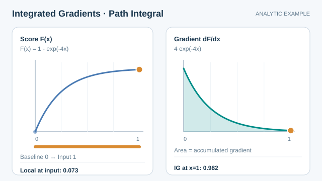

# Integrated gradients

Integrated gradients attributes a prediction to input features by accumulating the model's gradients along a straight path from a baseline input to the actual input. Sundararajan, Taly and Yan (2017) derived it from two axioms that they argue any attribution method should satisfy.

## Problem

Plain gradients, as used in saliency maps, can be unreliable: in saturated regions of a network the gradient can be near zero even when a feature matters a great deal. The problem is to find an attribution method that does not depend on where the gradient happens to be flat, and that is principled enough to justify.

## Core idea

Choose a baseline $x'$ that carries no information, such as a black image or a zero vector. Move from the baseline to the input along a straight line and add up the gradients along the way. The total is the attribution for each feature, measured relative to the baseline.

## Equation

For input $x$, baseline $x'$ and model $F$, the attribution to feature $i$ is

$$
\mathrm{IG}_i(x) = (x_i - x'_i) \int_0^1 \frac{\partial F\bigl(x' + \alpha (x - x')\bigr)}{\partial x_i}\, d\alpha.
$$

In practice the integral is approximated by a sum over a finite number of steps.

### Visual walkthrough

*Original continuous teaching animation, CC BY-SA 4.0.* The orange marker traces the baseline-to-input path while the shaded area accumulates the gradients. For the **synthetic analytic example** $F(x)=1-e^{-4x}$ with baseline $0$ and input $1$, the endpoint derivative is $F'(1)=4e^{-4}\approx0.073$ but the integral is $\mathrm{IG}=F(1)-F(0)=1-e^{-4}\approx0.982$. In one dimension the path integral equals the output difference; this does **not** validate any attribution as a real-world causal explanation. MkDocs adds Play/Pause and a reduced-motion fallback; narrow screens can be scrolled horizontally. [GitHub-readable static overview](../../assets/concept-animations/integrated-gradients-path-still.svg).

## Results

The paper uses two axioms to design the method. Sensitivity says that a feature which changes the output must receive a non-zero attribution. Implementation invariance says that functionally equivalent networks must receive identical attributions. The authors argue that most earlier attribution methods break at least one of these axioms. They apply integrated gradients to two image models, including a GoogLeNet ImageNet classifier and a diabetic retinopathy network, to two text models, and to a molecular graph model. The examples are illustrative; the paper does not establish that the attributions are correct for every use.

## Limitations

- **Baseline dependence.** The result depends on the baseline, and the choice of a neutral baseline is itself a judgement.
- **Approximation.** The integral is estimated numerically, so the attributions carry approximation error that must be checked.
- **Model, not world.** Attributions describe the model's sensitivity along the path, not causal effects in the world.
- **Sanity.** As with other gradient methods, a plausible-looking attribution does not by itself show that the model relies on the feature (Adebayo et al., 2018).

## Connections

Integrated gradients is a gradient method in [feature attribution](feature-attribution.md). It answers the local-slope problem of [saliency maps](saliency-maps.md) by summing along a path, and DeepLIFT (Shrikumar et al., 2017) takes a different route with differences from a reference. [SHAP](shap.md) also uses a reference, the background distribution, and it attributes by a game-theoretic average rather than a path integral. For the baseline-dependence problem that all these methods share, see the [interpretability overview](index.md).

## Applications

- Explaining image classifications with a black or blurred baseline, and checking that the highlighted regions match the object.
- Attributing text-model predictions to tokens by using embeddings as the path variable.
- Comparing attributions across models trained for the same task.

## Open questions

- Which baseline is neutral for a given domain, and how sensitive are the attributions to that choice?
- How many integration steps are enough for a reliable approximation?
- Do path-based attributions stay faithful for models with many saturated units?

## References

### Seminal papers

- Sundararajan, M., Taly, A. & Yan, Q. (2017). Axiomatic Attribution for Deep Networks. *Proceedings of ICML 2017*. https://arxiv.org/abs/1703.01365 — Introduces integrated gradients and the sensitivity and implementation-invariance axioms.
- Simonyan, K., Vedaldi, A. & Zisserman, A. (2014). Deep Inside Convolutional Networks: Visualising Image Classification Models and Saliency Maps. arXiv:1312.6034. https://arxiv.org/abs/1312.6034 — The gradient-based saliency maps that integrated gradients refines.
- Shrikumar, A., Greenside, P. & Kundaje, A. (2017). Learning Important Features Through Propagating Activation Differences. *Proceedings of ICML 2017*. https://arxiv.org/abs/1704.02685 — DeepLIFT, a reference-based alternative to gradient attribution.

### Surveys and textbooks

- Lundberg, S. M. & Lee, S.-I. (2017). A Unified Approach to Interpreting Model Predictions. *Advances in Neural Information Processing Systems 30*. https://arxiv.org/abs/1705.07874 — Presents SHAP, which compares attributions with Shapley values rather than gradients.
- Adebayo, J. et al. (2018). Sanity Checks for Saliency Maps. *Advances in Neural Information Processing Systems 31*. https://arxiv.org/abs/1810.03292 — Shows that some gradient-based maps are independent of the model and the data.

## Further learning

- Molnar, C. *Interpretable Machine Learning: A Guide for Making Black Box Models Explainable*, 3rd edition. [Free online book](https://christophm.github.io/interpretable-ml-book/), covering attribution methods with worked examples.
