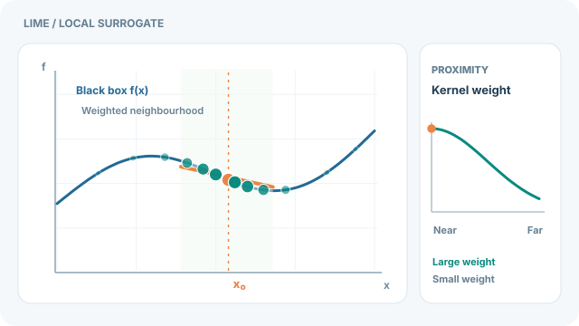

# LIME

!!! info "屬於特徵歸因"
    本方法頁屬於[特徵歸因](feature-attribution.md)。它詳細說明此方法；總覽頁則比較各種方法。

LIME（Local Interpretable Model-agnostic Explanations）以一個簡單、可解釋的模型，擬合任何分類器在某個輸入附近的行為，從而解釋該分類器的單一預測。Ribeiro、Singh 與 Guestrin（2016）提出了它，此方法不需要存取模型的內部結構。

## 問題

複雜的分類器可能很準確，但必須依據某一個預測採取行動的使用者，需要知道它為何做出這個預測。問題在於：只使用模型的輸入與輸出，以一個人能讀懂的方式，解釋單一決策。

## 核心想法

對輸入加以擾動，產生許多相近的樣本，記錄分類器對每個樣本的輸出，並依樣本與原輸入的距離加權。對這些加權樣本擬合一個稀疏的線性模型。該模型的係數即為解釋，而且只在原輸入附近才忠實。

## 方程式

LIME 選擇解釋 $\xi(x)$，為在局部忠實度與簡單性之間取得平衡的可解釋模型 $g$：

$$
\xi(x) = \operatorname*{argmin}_{g \in G} \; \mathcal{L}(f, g, \pi_x) + \Omega(g),
$$

其中 $f$ 是分類器，$\pi_x$ 是圍繞 $x$ 的接近度加權，$\mathcal{L}$ 衡量 $g$ 在 $x$ 附近與 $f$ 的吻合程度差距，$\Omega(g)$ 則懲罰複雜度。

## 動態教學示範

  

    
  

[開啟連續 SVG 動畫](../../assets/concept-animations/lime-local-surrogate-motion.svg) · [檢視 GitHub 靜態回退圖](../../assets/concept-animations/lime-local-surrogate-still.svg)。

**藍線**為固定的黑箱函數，青綠色點是圍繞橘色輸入 $x_0$ 人工產生的擾動樣本，圓點大小表示**接近度核函數的權重**。橘線為加權最小平方法得到的局部替代模型，刻意只畫出目標附近的區段，**不能當成全域的 $f$**。在 MkDocs 網站可使用「**播放／暫停動畫**」（Tab 鍵聚焦後按 Enter 或空白鍵）。手機版保持可讀圖寬，並可水平捲動；GitHub 與降低動態效果偏好的讀者可直接查看靜態回退圖。

此圖是**一維連續輸入的教學類比**：人工函數為 $f(x)=0.27+0.34x+0.15\sin(2\pi x)+0.13(x-0.55)^2$，$x_0=0.54$，高斯權重為 $\exp[-(x_i-x_0)^2/(2\cdot0.15^2)]$。十二個固定樣本經加權最小平方法擬合，得到約 $g(x)=0.598-0.314x$。移動的點只是呈現**擾動抽樣與加權流程**，不是真實資料的運動軌跡；線性擬合也不是受訓模型的實測解釋。完整 LIME 還包含可解釋特徵表示與模型複雜度懲罰，這裡僅單獨解釋**局部性與忠實度**，對應 [Ribeiro、Singh 與 Guestrin（2016）](https://arxiv.org/abs/1602.04938)。

*原創教學圖像，採 CC BY-SA 4.0 授權。*

## 結果

論文報告了模擬實驗與人類受試者實驗。模擬實驗探討解釋是否幫助使用者判斷是否信任某個預測或某個模型。人類受試者研究的對象包括 Mechanical Turk 工作者與研究生，探討解釋是否幫助人們選擇要信任的兩個分類器。這些結果支持解釋對於上述決策的用處，但並不表示解釋是模型的準確描述。

## 限制

- **只限局部。** 解釋描述的是模型在某一輸入附近的行為，對其他輸入未必成立。
- **不穩定。** 因為擾動是隨機的，除非控制抽樣，否則重複執行可能得到不同的解釋。
- **表徵的選擇。** 可解釋的特徵（例如詞或超像素）由設計者選定，並會塑造解釋。
- **忠實度。** 低複雜度的替代模型可能看起來令人信服，卻扭曲了模型，因此必須加以量測。

## 相關連結

LIME 是[特徵歸因](feature-attribution.md)中的替代模型方法之一。[SHAP](shap.md) 建立在相同的加性形式上，但其 Kernel SHAP 變體以 Shapley 核函數為樣本加權，選擇此核函數是為了使擬合係數恢復 Shapley 值，而非以接近度核函數加權。LIME 與模型無關，適用於黑箱分類器；而[顯著性圖](saliency-maps.md)與[積分梯度](integrated-gradients.md)則需要梯度。關於如何信任各種解釋的一般問題，見[可解釋性總覽](index.md)。

## 應用

- 解釋個別文字分類的決策，例如哪些詞促成了垃圾郵件或情感標籤。
- 檢查影像分類器突顯的超像素是否吻合物體，以除錯。
- 以一組人工選定的可解釋特徵，檢查模型是否依賴捷徑。

## 開放問題

- 應如何選擇擾動分布，使局部替代模型能反映實際的輸入？
- 如何可靠地量測某個輸入的局部解釋之忠實度？
- 這類解釋能否在實務中改善決策，而不只是在論文的受控研究中有效？

## 參考文獻

### 開創性論文

- Ribeiro, M. T., Singh, S. & Guestrin, C. (2016). "Why Should I Trust You?": Explaining the Predictions of Any Classifier. *Proceedings of KDD 2016*. https://arxiv.org/abs/1602.04938 — Introduces LIME and reports both simulated and human-subject experiments.
- Lundberg, S. M. & Lee, S.-I. (2017). A Unified Approach to Interpreting Model Predictions. *Advances in Neural Information Processing Systems 30*. https://arxiv.org/abs/1705.07874 — Presents SHAP, a related additive method that unifies six existing explanation methods, LIME among them.
- Štrumbelj, E. & Kononenko, I. (2014). Explaining prediction models and individual predictions with feature contributions. *Knowledge and Information Systems*, 41(3), 647–665. https://doi.org/10.1007/s10115-013-0679-x — Explains individual predictions of general models with feature contributions based on Shapley values.

### 綜述與教科書

- Sundararajan, M., Taly, A. & Yan, Q. (2017). Axiomatic Attribution for Deep Networks. *Proceedings of ICML 2017*. https://arxiv.org/abs/1703.01365 — A gradient-based alternative for neural networks, for comparison.
- Adebayo, J. et al. (2018). Sanity Checks for Saliency Maps. *Advances in Neural Information Processing Systems 31*. https://arxiv.org/abs/1810.03292 — Shows that some explanation maps fail basic sanity checks, a caution for any local explanation.

## 延伸學習

- Molnar, C. *Interpretable Machine Learning: A Guide for Making Black Box Models Explainable*, 3rd edition. [免費線上書](https://christophm.github.io/interpretable-ml-book/)，其中有一章討論局部替代模型，包括 LIME。
