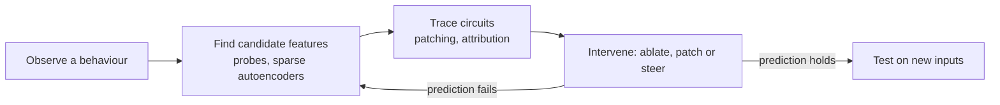

# Mechanistic interpretability and circuits

Mechanistic interpretability tries to reverse-engineer the algorithms a neural network has learned. It names the internal features the network computes with, finds the small subnetworks (circuits) that combine them, and tests each claim by intervening on the network's activations.

## Overview

Most explanation methods ask which inputs or features mattered for one output (see [Interpretability](index.md)). Mechanistic interpretability asks a harder question: what program is the network running? The approach grew out of the circuits program on vision models, which made three speculative claims: that features are the basic units of neural networks, that features are linked by circuits, and that similar features and circuits recur across models (Olah et al., 2020).

Transformers became the main target. Their residual stream gives every layer a shared channel to read from and write to, which makes information flow easier to trace (see [Transformers & Attention](../../theory/models/transformer/index.md)). Most results so far come from small models and narrow tasks.

## Key concepts

- **Feature**: a direction in a layer's activation space, or a single neuron, that corresponds to a recognisable property of the input.
- **Circuit**: a subgraph of features and the weights between them that carries out an identifiable computation.
- **Superposition**: a network represents more features than it has dimensions by giving them nearly orthogonal directions. Toy models show this happens when features are sparse and rarely active together (Elhage et al., 2022).
- **Polysemanticity**: a single neuron that responds to several unrelated features, the usual symptom of superposition.
- **Induction head**: an attention head that, when a token reappears, copies the token that followed its earlier occurrence. It is built from two heads working together (Olsson et al., 2022).
- **Activation patching**: running the model on a clean input and a corrupted one, then copying an internal activation from the clean run into the corrupted run to measure how much it restores the correct output.
- **Probing**: training a simple classifier on activations to test whether information is present. A probe can find information the model never uses, so it shows what is represented, not what is used.

## How it works

Work in this field tends to follow a loop: observe a behaviour, propose candidate features, trace circuits, and test the claim by intervening.

Feature finding often uses sparse autoencoders, trained to reconstruct a layer's activations from a wide code in which most entries are zero. Such a penalty can recover features that superposition hides from single neurons (Cunningham et al., 2023).

Induction heads show circuit tracing at small scale. In repeated text such as "Harry Potter … Harry", the model predicts "Potter". A previous-token head records, at each position, the token before it. An induction head then matches the current token to an earlier position whose predecessor matches, and copies the token that followed. Olsson et al. (2022) found these heads form during training at about the time in-context learning improves sharply.

A larger example is the indirect-object circuit in GPT-2 small. Wang et al. (2022) traced how the model completes "When Mary and John went to the store, John gave a drink to" with "Mary". Some attention heads suppress the repeated name, and others copy the remaining name to the output. Intervening on its heads changed the behaviour as predicted.

## Key methods

The methods differ in what they assume and what they can show.

| Method | Idea | Main caveat |
|---|---|---|
| Causal tracing and activation patching (Meng et al., 2022; Heimersheim & Nanda, 2024) | Restore one clean activation in a corrupted run and measure the recovery | Results depend on the baseline, and restoring an activation can give a different answer from ablating it. |
| Automated circuit discovery (Conmy et al., 2023) | Prune edges of the computational graph while a chosen metric is kept | Costly on large models, and sensitive to the metric and inputs. |
| Sparse autoencoders (Cunningham et al., 2023; Gao et al., 2024) | Learn sparse features that reconstruct activations | Reconstruction error leaves part of the computation unexplained. |
| Activation steering (Turner et al., 2023) | Add a direction to activations to shift behaviour | A direction meant to change one behaviour can change others. |

## Connections

- The parent overview, [Interpretability](index.md), contrasts this approach with explainable AI.
- Sparse autoencoders are a form of sparse dictionary learning, the idea behind the [sparse coding](../../brain-mind/computational-neuroscience/sparse-coding/index.md) model of primary visual cortex. Both ask which small set of units explains a dense signal.
- Jonas and Kording (2017) showed that standard neuroscience analyses can mislead even on a fully known system. The same caution applies to networks; see also [NeuroAI](../../brain-mind/neuroai/index.md).
- Many safety proposals depend on looking inside models, to detect deception, monitor for unwanted goals or steer behaviour. See [Safety & Alignment](../safety-alignment/index.md).

## Applications

- **Debugging.** Narrow circuits give testable explanations of specific errors.
- **Model editing.** Causal tracing localised factual recall to mid-layer MLP modules at the subject's final token, and Meng et al. (2022) used this to edit a stored fact. The reliability of such edits is still debated.
- **Steering and monitoring.** Adding a direction to activations can change a behaviour without retraining (Turner et al., 2023). Reviews assess how such tools could support safety work (Bereska & Gavves, 2024).
- **Scientific discovery.** Nanda et al. (2023) found that a small transformer trained on modular addition had learned an algorithm based on discrete Fourier transforms.

## Open questions

### What has been reverse-engineered so far

Induction heads, the indirect-object circuit in GPT-2 small, the localisation of factual recall, and a complete modular-addition algorithm are the clearest cases. Each involves a small model or a narrow task.

### What has not

- **Scale.** Whether these methods can explain frontier-size models and complex multi-step behaviour is largely unknown.
- **The right units.** It is unclear whether sparse-autoencoder features are the network's real units. Reconstruction error, split features and features that never activate all complicate the answer (Gao et al., 2024).
- **Faithfulness.** A circuit that matches behaviour on one distribution may not be the general mechanism. Stated reasoning is also not always faithful: chain-of-thought explanations can omit the cues that shaped an answer (Turpin et al., 2023).
- **Feasibility.** Jonas and Kording's warning raises the question of whether a complete mechanistic account of a large network is achievable at all.

## References

### Seminal papers

- Olah, C., et al. (2020). *Zoom In: An Introduction to Circuits*. Distill. https://doi.org/10.23915/distill.00024.001 — Sets out the three claims of the circuits program: features, circuits and universality.
- Elhage, N., et al. (2022). *Toy Models of Superposition*. arXiv. https://arxiv.org/abs/2209.10652 — Shows in small models how networks store more features than dimensions when features are sparse.
- Olsson, C., et al. (2022). *In-context Learning and Induction Heads*. arXiv. https://arxiv.org/abs/2209.11895 — Identifies induction heads, a circuit behind in-context copying, and links them to learning.
- Meng, K., et al. (2022). *Locating and Editing Factual Associations in GPT*. arXiv. https://arxiv.org/abs/2202.05262 — Introduces causal tracing to localise factual recall to mid-layer MLP modules, then edits them.
- Wang, K., et al. (2022). *Interpretability in the Wild: a Circuit for Indirect Object Identification in GPT-2 small*. arXiv. https://arxiv.org/abs/2211.00593 — Reverse-engineers a complete circuit of attention heads for one natural-language task.
- Cunningham, H., et al. (2023). *Sparse Autoencoders Find Highly Interpretable Features in Language Models*. arXiv. https://arxiv.org/abs/2309.08600 — Trains sparse autoencoders on residual-stream activations and finds features more interpretable than neurons.
- Heimersheim, S. & Nanda, N. (2024). *How to use and interpret activation patching*. arXiv. https://arxiv.org/abs/2404.15255 — Practical guide to activation patching and the pitfalls in reading its results.
- Conmy, A., et al. (2023). *Towards Automated Circuit Discovery for Mechanistic Interpretability*. arXiv. https://arxiv.org/abs/2304.14997 — Automates the search for circuits by pruning edges of the computational graph.
- Nanda, N., et al. (2023). *Progress measures for grokking via mechanistic interpretability*. arXiv. https://arxiv.org/abs/2301.05217 — Reverse-engineers the modular-addition algorithm a small transformer learns, tracked through training.
- Jonas, E. & Kording, K. P. (2017). Could a neuroscientist understand a microprocessor? *PLOS Computational Biology*. https://doi.org/10.1371/journal.pcbi.1005268 — Applies standard neuroscience analyses to a simulated processor whose function is fully known.
- Turner, A. M., et al. (2023). *Steering Language Models With Activation Engineering*. arXiv. https://arxiv.org/abs/2308.10248 — Shows that adding activation vectors to a model's residual stream can steer its output.
- Turpin, M., et al. (2023). *Language Models Don't Always Say What They Think*. arXiv. https://arxiv.org/abs/2305.04388 — Shows that chain-of-thought explanations can omit the input cues that shaped the answer.
- Gao, L., et al. (2024). *Scaling and evaluating sparse autoencoders*. arXiv. https://arxiv.org/abs/2406.04093 — Studies how sparse autoencoder quality changes with dictionary size and proposes ways to evaluate it.

### Surveys and textbooks

- Bereska, L. & Gavves, E. (2024). *Mechanistic Interpretability for AI Safety — A Review*. arXiv. https://arxiv.org/abs/2404.14082 — Surveys mechanistic interpretability methods and how they bear on AI safety goals.
