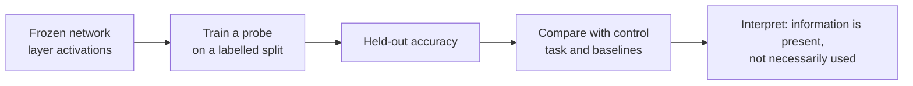

# Probing classifiers and representation analysis

Probing trains a simple supervised model to read a property out of a network's internal activations. Representation analysis compares those activations across networks, tasks and brains. Both ask what information a representation contains, which is not the same as whether the network uses it.

## Overview

A **probe** is a small classifier trained on frozen activations to predict a property of the input, such as the part of speech of a word, whether a statement is true, or the state of a game board. If the probe succeeds, the property can be recovered from the representation. Alain and Bengio (2016) introduced the method in its modern form, training linear classifiers on each layer of image models, and found that the features became more linearly separable with depth. In natural language processing, Tenney et al. (2019) used probes to show that the layers of BERT encode the stages of the classical NLP pipeline in the expected order.

Representation analysis is the wider family. It asks how similar two representations are, whether two networks arrange the same stimuli alike, and whether a network matches a brain. Its tools underpin the comparisons in [NeuroAI](../../brain-mind/neuroai/index.md).

## Key concepts

- **Probe**: a supervised model trained on frozen activations to predict an external label. Only the probe is fitted; the network is unchanged.
- **Linear probe**: a probe that is a linear, or logistic, function of the activations. The restriction limits what the probe can learn on its own, so a good score is evidence about the representation. Whether this is the right restriction is disputed.
- **Control task**: a random labelling, fixed for each input type, that can only be predicted by memorisation. Hewitt and Liang (2019) measured **selectivity** as accuracy on the real task minus accuracy on the control.
- **Representational similarity matrix**: the matrix of pairwise similarities between the responses to a set of stimuli. RSA compares these matrices, so systems with different numbers of units can still be compared.
- **Linear representation hypothesis**: the idea that high-level concepts are directions in activation space, so that a concept can be read by a projection and changed by moving along its direction (Park et al., 2023).

## How it works

A probing study follows a fixed sequence:

1. Choose a layer and a labelled dataset.
2. Run the frozen network and record the activations at that layer.
3. Train the probe on one split to predict the label, usually by logistic regression.
4. Evaluate on held-out data against baselines, such as a probe on a randomly initialised network.
5. Repeat for every layer. The accuracy profile by depth shows where the property appears.

For activations $h(x) \in \mathbb{R}^d$ at a chosen layer, a linear probe outputs $\hat{y} = \mathrm{softmax}(W h(x) + b)$, with $W$ and $b$ fitted by cross-entropy. Selectivity is

$$\mathrm{Sel} = \mathrm{Acc}_{\text{task}} - \mathrm{Acc}_{\text{control}},$$

using the same probe family and training budget for both.

RSA and CKA compare representations rather than predict labels. RSA rank-correlates two systems' similarity matrices over the same stimuli (Kriegeskorte, 2008). Linear centred kernel alignment (CKA) compares centred activation matrices $X$ and $Y$, one row per stimulus:

$$\mathrm{CKA}(X, Y) = \frac{\lVert Y^{\top} X \rVert_F^2}{\lVert X^{\top} X \rVert_F \, \lVert Y^{\top} Y \rVert_F}.$$

It is unchanged by rotating either representation or by uniform scaling (Kornblith et al., 2019).

## Key methods

| Variant | Idea | Main caveat |
|---|---|---|
| Linear probe (Alain & Bengio, 2016) | Fit a linear classifier to one layer | Accuracy shows decodability, not use |
| Control-task probe (Hewitt & Liang, 2019) | Compare task accuracy with a random control | Selectivity depends on the probe family and its budget |
| Information-theoretic probe (Pimentel et al., 2020) | Estimate mutual information with the property | The estimate depends on the probe; the authors favour the strongest one |
| RSA (Kriegeskorte, 2008) | Correlate similarity matrices from two systems | Depends on the stimuli and the similarity measure |
| Linear CKA (Kornblith et al., 2019) | Normalised similarity, invariant to rotation and scaling | One number; does not say which features correspond |
| Linear representation tests (Park et al., 2023; Marks & Tegmark, 2023) | Find a concept direction, then test reading and steering | The direction depends on how the concept is defined |

## Connections

- The parent overview, [Interpretability](index.md), covers attribution and mechanistic work. Probing sits between them: it asks what a representation contains, while the others ask what drives an output.
- [Mechanistic interpretability and circuits](mechanistic-interpretability.md) lists probing as one tool. Its causal tests, such as activation patching, address the gap a probe leaves: whether the network uses the information.
- [Feature attribution](feature-attribution.md) asks which inputs drove one output; a probe asks which property an internal activation carries.
- **Brain and mind.** Encoding models and RSA relate model features to neural recordings, as in [NeuroAI](../../brain-mind/neuroai/index.md). Yamins et al. (2014) showed that networks optimised for object recognition predict higher visual cortex. In language, [Goldstein et al. (2022)](../../brain-mind/language-in-brain/goldstein-2022/index.md) compares a language model's representations with listeners' brain recordings. Neuroscience also decodes brain activity, which is probing applied to the brain, and Kriegeskorte and Diedrichsen (2019) caution that reading activity as representation needs justification.
- **Models and training.** Probes are routine on [Transformers & Attention](../../theory/models/transformer/index.md) and [NLP](../../theory/models/nlp/index.md) systems. A probe is an ordinary [linear model](../../theory/paradigms/supervised/linear-models/index.md) on frozen features. Linear probing is also a standard way to evaluate [self-supervised](../../theory/paradigms/self-supervised/index.md) encoders.

## Applications

- **Linguistic structure.** Tenney et al. (2019) found the NLP pipeline stages in BERT's layers.
- **World models.** Li et al. (2022) trained a sequence model on Othello moves and found a board-state representation. Interventions on it changed the model's predicted moves.
- **Truth.** Marks and Tegmark (2023) found a direction that separates true from false statements in LLM activations. It transferred across datasets, and intervening along it could make the model treat false statements as true.
- **Model-to-brain comparison.** RSA and encoding models compare the layers of a network with cortical areas.

## Open questions

### Presence or use

A probe can succeed on information the model never uses. Ravichander et al. (2020) show that a model can encode a property its training task does not need. Belinkov (2022) reviews this and other limitations.

### How strong a probe should be

Hewitt and Liang judge a probe by its selectivity, penalising one that memorises. Pimentel et al. (2020) argue that the highest-performing probe gives the better estimate. The two positions answer different questions, and the field has not settled which measure is right.

### Are representations linear?

The linear representation hypothesis fits several results (Park et al., 2023; Marks & Tegmark, 2023), but the Othello board representation was nonlinear (Li et al., 2022). Whether high-level concepts are generally linear is open.

### Which similarity measure?

RSA and CKA can disagree about how alike two representations are. High similarity also does not show shared computation, since different mechanisms can produce similar geometries. The NeuroAI caveat that predictivity is not mechanism applies here too.

## References

### Seminal papers

- Alain, G. & Bengio, Y. (2016). *Understanding intermediate layers using linear classifier probes*. arXiv. https://arxiv.org/abs/1610.01644 — Introduces linear probes on image-classifier layers, showing that feature separability grows with depth.
- Hewitt, J. & Liang, P. (2019). *Designing and Interpreting Probes with Control Tasks*. EMNLP. https://arxiv.org/abs/1909.03368 — Introduces control tasks and selectivity, separating a probe's skill from the content of the representation.
- Tenney, I., Das, D. & Pavlick, E. (2019). *BERT Rediscovers the Classical NLP Pipeline*. ACL. https://arxiv.org/abs/1905.05950 — Probes each BERT layer and finds the NLP pipeline stages in the expected order.
- Pimentel, T., Valvoda, J., Hall Maudslay, R., Zmigrod, R., Williams, A. & Cotterell, R. (2020). *Information-Theoretic Probing for Linguistic Structure*. ACL. https://arxiv.org/abs/2004.03061 — Treats probing as estimating mutual information and argues for the highest-performing probe.
- Ravichander, A., Belinkov, Y. & Hovy, E. (2020). *Probing the Probing Paradigm: Does Probing Accuracy Entail Task Relevance?* arXiv. https://arxiv.org/abs/2005.00719 — Shows that a model can encode a property its training task does not need, so probe accuracy does not prove use.
- Kriegeskorte, N. (2008). *Representational similarity analysis – connecting the branches of systems neuroscience*. Frontiers in Systems Neuroscience. https://doi.org/10.3389/neuro.06.004.2008 — Proposes comparing systems through their similarity matrices, so brains and models can be compared directly.
- Kornblith, S., Norouzi, M., Lee, H. & Hinton, G. (2019). *Similarity of Neural Network Representations Revisited*. ICML. https://arxiv.org/abs/1905.00414 — Proposes centred kernel alignment as a similarity index for comparing representations across networks.
- Yamins, D. L. K., Hong, H., Cadieu, C. F., Solomon, E. A., Seibert, D. & DiCarlo, J. J. (2014). *Performance-optimized hierarchical models predict neural responses in higher visual cortex*. PNAS. https://doi.org/10.1073/pnas.1403112111 — Shows that a network optimised for object recognition predicts responses in V4 and inferior temporal cortex.
- Li, K., Hopkins, A. K., Bau, D., Viégas, F., Pfister, H. & Wattenberg, M. (2022). *Emergent World Representations: Exploring a Sequence Model Trained on a Synthetic Task*. arXiv. https://arxiv.org/abs/2210.13382 — Finds a nonlinear board-state representation in a model trained on Othello moves, usable for intervention.
- Marks, S. & Tegmark, M. (2023). *The Geometry of Truth: Emergent Linear Structure in Large Language Model Representations of True/False Datasets*. arXiv. https://arxiv.org/abs/2310.06824 — Finds linear truth directions in LLM activations that transfer across datasets and can be intervened on.
- Park, K., Choe, Y. J. & Veitch, V. (2023). *The Linear Representation Hypothesis and the Geometry of Large Language Models*. arXiv. https://arxiv.org/abs/2311.03658 — Formalises what it means for a concept to be linearly represented in a language model.

### Surveys and textbooks

- Belinkov, Y. (2022). *Probing Classifiers: Promises, Shortcomings, and Advances*. Computational Linguistics. https://doi.org/10.1162/coli_a_00422 — A critical review of probing classifiers and what they can and cannot show.
- Kriegeskorte, N. & Diedrichsen, J. (2019). *Peeling the Onion of Brain Representations*. Annual Review of Neuroscience. https://doi.org/10.1146/annurev-neuro-080317-061906 — Reviews how brain activity is interpreted as representation, and the difficulties of doing so.
